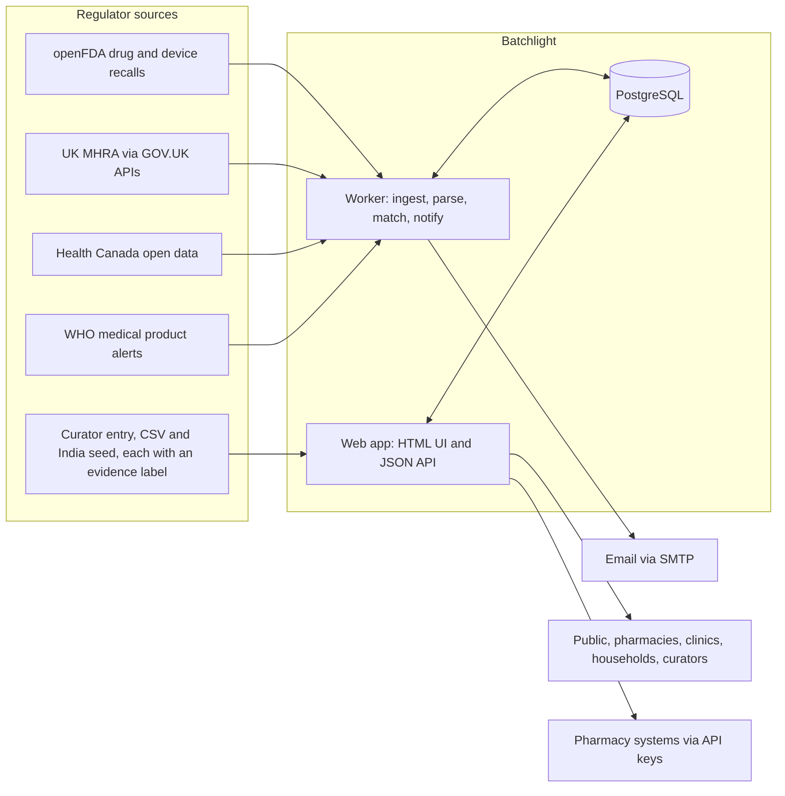
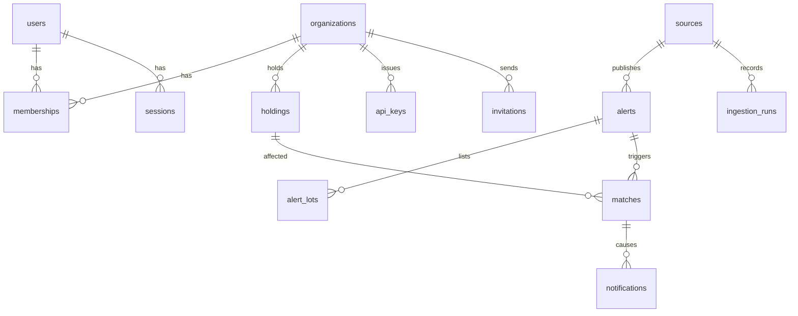

# Batchlight: architecture

## Design drivers

The architecture follows from who uses Batchlight and what the data looks like.

- **Users are on low-end phones and patchy mobile data.** A pharmacist in Kano or a clinic in rural Kenya should get a fast, complete page on a cheap Android phone. Pages are therefore server-rendered HTML that works with no JavaScript, with one small stylesheet.
- **The data is messy public records.** Regulators publish free text, HTML tables and PDFs. Python has the strongest ecosystem for parsing these, and batch-number extraction is the heart of the product.
- **The core operation is relational matching.** Alerts, batches, holdings and matches are relational, matching needs indexed array overlap and text search, and actions need transactional integrity. PostgreSQL covers all of this without extra infrastructure.
- **Integrations matter.** Pharmacy management systems should sync stock automatically, so every core capability is also exposed as a JSON API.
- **Small team, global reach.** Two processes (web, worker), one database, deployable as containers on any cloud.

## System overview

| Component | Responsibility |
|---|---|
| **Web app** (FastAPI, Jinja2) | Public search and batch check, accounts and workspaces, inventory, inbox and action recording, curator console, JSON API, OpenAPI docs. Stateless; scales horizontally. |
| **Worker** (same codebase, `python -m batchlight.worker`) | On a schedule, runs each enabled source adapter, upserts alerts, extracts batches, matches changed alerts against holdings, and sends notification digests. |
| **PostgreSQL 16** | System of record. Array columns with GIN indexes for candidate matching, full-text search over alerts, `citext` for emails. |
| **SMTP** | Email notifications, invitations and password resets. A console backend logs emails in development. |

## Technology stack and rationale

| Layer | Choice | Why |
|---|---|---|
| Language | Python 3.13 | Best ecosystem for parsing regulator HTML, tables and (next) PDFs; one language for web and worker. |
| Web framework | FastAPI on Uvicorn | Typed request validation with Pydantic, automatic OpenAPI for integrators, and HTML via Jinja2 in the same app. |
| Templates and UI | Jinja2, Tailwind CSS (compiled at build time), no client framework | Works without JavaScript, small pages, accessible semantic HTML. |
| ORM and migrations | SQLAlchemy 2, Alembic | Explicit SQL control for matching queries; versioned schema migrations. |
| Database | PostgreSQL 16 | Relational integrity, arrays and GIN indexes, full-text search, `citext`, `pgcrypto`. |
| Auth | Server-side sessions, Argon2id password hashing, hashed API keys | Revocable sessions, no tokens in local storage, standard password hashing. |
| HTTP client | httpx | Timeouts, retries and a mock transport for offline tests. |
| Tests | pytest against a real PostgreSQL, Playwright for end-to-end | Tests exercise real SQL, not mocks. |
| Packaging | Docker, Docker Compose, GitHub Actions | Runs on any container host. |

## Modules and categories

Every source and alert has a `category`: `medicine` (Batchlight) or `food` (the Food Safety module). Both share the ingestion pipeline, batch parsing, search and curation. The category keeps them apart:

- Only `medicine` alerts are matched against workspace stock, in both directions.
- Medicine pages, the manufacturer index, impact metrics and the API default to `medicine`; food pages always filter to `food`.
- `/alerts/{id}` redirects food alerts to `/food/recalls/{id}`, and the reverse.

Food-only tables: `food_reports` (consumer reports, reviewed by curators, never published; stores a keyed hash of the IP address for rate limiting, not the address) and `testing_labs` (labs added by curators with the official source they checked). The food knowledge base is versioned code in `batchlight/food/knowledge.py`, not database rows, so every change is reviewed.

## Data model

| Table | Key columns | Notes |
|---|---|---|
| `users` | `email` (citext, unique), `password_hash`, `full_name`, `is_curator` | Curator is a platform role set from the command line. |
| `organizations` | `name`, `kind` (pharmacy, clinic, hospital, distributor, household, ngo, other), `country_code` | Called "workspaces" in the UI. |
| `memberships` | `user_id`, `org_id`, `role` (owner, manager, member) | Composite primary key. |
| `invitations` | `org_id`, `email`, `role`, `token_hash`, `expires_at`, `accepted_at` | Only the hash of the token is stored. |
| `sessions` | `id` (SHA-256 of the cookie token), `user_id`, `active_org_id`, `expires_at` | Revocable server-side sessions. |
| `password_resets` | `user_id`, `token_hash`, `expires_at`, `used_at` | One-time, one-hour tokens. |
| `api_keys` | `org_id`, `prefix`, `key_hash`, `revoked_at`, `last_used_at` | The full key is shown once at creation. |
| `sources` | `id` (slug), `regulator`, `country_code`, `enabled`, `last_success_at`, `last_error` | One row per adapter. |
| `ingestion_runs` | `source_id`, `status`, `fetched`, `created`, `updated`, `matched`, `error` | Source health and audit. |
| `alerts` | `source_id` + `external_id` (unique), `severity`, `alert_type`, `title`, `product_names[]`, `active_ingredients[]`, `manufacturer`, `manufacturer_key`, `product_codes[]`, `name_tokens[]`, `all_lots`, `reason`, `published_at`, `source_url`, `evidence` (`official`, `lab_test` or `report`), `content_hash`, `raw` (jsonb), generated `search` tsvector | `content_hash` detects real changes so re-ingestion is idempotent; it leaves out `evidence` when it is `official`, so existing hashes did not change. `evidence` says what `source_url` is: the regulator's own notice, an official lab result, or a news or NGO report. It is shown as a badge on every list row and detail page. Automated feeds are always `official`; hand-added alerts must declare it (see Curated below). A check constraint limits it to the three values. |
| `alert_lots` | `alert_id`, `lot`, `lot_key`, `expiry_text` | `lot_key` is the normalised batch code, indexed. |
| `holdings` | `org_id`, `product_name`, `active_ingredient`, `strength`, `manufacturer`, `product_code`, `lot`, `lot_key`, `expiry_date`, `quantity`, `name_tokens[]`, `archived_at` | A stock line or a household medicine. |
| `matches` | `alert_id` + `holding_id` (unique), `org_id`, `level` (batch, product), `confidence`, `reasons[]`, `status`, `outcome`, `units_affected`, `resolved_at`, `resolved_by` | The closed loop. |
| `notifications` | `user_id`, `org_id`, `match_id`, `channel` (in_app, email), `status`, `read_at` | In-app notifications always exist; email is additional. |
| `audit_events` | `org_id`, `user_id`, `action`, `entity_type`, `entity_id`, `data`, `ip` | Login attempts, imports, resolutions, key changes. Also used for login throttling. |

## Ingestion pipeline

Each source adapter yields normalised `AlertRecord` objects. The pipeline is the same for every source:

1. **Fetch** with timeouts, retries with backoff, and a descriptive user agent. Incremental windows use the source's last successful run minus an overlap, so status updates are picked up.
2. **Normalise** severity, alert type, product names, ingredients, manufacturer key and product codes.
3. **Extract batches** from free text (FDA `code_info`) or from HTML tables whose header mentions a batch or lot (MHRA, Health Canada, WHO). Phrases such as "all lots within expiry" set `all_lots`.
4. **Upsert** on `(source_id, external_id)`. A new `content_hash` marks the alert as changed and replaces its batch rows.
5. **Match** every created or changed alert against holdings.
6. **Notify** each affected workspace once per run with a digest, plus in-app notifications.

| Source | Endpoint | Batch data |
|---|---|---|
| FDA drug and device recalls | `api.fda.gov/{drug,device}/enforcement.json` | Parsed from `code_info` free text. |
| UK MHRA | `gov.uk/api/search.json` (filter `medical_safety_alert`) and `gov.uk/api/content/...` | HTML batch tables in the alert body. |
| Health Canada | `recalls-rappels.canada.ca` open data JSON | Product level; batch tables parsed from detail pages for recent alerts. |
| WHO | `who.int` medical product alerts list and pages | HTML tables when present, otherwise product level. |
| Curated | Curator form, CSV import and the India seed (`python -m batchlight.cli seed-india`, data in `batchlight/data/india_alerts.json`) | Entered from PDF or image notices, or from a news report when the official notice can't be opened, with the source link. Each must declare `evidence`: `official` and `lab_test` need a government, Parliament or WHO link (`OFFICIAL_DOMAINS` in `batchlight/text.py`), and `lab_test` needs a reason. |

## Matching algorithm

Matching is deterministic and explainable. Every match stores human-readable reasons.

1. **Normalise batch codes.** Uppercase, remove spaces and separators, and strip labels such as "LOT", "BATCH" and "B.NO". `Lot # AB-123/4` becomes `AB1234`.
2. **Find candidates in SQL.** Holdings whose `lot_key` equals one of the alert's batch keys, plus holdings whose `name_tokens` overlap the alert's (`&&` on GIN-indexed arrays). For a new holding, the same query runs in reverse against alerts from the last few years.
3. **Score in Python.**
   - **Name evidence:** every distinctive word of the holding's name must appear in the alert. Salts, counter-ions and generic words ("sodium", "chloride", "hydrochloride", "vitamin") don't count on their own, so "Levothyroxine Sodium" needs "levothyroxine". A name made only of such words, such as "Sodium Chloride 0.9%", must match completely.
   - **Batch-level match:** the batch number is on the alert's list, and a product code, the product name or the manufacturer agrees. Short codes collide across unrelated products, so a batch number alone is never enough. A strength difference lowers confidence and adds a "check the pack" note.
   - **No match:** the holding's batch is known and is not on the alert's list.
   - **Product-level match:** the alert covers all batches, lists none, or the holding has no batch recorded. The alert's *product name*, not just a shared ingredient, must cover the holding's name, with no conflicting strength or manufacturer. Stock matching also needs identity evidence: a product code, a matching manufacturer, or the brand name for falsified and substandard alerts. The public batch check relaxes the identity requirement and labels such results "check the pack".
4. **Re-score when rules change.** `python -m batchlight.cli rescore` re-applies the current rules to open matches, updating or removing them. Resolved matches are kept as history.
5. **Record.** Matches are unique per alert and holding, so re-running is idempotent. A user can mark a false match, which closes it and feeds the precision metric.

## API

The JSON API is versioned under `/api/v1`, documented at `/api/docs`, and returns errors as `{"detail": ...}` with standard status codes.

| Method and path | Auth | Purpose |
|---|---|---|
| `GET /api/v1/alerts` | Public | Search alerts by text, batch, source, severity and date. Paginated. |
| `GET /api/v1/alerts/{id}` | Public | Alert detail with batches. |
| `GET /api/v1/check?batch=&product=` | Public | Batch check with the list of sources searched. |
| `GET /api/v1/manufacturers/{key}` | Public | Manufacturer alert history. |
| `GET /api/v1/sources` | Public | Source freshness. |
| `GET /api/v1/holdings` | API key | List the workspace's holdings. |
| `POST /api/v1/holdings` | API key | Create one holding; returns any matches found. |
| `POST /api/v1/holdings/bulk` | API key | Create up to 1,000 holdings in one call. |
| `PATCH /api/v1/holdings/{id}`, `DELETE ...` | API key | Update or archive a holding. |
| `GET /api/v1/matches?status=open` | API key | Matches for the workspace. |
| `POST /api/v1/matches/{id}/resolve` | API key | Record an outcome and unit count. |

API keys are sent as `Authorization: Bearer bl_<prefix>_<secret>` and are scoped to one workspace.

## Security and privacy model

- **Data minimisation.** Holdings record products and batches, not patients. Household workspaces never ask for diagnoses or patient names.
- **Tenant isolation.** Every workspace query filters by `org_id` from the authenticated membership, never from user input. Cross-tenant access returns 404. Tests cover it.
- **Passwords and secrets.** Argon2id password hashes. Session tokens, invitation tokens, reset tokens and API keys are stored only as SHA-256 hashes, so a database leak does not expose live credentials.
- **Sessions.** HttpOnly, SameSite=Lax cookies, Secure in production, sliding 30-day expiry, revoked on logout and on password reset.
- **CSRF.** Every form carries a token checked against a per-browser cookie (double submit), in addition to SameSite cookies.
- **Brute force.** Failed logins are throttled per email and IP using the audit log, and password reset requests always return the same response.
- **Headers.** Strict Content Security Policy (no inline scripts), HSTS in production, `X-Content-Type-Options`, `Referrer-Policy`, `frame-ancestors 'none'`.
- **Untrusted source data.** All regulator content is treated as untrusted text and HTML-escaped on output. Only tables and text are extracted, never markup.
- **Authorisation.** Roles are owner, manager and member within a workspace. Curator is a separate platform role. Each route declares the role it needs.
- **Audit.** Logins, imports, match resolutions, member changes and API key changes are written to `audit_events`.
- **Safety messaging.** Negative results state the sources searched, the major sources not searched (such as India's CDSCO), and that no alert is not proof of quality. Patient-facing pages tell people to follow the advice in the original notice, which for contaminated or fake products may say do not use it at all; to see a doctor now if someone has taken it; and, for a medicine they take every day, to speak to a pharmacist or doctor before stopping. Every alert shows whether its source is an official notice, an official lab result or a news report.

## Scalability strategy

- **Web tier.** Stateless; sessions live in PostgreSQL. Scale by adding instances behind a load balancer. Public pages can be cached at a CDN for short periods.
- **Worker.** One scheduler instance; adapters run sequentially with per-source throttling to respect regulator servers. Sources can be split across workers later with an advisory lock per source.
- **Matching cost.** Candidate generation is index-driven (batch key equality and array overlap), so a new alert touches only plausible holdings, not every row. A national pharmacy network of tens of millions of stock lines stays in single-digit-millisecond lookups per alert.
- **Database growth.** Alerts number in the hundreds of thousands, holdings in the millions. Indexes on `lot_key`, GIN on `name_tokens` and `search`, and partial indexes on open matches cover the hot paths. Read replicas serve public search if needed.
- **Notifications.** Digests per workspace per run keep email volume proportional to workspaces, not matches.

## Observability and operations

- Structured logs from web and worker.
- `ingestion_runs` records every run with counts and errors, and the curator console shows source freshness.
- `GET /healthz` checks the process; `GET /readyz` checks the database.
- Configuration comes from environment variables, documented in `.env.example`.

## Testing strategy

- **Unit tests** cover batch parsing against real FDA formats, normalisation, scoring, severity mapping, and each source parser against recorded fixtures.
- **Integration tests** run against a real PostgreSQL database: signup and login, CSRF, tenant isolation, inventory and CSV import, ingestion through mocked HTTP into matches and notifications, API keys, curator permissions, throttling.
- **End-to-end tests** drive a real browser with Playwright through signup, stock entry, matching and resolution.
