# Humanity Labs: user-facing features

A visual tour of the screens people use across the three Humanity Labs products. Every screenshot comes from the running application and shows real records from its connected sources.

- **Screenshots:** 57, in [`docs/assets/user-facing-features/`](assets/user-facing-features/), with one folder per product and one for shared pages.
- **Format:** PNG, 2560 × 1600 px (a 1280 × 800 window at 2× density), 16:10 throughout.
- **Captured:** 11 November 2026, from commit `9cd8248`.
- **Data:** records collected from the connected sources, last refreshed 9 to 11 November 2026.

**Contents**

1. [Food Safety](#1-food-safety) (14 screenshots)
2. [Medicine Safety](#2-medicine-safety) (25 screenshots)
3. [Infrastructure Transparency](#3-infrastructure-transparency) (14 screenshots)
4. [Shared pages](#4-shared-pages) (4 screenshots)
5. [How these screenshots were made](#5-how-these-screenshots-were-made)

Click any screenshot to open it at full size.

---

## 1. Food Safety

Search food recalls, read what tests have found in everyday food in India, check a pack, report a problem and learn how to get food tested. Every item is labelled as an official source, an official lab result, a peer-reviewed study or a news report, and links to where it came from. In the app: `/food`.

<a href="assets/user-facing-features/food-safety/01-food-safety-home.png">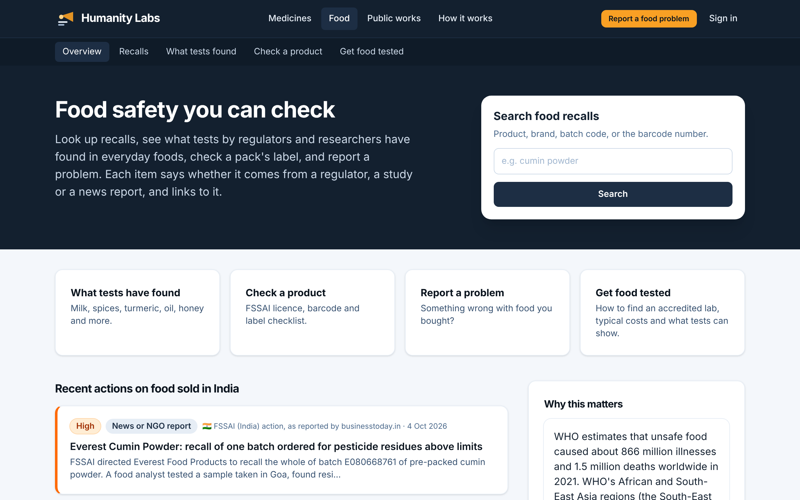</a>

**01 · Food Safety home.** Search food recalls by product, brand, batch code or barcode, and jump to the four main tools: test findings, product checks, problem reports and lab testing.

<table>
<tr>
<td width="50%" valign="top">
<a href="assets/user-facing-features/food-safety/02-india-food-actions.png">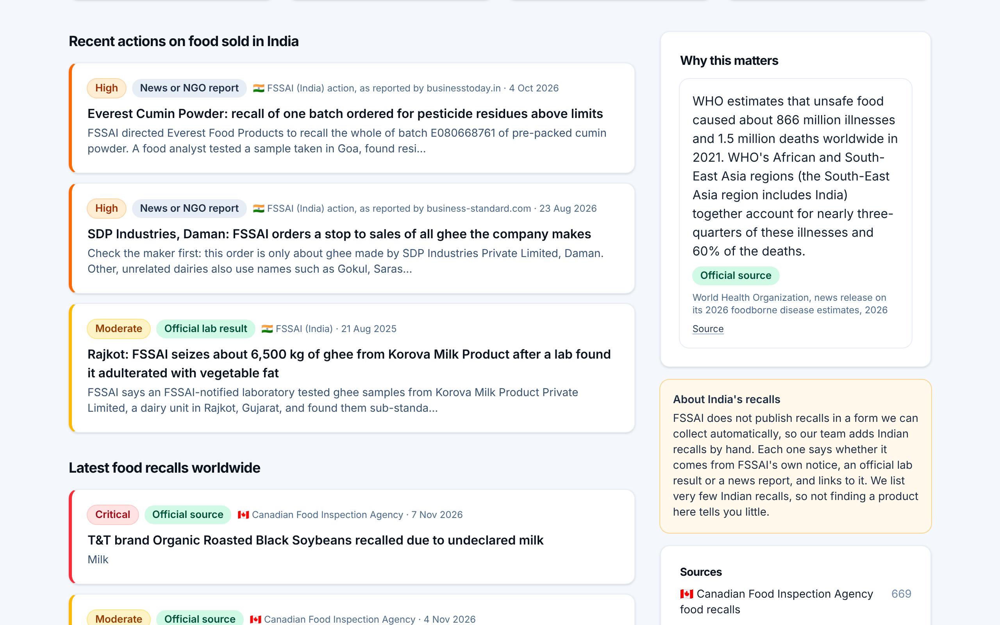</a>
 <b>02 · Recent actions on food sold in India</b> 
Indian food safety actions added by the team, each labelled as an official notice, an official lab result or a news report, next to the latest recalls worldwide and a note on how few recalls India publishes.
</td>
<td width="50%" valign="top">
<a href="assets/user-facing-features/food-safety/03-recall-search.png">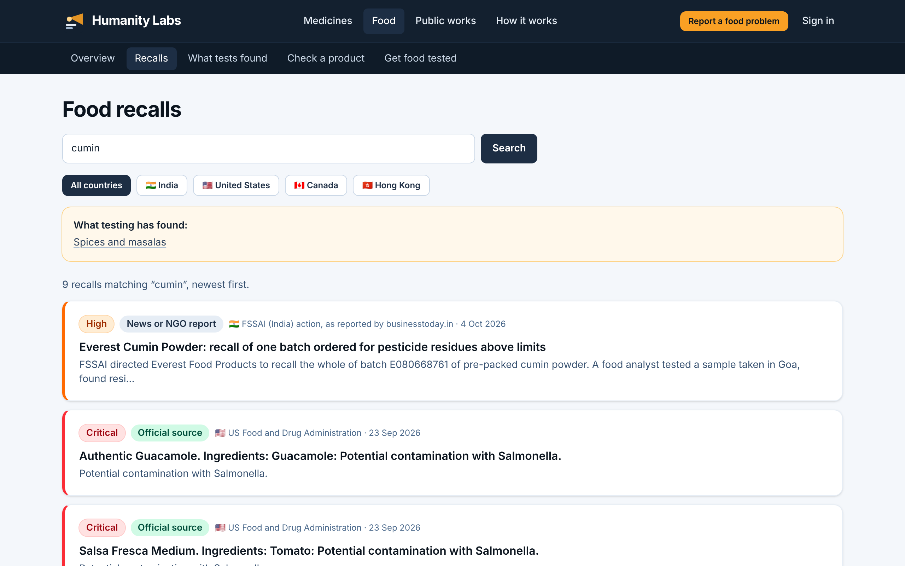</a>
 <b>03 · Recall search</b> 
A search for "cumin" finds nine recalls. Results can be narrowed by country, and a hint links to what testing has found for that kind of food.
</td>
</tr>
<tr>
<td width="50%" valign="top">
<a href="assets/user-facing-features/food-safety/04-recalls-filtered-by-country.png">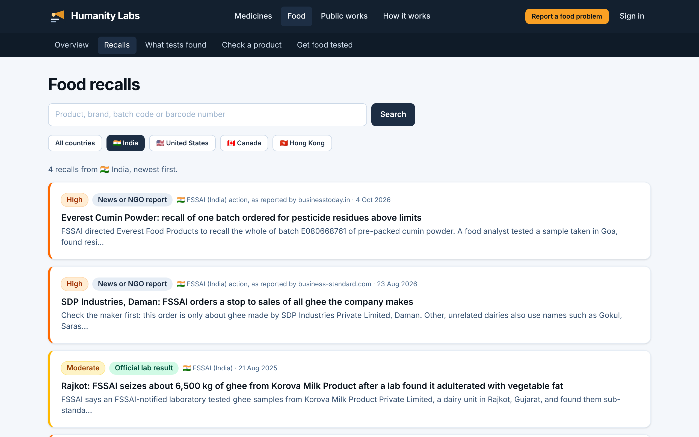</a>
 <b>04 · Recalls filtered by country</b> 
The same list narrowed to India. Each card shows the severity, the evidence label, who acted and when.
</td>
<td width="50%" valign="top">
<a href="assets/user-facing-features/food-safety/05-recall-detail.png">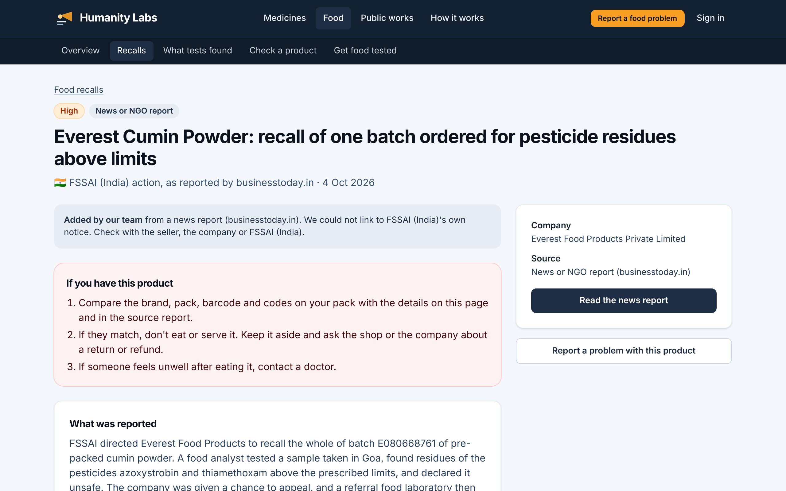</a>
 <b>05 · Recall detail</b> 
One recall in full: what to do if you have the product, what was reported, the company, and a link to the source. A banner says when the entry comes from a news report and not from the regulator's own notice.
</td>
</tr>
<tr>
<td width="50%" valign="top">
<a href="assets/user-facing-features/food-safety/06-recall-detail-barcodes-and-batch-codes.png">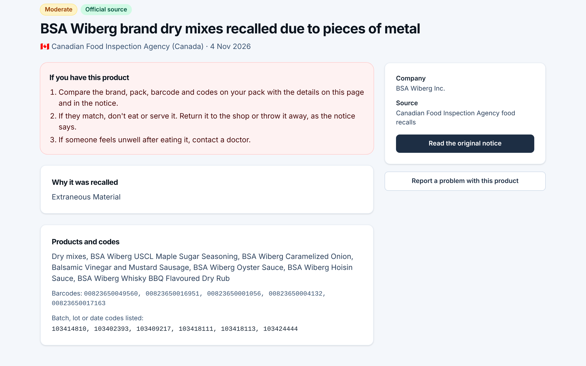</a>
 <b>06 · Barcodes and batch codes</b> 
A Canadian recall with every affected product, barcode and batch code listed, so a pack can be matched exactly.
</td>
<td width="50%" valign="top">
<a href="assets/user-facing-features/food-safety/07-test-findings.png">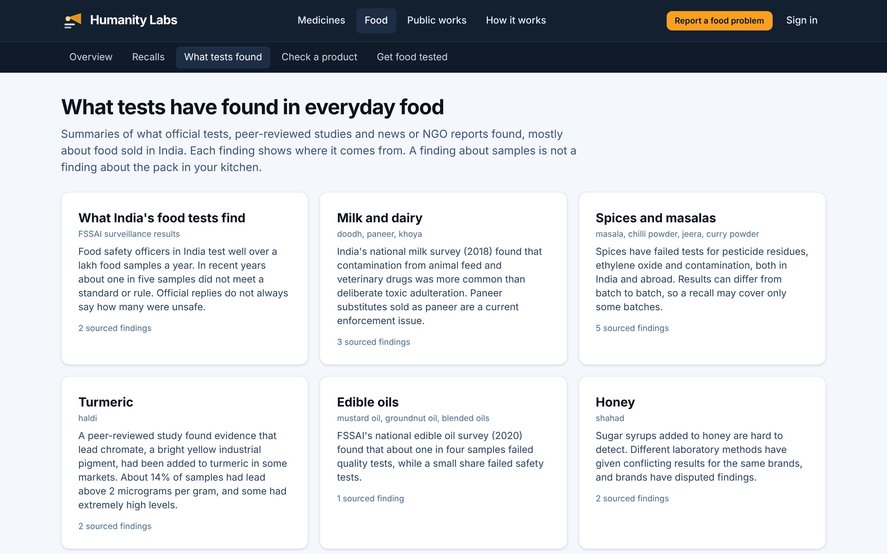</a>
 <b>07 · What tests have found</b> 
Summaries of official tests, peer-reviewed studies and news reports about everyday foods in India, grouped by food type, with the number of sourced findings on each card.
</td>
</tr>
<tr>
<td width="50%" valign="top">
<a href="assets/user-facing-features/food-safety/08-test-findings-by-food.png">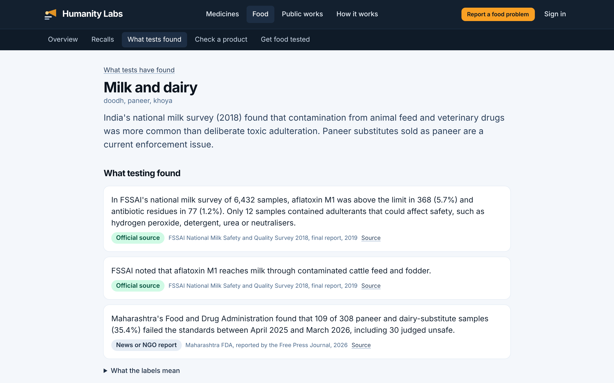</a>
 <b>08 · Findings for one food</b> 
The milk and dairy page. Each finding carries an evidence label and a link to the survey, study or report it comes from.
</td>
<td width="50%" valign="top">
<a href="assets/user-facing-features/food-safety/09-test-findings-what-you-can-do.png">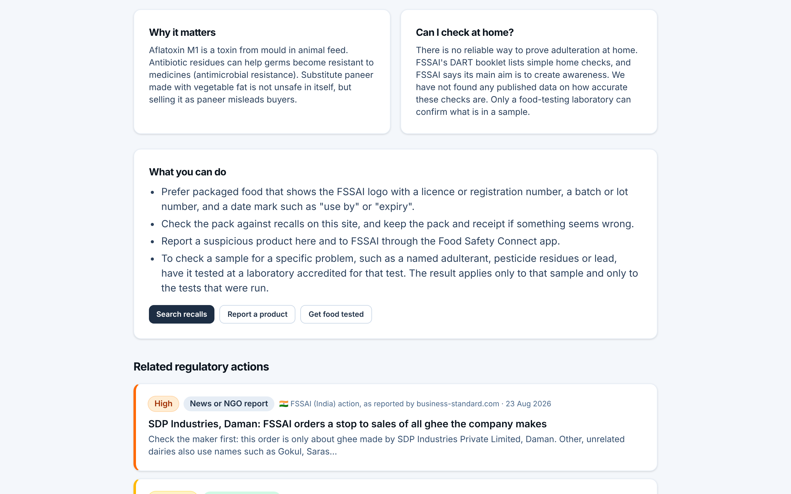</a>
 <b>09 · Why it matters and what you can do</b> 
Practical guidance for each food: why the finding matters, whether it can be checked at home, what to do next, and related regulatory actions.
</td>
</tr>
<tr>
<td width="50%" valign="top">
<a href="assets/user-facing-features/food-safety/10-check-licence-and-barcode.png">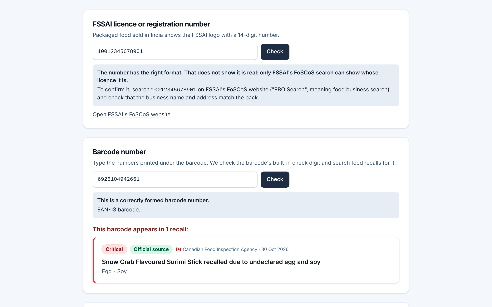</a>
 <b>10 · Check a licence number and a barcode</b> 
Type the FSSAI licence number or the barcode printed on a pack. The licence check confirms only the format and points to FSSAI's own search. The barcode's check digit is verified and food recalls are searched for it; here the barcode appears in a Canadian recall.
</td>
<td width="50%" valign="top">
<a href="assets/user-facing-features/food-safety/11-label-checklist.png">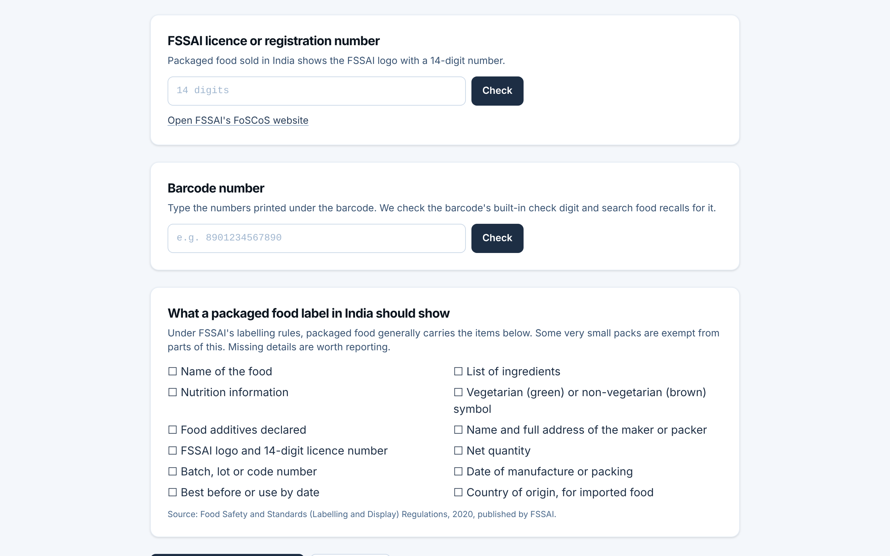</a>
 <b>11 · Label checklist</b> 
The three product checks on one page, ending with a checklist of what a packaged food label in India should show under FSSAI's labelling rules.
</td>
</tr>
<tr>
<td width="50%" valign="top">
<a href="assets/user-facing-features/food-safety/12-report-a-food-problem.png">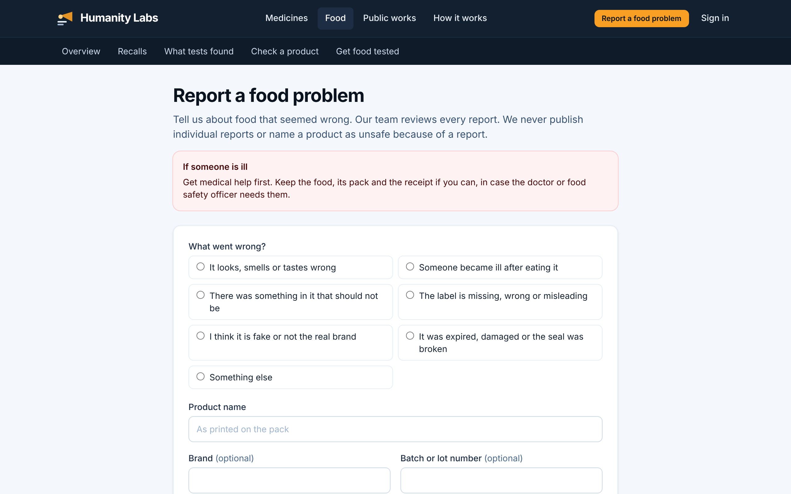</a>
 <b>12 · Report a food problem</b> 
A short form for reporting food that seemed wrong, with advice to get medical help first if someone is ill. Reports are reviewed by the team and never published as findings.
</td>
<td width="50%" valign="top">
<a href="assets/user-facing-features/food-safety/13-official-complaint-routes.png">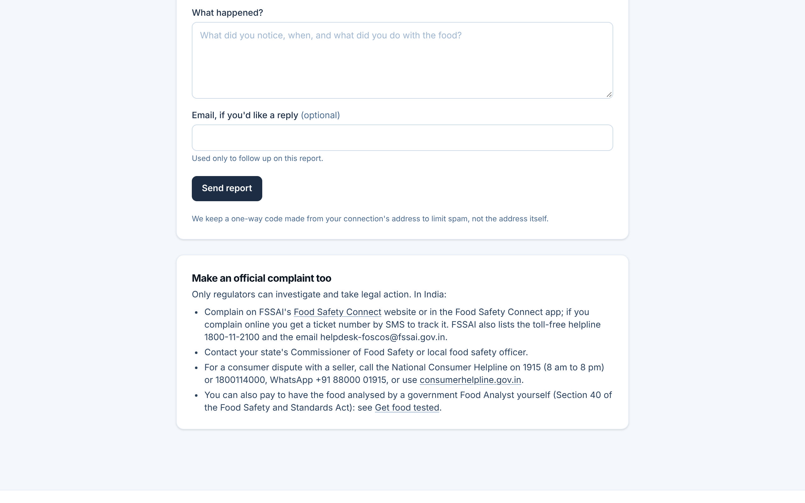</a>
 <b>13 · Official complaint routes</b> 
The end of the report form, followed by the official routes in India: FSSAI's Food Safety Connect, the state food safety commissioner and the National Consumer Helpline.
</td>
</tr>
<tr>
<td width="50%" valign="top">
<a href="assets/user-facing-features/food-safety/14-get-food-tested.png">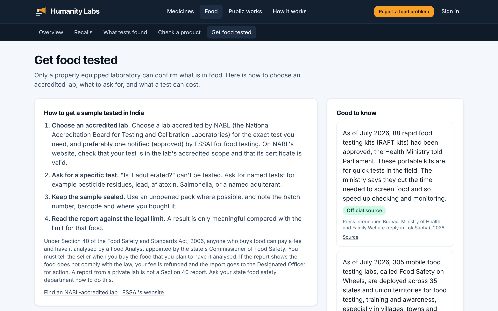</a>
 <b>14 · Get food tested</b> 
How to have a sample tested properly in India: choosing an accredited lab, asking for a specific test, and what a result means, with sourced facts on rapid test kits and mobile testing labs.
</td>
<td width="50%"></td>
</tr>
</table>

---

## 2. Medicine Safety

Batchlight checks medicine batches against safety alerts from the US FDA, the UK MHRA, Health Canada and the WHO, plus a few Indian alerts added by the team. Anyone can check a batch without an account. Pharmacies, clinics and families can also list their stock and be told when a new alert matches it. In the app: `/medicines`, `/check`, `/alerts`, `/manufacturers` and the `/app` workspace.

<a href="assets/user-facing-features/medicine-safety/01-medicine-safety-home.png">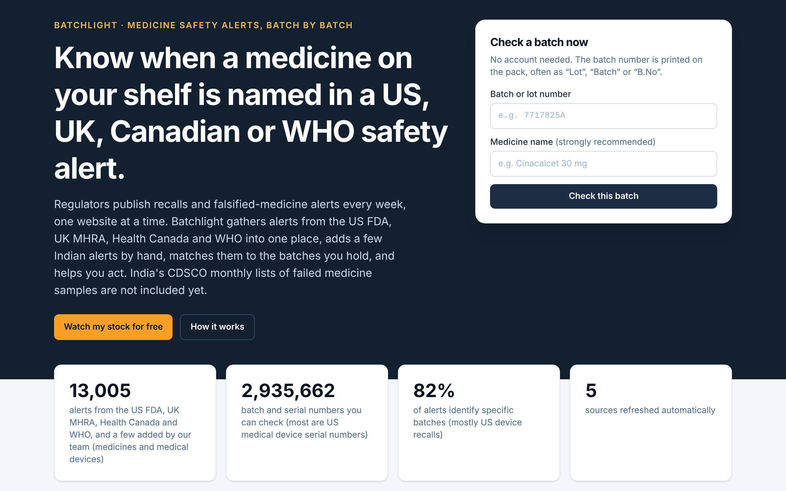</a>

**01 · Medicine Safety home.** Batchlight, the medicine module: check a batch without an account, or watch your stock for free. The counters show alerts held, batch numbers read from them, and the share of alerts that name specific batches.

### Public tools, no account needed

<table>
<tr>
<td width="50%" valign="top">
<a href="assets/user-facing-features/medicine-safety/02-latest-serious-alerts.png">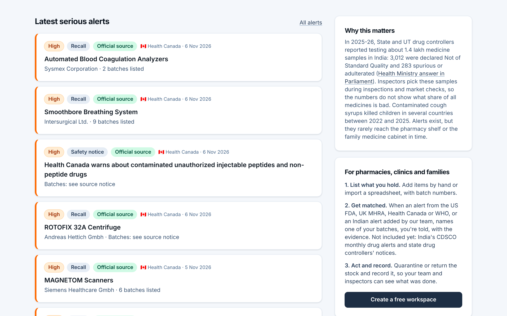</a>
 <b>02 · Latest serious alerts</b> 
The newest serious medicine and device alerts, beside a sourced explanation of why this matters and the three steps for pharmacies, clinics and families.
</td>
<td width="50%" valign="top">
<a href="assets/user-facing-features/medicine-safety/03-batch-check-exact-match.png">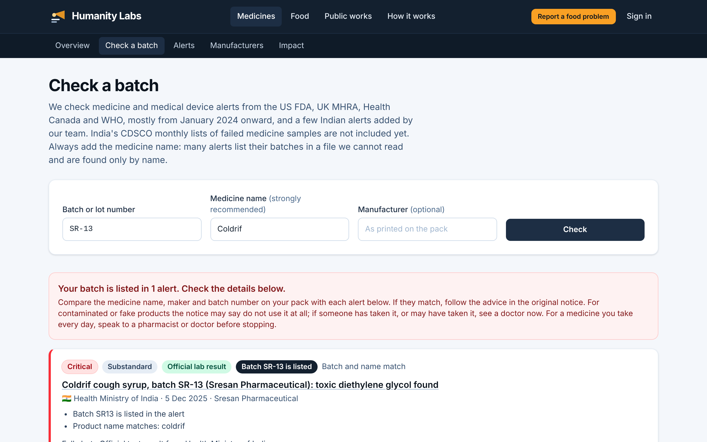</a>
 <b>03 · Batch check: exact match</b> 
Checking batch SR-13 of Coldrif finds the alert that lists it. The result explains why it matched (batch and name) and what to do next.
</td>
</tr>
<tr>
<td width="50%" valign="top">
<a href="assets/user-facing-features/medicine-safety/04-batch-check-similar-name.png">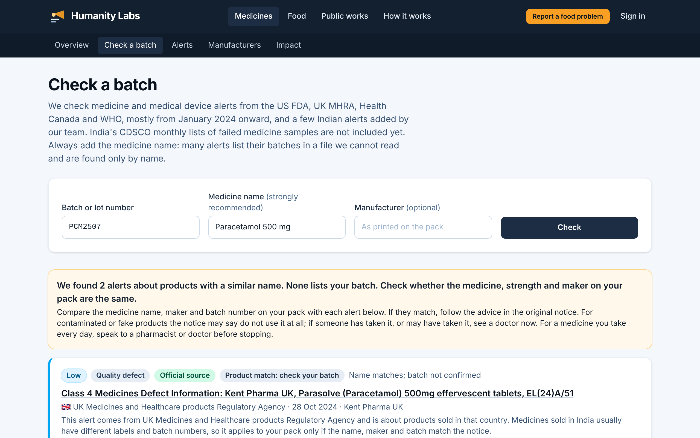</a>
 <b>04 · Batch check: similar name only</b> 
When alerts mention a similar product but not the batch, the result says so in a different colour and asks the user to compare strength and maker.
</td>
<td width="50%" valign="top">
<a href="assets/user-facing-features/medicine-safety/05-alerts-browse.png">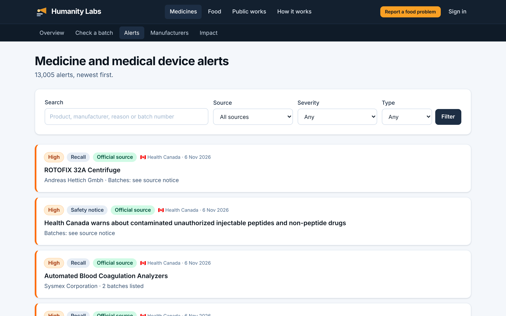</a>
 <b>05 · Browse all alerts</b> 
More than 13,000 medicine and medical device alerts, newest first, with search and filters for source, severity and type.
</td>
</tr>
<tr>
<td width="50%" valign="top">
<a href="assets/user-facing-features/medicine-safety/06-alerts-search-and-filter.png">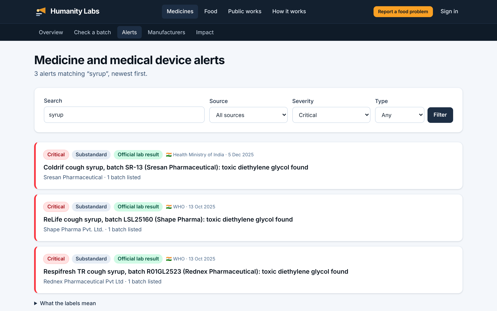</a>
 <b>06 · Search and filter</b> 
A search for "syrup" limited to critical alerts returns the contaminated cough syrups reported in India, each with its evidence label.
</td>
<td width="50%" valign="top">
<a href="assets/user-facing-features/medicine-safety/07-alert-detail.png">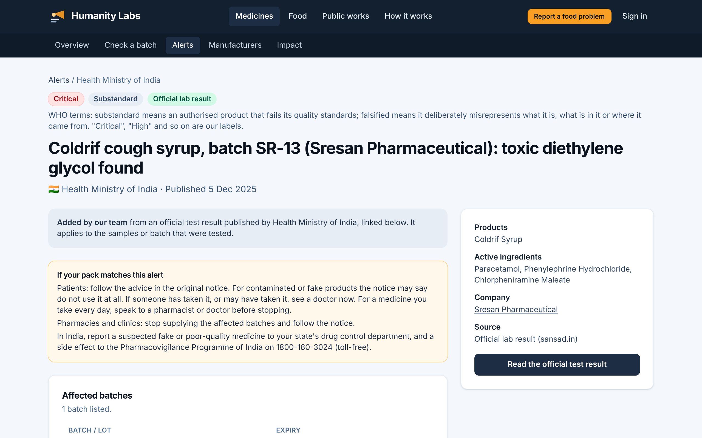</a>
 <b>07 · Alert detail</b> 
One alert in full: severity, type and evidence labels, advice for patients and pharmacies, product, ingredients and company, and a button to the official test result.
</td>
</tr>
<tr>
<td width="50%" valign="top">
<a href="assets/user-facing-features/medicine-safety/08-alert-detail-batches-and-reason.png">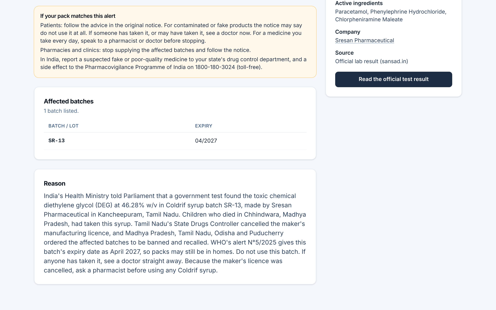</a>
 <b>08 · Affected batches and reason</b> 
The batches the alert names, with expiry dates, and the reason in plain language with what the authorities did.
</td>
<td width="50%" valign="top">
<a href="assets/user-facing-features/medicine-safety/09-who-falsified-medicine-alert.png">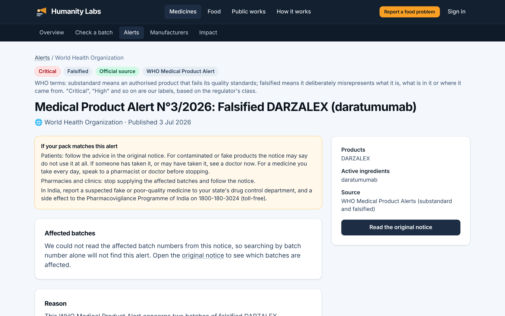</a>
 <b>09 · WHO falsified-medicine alert</b> 
A WHO Medical Product Alert about a falsified cancer medicine. When batch numbers cannot be read from a notice, the page says so and points to the original.
</td>
</tr>
<tr>
<td width="50%" valign="top">
<a href="assets/user-facing-features/medicine-safety/10-manufacturer-histories.png">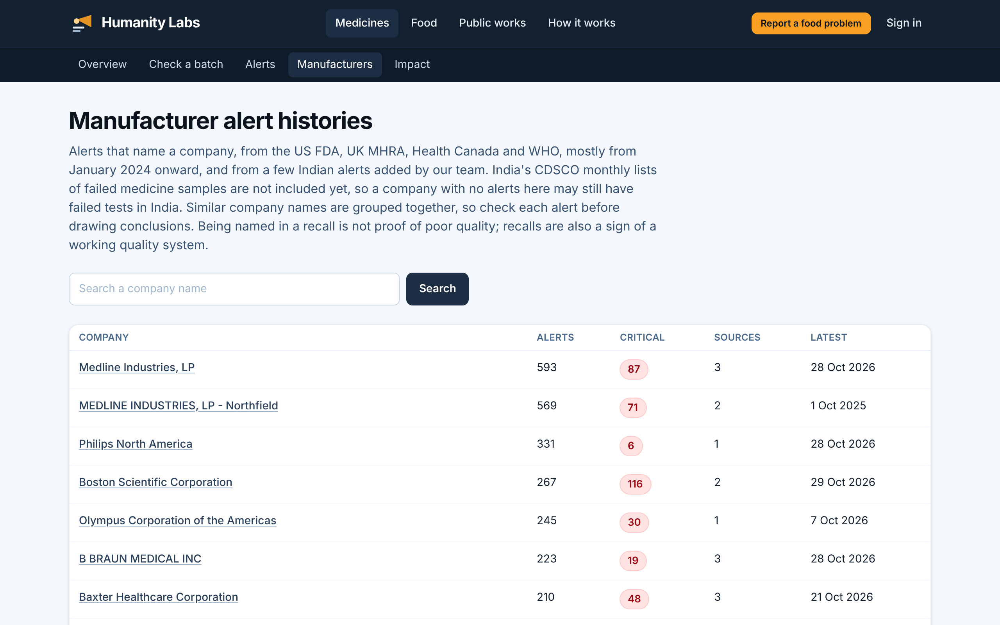</a>
 <b>10 · Manufacturer alert histories</b> 
Companies named in alerts, with the number of alerts, how many were critical, how many sources named them and the latest date. A note explains that a recall is not proof of poor quality.
</td>
<td width="50%" valign="top">
<a href="assets/user-facing-features/medicine-safety/11-manufacturer-alert-history.png">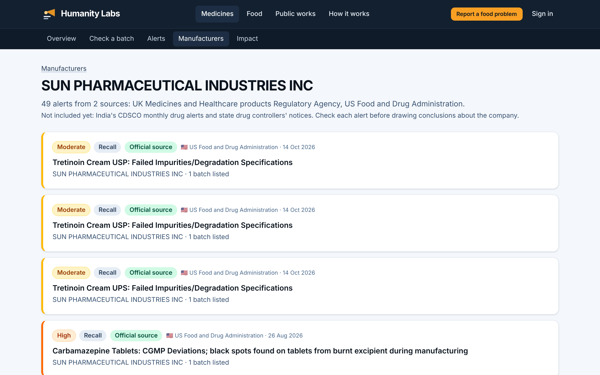</a>
 <b>11 · One manufacturer's history</b> 
Every alert that names one company, across sources, newest first.
</td>
</tr>
</table>

### Workspace for pharmacies, clinics and families

The workspace screenshots use a demo pharmacy created for this tour. Its stock list is sample data; the alerts it is matched against are real (see [how these screenshots were made](#5-how-these-screenshots-were-made)).

<table>
<tr>
<td width="50%" valign="top">
<a href="assets/user-facing-features/medicine-safety/12-create-a-workspace.png">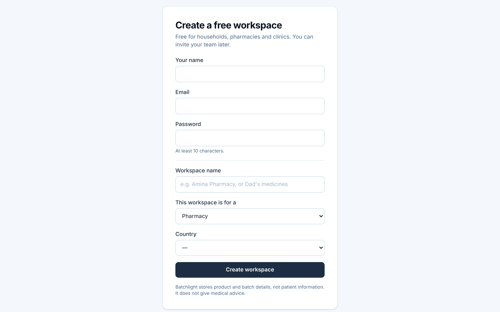</a>
 <b>12 · Create a free workspace</b> 
Sign-up for pharmacies, clinics, hospitals, distributors and households. It asks for a name, an email address, a password and a few details about the workspace.
</td>
<td width="50%" valign="top">
<a href="assets/user-facing-features/medicine-safety/13-workspace-dashboard.png">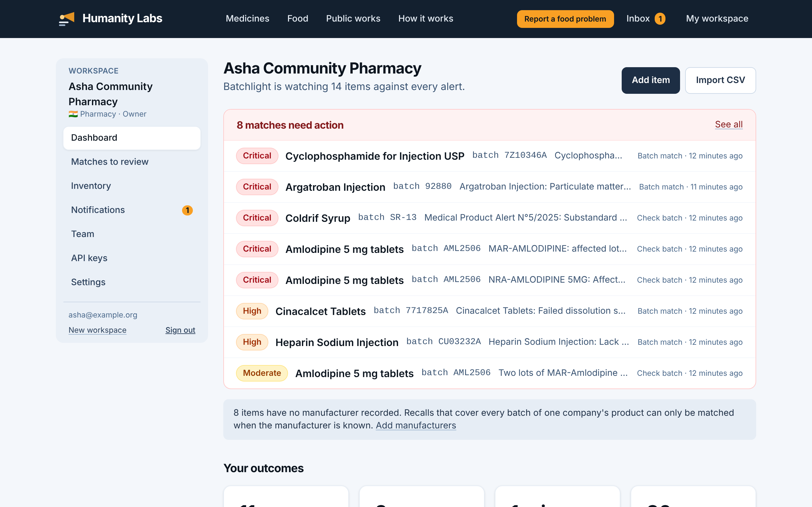</a>
 <b>13 · Workspace dashboard</b> 
The pharmacy's home screen: how many stock items are being watched and which matches need action, most severe first.
</td>
</tr>
<tr>
<td width="50%" valign="top">
<a href="assets/user-facing-features/medicine-safety/14-workspace-outcomes-and-sources.png">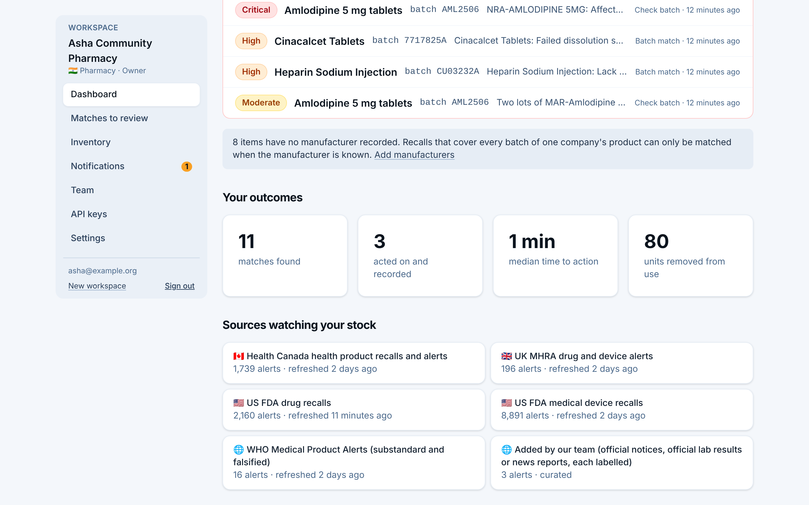</a>
 <b>14 · Outcomes and sources</b> 
What the workspace has done about its matches (acted on, time to action, units removed from use) and the sources watching its stock, with their last refresh.
</td>
<td width="50%" valign="top">
<a href="assets/user-facing-features/medicine-safety/15-matches-to-review.png">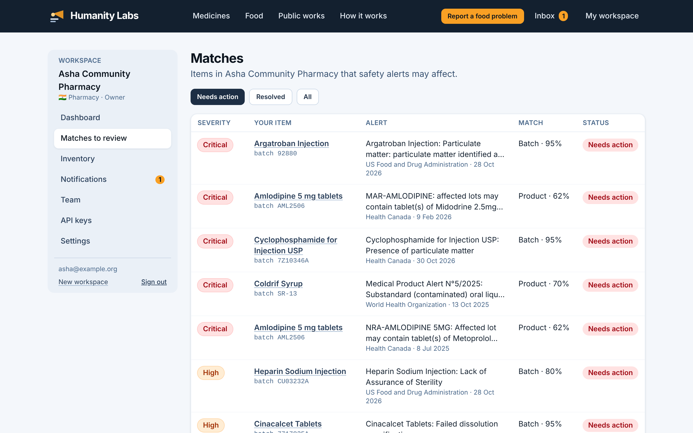</a>
 <b>15 · Matches to review</b> 
Stock items that alerts may affect. Each row shows the severity, the item and batch, the alert, how it matched (batch or product name) with a confidence score, and its status.
</td>
</tr>
<tr>
<td width="50%" valign="top">
<a href="assets/user-facing-features/medicine-safety/16-match-detail.png">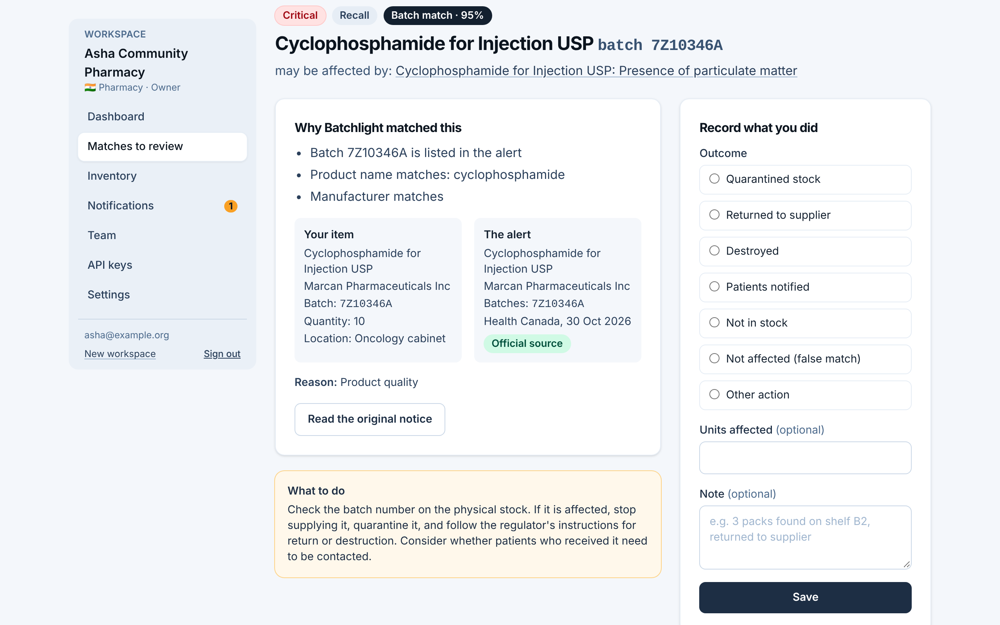</a>
 <b>16 · Match detail</b> 
Why Batchlight matched an item, with the stock record and the alert side by side, advice on what to do, and a form to record the outcome.
</td>
<td width="50%" valign="top">
<a href="assets/user-facing-features/medicine-safety/17-match-resolved.png">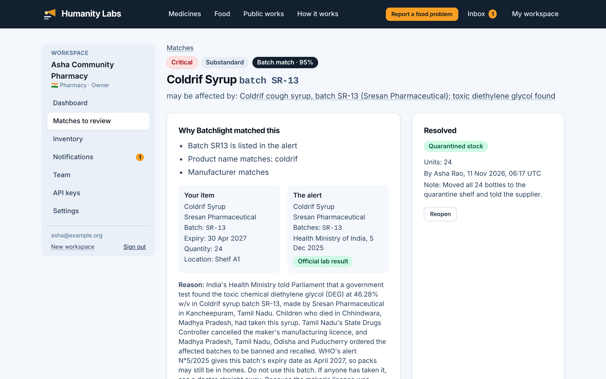</a>
 <b>17 · Recorded outcome</b> 
A resolved match keeps a record of what was done, how many units were affected, who recorded it and when. It can be reopened.
</td>
</tr>
<tr>
<td width="50%" valign="top">
<a href="assets/user-facing-features/medicine-safety/18-inventory.png">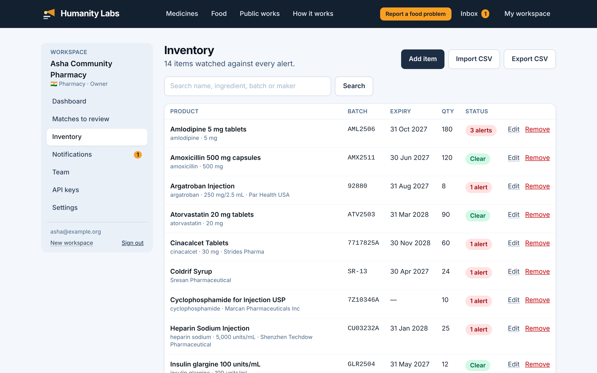</a>
 <b>18 · Inventory</b> 
The stock list with batch, expiry and quantity. A status on each row shows whether the item is clear or how many alerts may affect it.
</td>
<td width="50%" valign="top">
<a href="assets/user-facing-features/medicine-safety/19-add-an-item.png">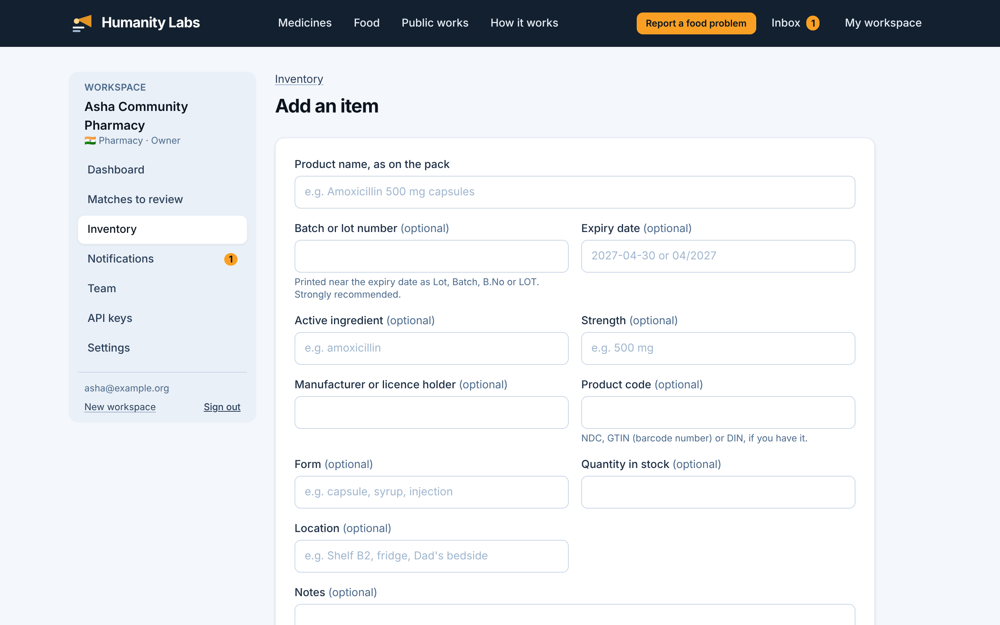</a>
 <b>19 · Add an item</b> 
Add one item by hand. Only the product name is required; the batch number is strongly recommended because it allows exact matches.
</td>
</tr>
<tr>
<td width="50%" valign="top">
<a href="assets/user-facing-features/medicine-safety/20-import-from-a-spreadsheet.png">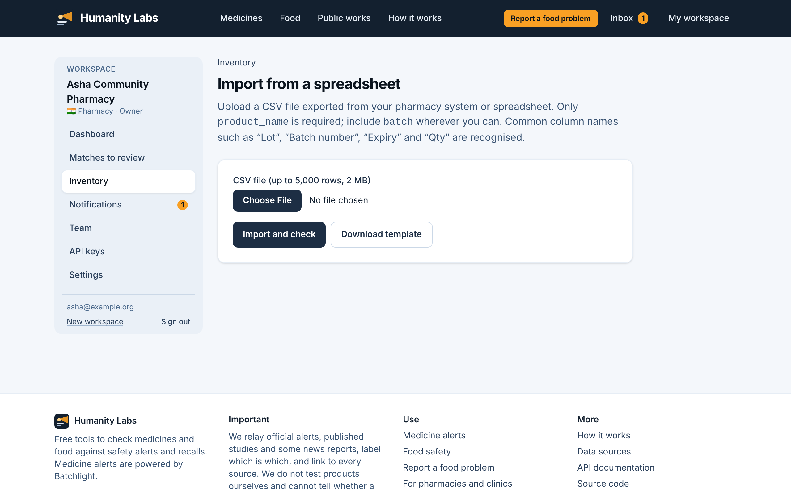</a>
 <b>20 · Import from a spreadsheet</b> 
Upload a CSV exported from a pharmacy system. Common column names such as "Lot", "Batch number" and "Expiry" are recognised, and the import is checked against every alert at once.
</td>
<td width="50%" valign="top">
<a href="assets/user-facing-features/medicine-safety/21-notifications.png">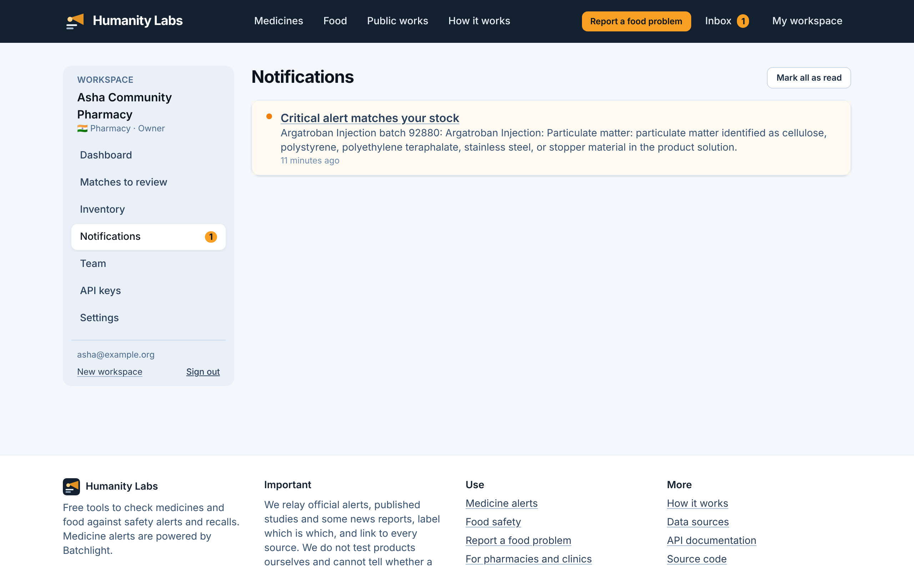</a>
 <b>21 · Notifications</b> 
When a newly published alert matches something in stock, everyone in the workspace is notified here and, if switched on, by an email digest.
</td>
</tr>
<tr>
<td width="50%" valign="top">
<a href="assets/user-facing-features/medicine-safety/22-team-and-invitations.png">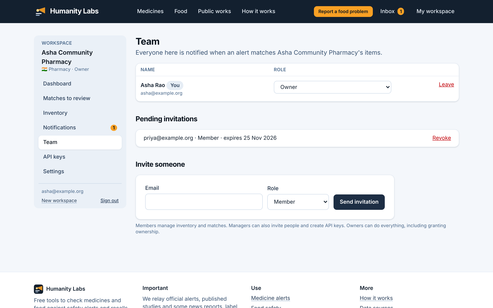</a>
 <b>22 · Team and invitations</b> 
Invite colleagues by email as owner, manager or member, see pending invitations and change roles.
</td>
<td width="50%" valign="top">
<a href="assets/user-facing-features/medicine-safety/23-workspace-settings.png">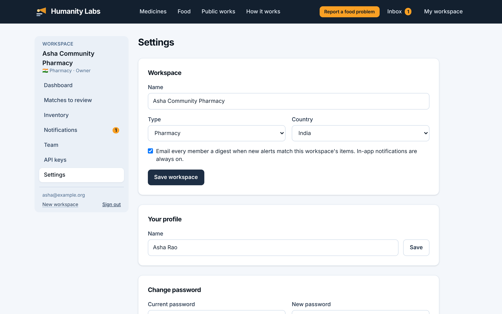</a>
 <b>23 · Workspace settings</b> 
Workspace name, type and country, the email digest switch, the user's profile and password.
</td>
</tr>
<tr>
<td width="50%" valign="top">
<a href="assets/user-facing-features/medicine-safety/24-api-keys.png">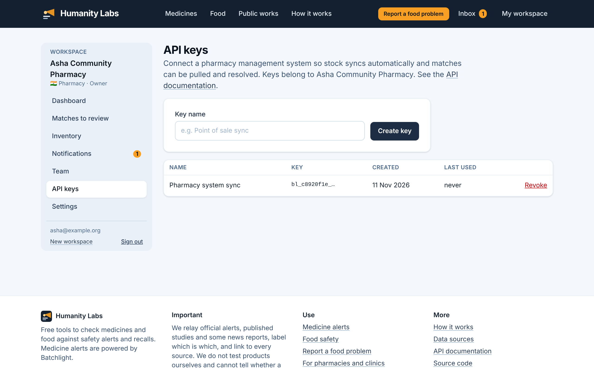</a>
 <b>24 · API keys</b> 
Create a key so a pharmacy management system can sync stock and pull matches automatically. Only the start of each key is shown after it is created.
</td>
<td width="50%" valign="top">
<a href="assets/user-facing-features/medicine-safety/25-api-documentation.png">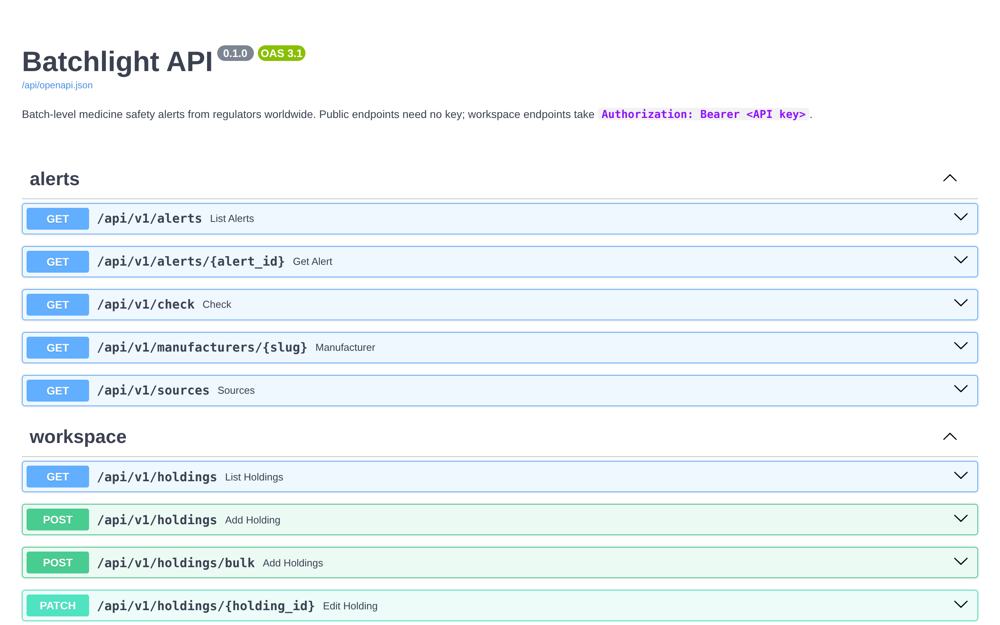</a>
 <b>25 · API documentation</b> 
Interactive documentation for the public alerts API and the workspace API.
</td>
</tr>
</table>

---

## 3. Infrastructure Transparency

Look up a public works project in India and read its Project Passport: who approved and funded it, who won the contract, the price and the dates, each answer linked to the official record. When a record is not published, the passport says so instead of guessing. In the app: `/infrastructure` ("Public works" in the menu).

<a href="assets/user-facing-features/infrastructure-transparency/01-public-works-home.png">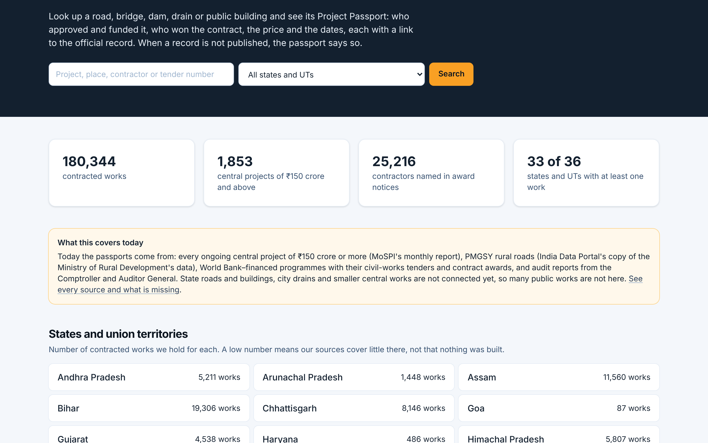</a>

**01 · Public works home.** Search for a road, bridge, dam, drain or public building by project, place, contractor or tender number. The counters show what is held, and a note says exactly what the data covers today.

<table>
<tr>
<td width="50%" valign="top">
<a href="assets/user-facing-features/infrastructure-transparency/02-states-and-union-territories.png">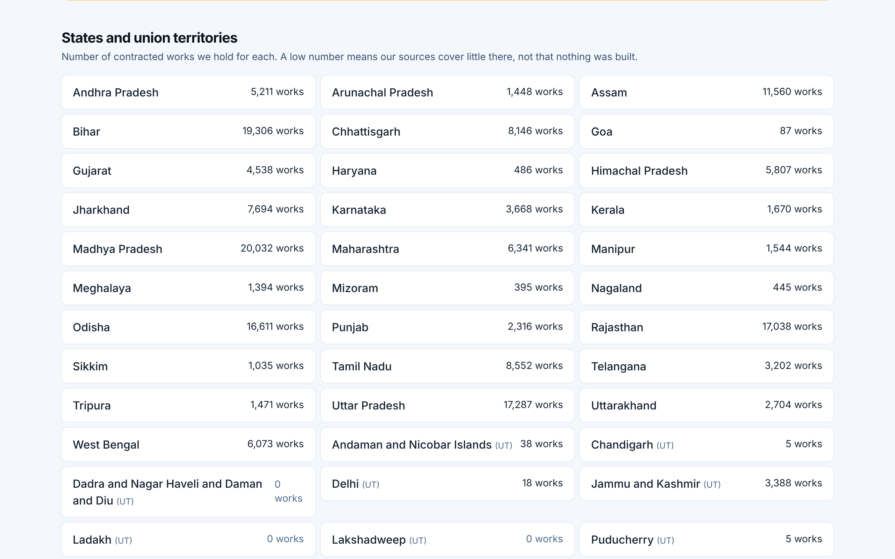</a>
 <b>02 · States and union territories</b> 
Every state and union territory with the number of contracted works held, and a reminder that a low number means little coverage, not that nothing was built.
</td>
<td width="50%" valign="top">
<a href="assets/user-facing-features/infrastructure-transparency/03-project-search-results.png">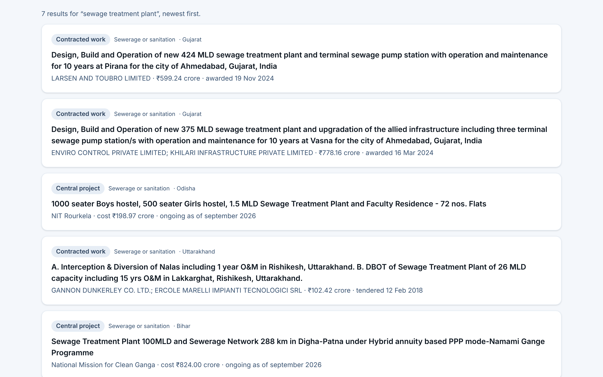</a>
 <b>03 · Project search results</b> 
Results for "sewage treatment plant". Each card shows the kind of record, the type of work, the state, the contractor or agency, the price and the award date or status.
</td>
</tr>
<tr>
<td width="50%" valign="top">
<a href="assets/user-facing-features/infrastructure-transparency/04-project-search-by-state-and-type.png">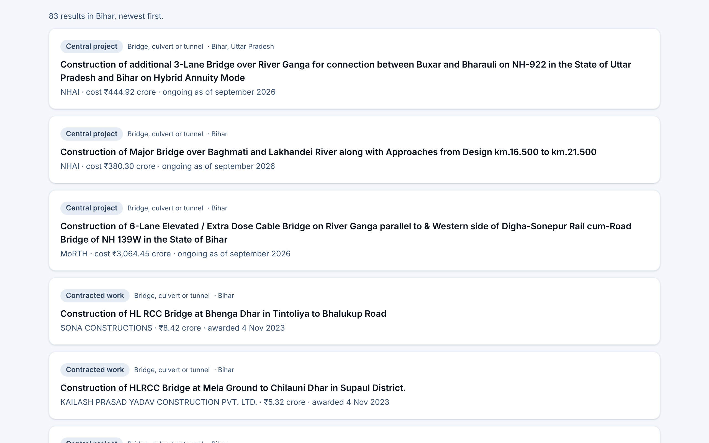</a>
 <b>04 · Search by state and type of work</b> 
Bridges, culverts and tunnels in Bihar: 83 records, from large central projects to individual contracted works.
</td>
<td width="50%" valign="top">
<a href="assets/user-facing-features/infrastructure-transparency/05-project-passport.png">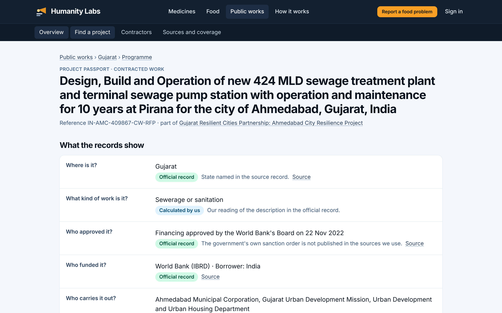</a>
 <b>05 · Project Passport</b> 
One page per project that answers plain questions: where it is, what kind of work, who approved it, who funded it. Every answer is labelled (official record, calculated by us) and links to its source.
</td>
</tr>
<tr>
<td width="50%" valign="top">
<a href="assets/user-facing-features/infrastructure-transparency/06-project-passport-contract-and-dates.png">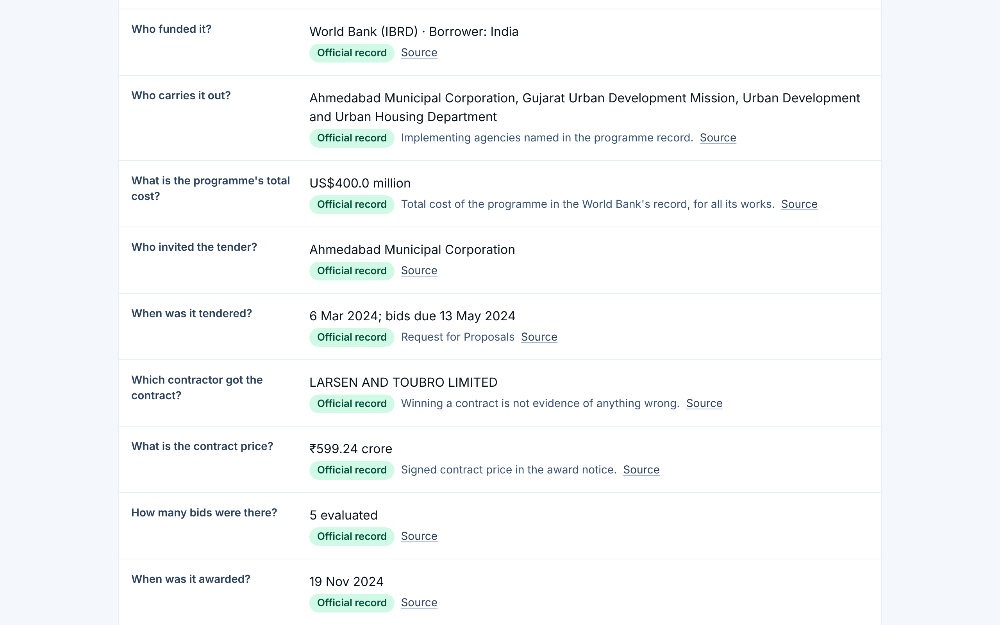</a>
 <b>06 · Contract, price and dates</b> 
Further down the same passport: who invited the tender, when, which contractor won, the signed contract price, how many bids were evaluated and when the contract was awarded.
</td>
<td width="50%" valign="top">
<a href="assets/user-facing-features/infrastructure-transparency/07-project-passport-what-is-not-published.png">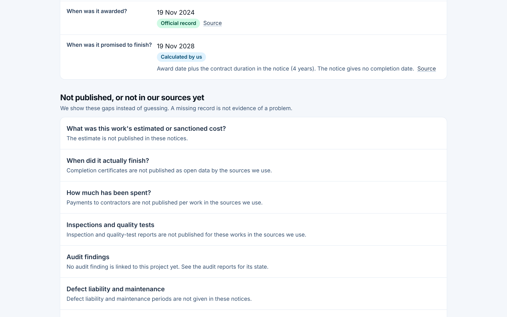</a>
 <b>07 · What is not published</b> 
The passport lists what the records do not show, such as actual completion, payments, inspections and audit findings, instead of guessing. A missing record is not treated as evidence of a problem.
</td>
</tr>
<tr>
<td width="50%" valign="top">
<a href="assets/user-facing-features/infrastructure-transparency/08-project-passport-cost-and-progress.png">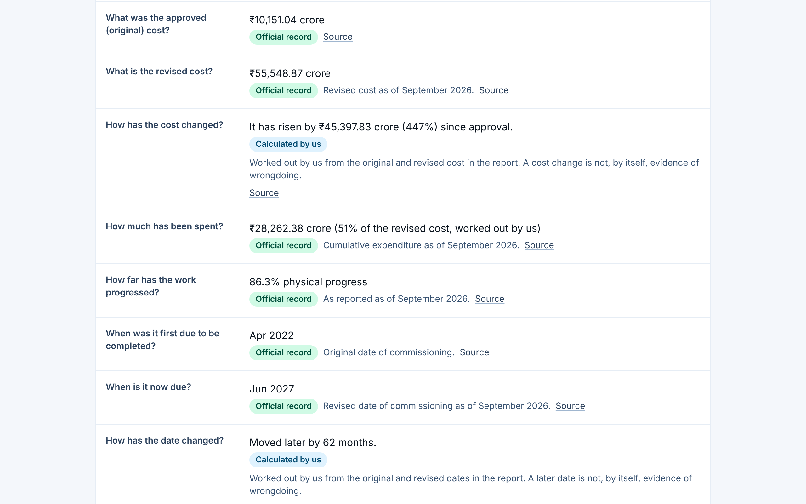</a>
 <b>08 · Cost, progress and delays</b> 
A large central project: approved and revised cost, money spent, physical progress and the original and revised completion dates, as given in the government's monthly report. The cost increase and the delay are worked out from those figures and labelled as calculations.
</td>
<td width="50%" valign="top">
<a href="assets/user-facing-features/infrastructure-transparency/09-state-overview.png">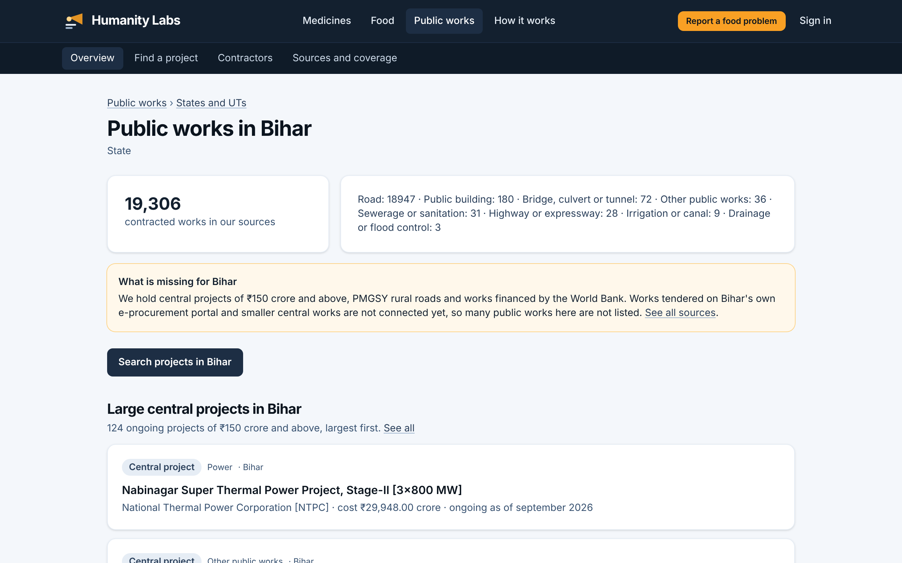</a>
 <b>09 · State overview</b> 
Public works in one state: the number of works by type, what is missing from the sources for that state, and its largest ongoing central projects.
</td>
</tr>
<tr>
<td width="50%" valign="top">
<a href="assets/user-facing-features/infrastructure-transparency/10-contractor-search.png">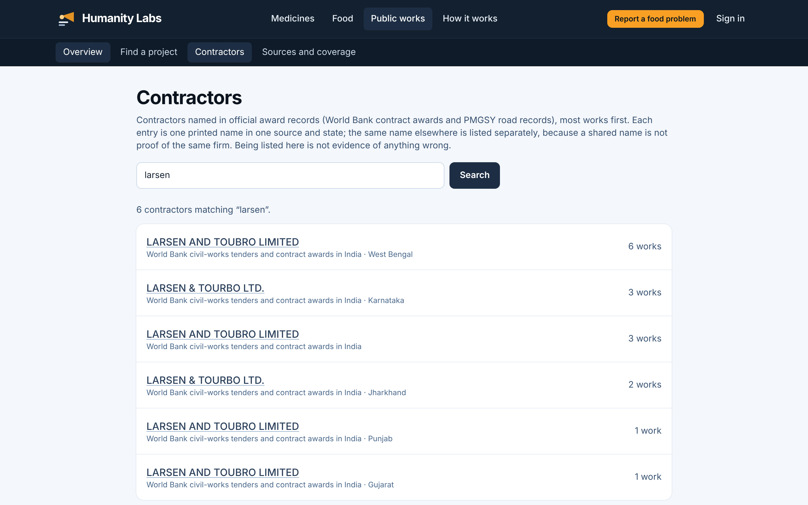</a>
 <b>10 · Contractor search</b> 
Search contractors named in official award records. Each entry is one printed name in one source, because a shared name is not proof of the same firm.
</td>
<td width="50%" valign="top">
<a href="assets/user-facing-features/infrastructure-transparency/11-contractor-profile.png">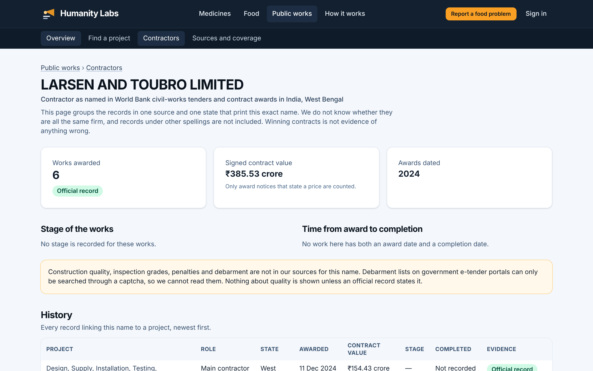</a>
 <b>11 · Contractor profile</b> 
Works awarded to one contractor name, the signed contract value where notices state it, the years covered and the stage of the works.
</td>
</tr>
<tr>
<td width="50%" valign="top">

 <b>12 · Contractor history</b> 
Every record that links the name to a project: role, state, award date, contract value, stage and completion, each with its evidence label and source link.
</td>
<td width="50%" valign="top">

 <b>13 · Sources and coverage</b> 
Every connected source with what it provides, how many records are held, how often it refreshes and the last successful update.
</td>
</tr>
<tr>
<td width="50%" valign="top">

 <b>14 · Sources checked but not connected yet</b> 
The important sources that were checked but cannot be collected from yet, with what each would add and the reason it is not connected.
</td>
<td width="50%"></td>
</tr>
</table>

---

## 4. Shared pages

The home page and the pages that explain where the data comes from and how it is handled.

**01 · One home page, two checks.** The home page lets anyone check a medicine batch or a food product straight away, with no account. Counters show how many alerts and recalls are searchable.

<table>
<tr>
<td width="50%" valign="top">

 <b>02 · Recent serious alerts</b> 
The latest serious food recalls and medicine alerts side by side, each labelled with its severity, its evidence type and the regulator that published it. Below, a summary of what testing has found in everyday food in India.
</td>
<td width="50%" valign="top">

 <b>03 · Data sources and freshness</b> 
Every connected source with the number of alerts held and the time of its last successful refresh. A note at the top states plainly what is not covered yet.
</td>
</tr>
<tr>
<td width="50%" valign="top">

 <b>04 · How it works</b> 
A plain-language explanation of where the data comes from, the evidence rules, and what the service does not do.
</td>
<td width="50%"></td>
</tr>
</table>

---

## 5. How these screenshots were made

**The application.** The screenshots were taken from the application at commit `9cd8248`, running locally. No application code was changed. The app ran against a private copy of the development database, so the existing data was left untouched.

**The data.** Alerts, recalls and public works records are the ones the app collected from its sources:

- **Medicines:** US FDA drug and device recalls, Health Canada, UK MHRA and WHO Medical Product Alerts, plus three Indian alerts added by the team.
- **Food:** US FDA and Canadian Food Inspection Agency recalls, plus five food safety actions about Indian products added by the team.
- **Public works:** MoSPI's monthly report on central projects, PMGSY rural roads (India Data Portal's copy), World Bank projects and civil-works contract awards, and CAG audit reports.

**What is sample data.** A few things had to be entered by hand to show screens that depend on a user's own information:

- **The demo pharmacy.** "Asha Community Pharmacy" and its 14 stock lines were created for this tour. Six lines carry batch numbers taken from real recalls so that matches appear. The outcomes recorded against three matches and the pending team invitation are sample actions.
- **The notification.** It was produced by the app's own ingestion re-reading one real US FDA recall, which matched the demo stock.
- **The licence number.** The FSSAI number in screenshot 10 of Food Safety is a made-up 14-digit example. The barcode on the same screen is from a real Canadian recall.

**What is not shown.**

- **Impact page:** its figures count workspace activity, which in this database is demo data.
- **Report confirmation page:** it appears only after a food problem report is sent, which would have meant submitting a made-up report.
- **Lab directory:** no labs have been added in this database, so only the testing guide is shown.
- **Curator tools:** these are for the team, not for the public.

**The capture.** Chromium at 1280 × 800 with a device scale factor of 2, giving 2560 × 1600 px images. Pages longer than one screen are shown in sections. The API documentation page loads its interface from a public CDN; it was captured with the same package served from a local copy.
