# Humanity Labs: feature walkthroughs

Screen recordings of real interactions with every user-facing feature of the three Humanity Labs products, and the pages they share. Each one was recorded in the running application, using the alerts, recalls and public works records it collected from its sources.

- **Recordings:** 56 videos, about 15 minutes in total, covering 33 features.
- **Format:** MP4 (H.264), 1920 × 1200 px, 30 frames per second, with the pointer visible. Each video has a thumbnail.
- **Recorded:** 12 November 2026, from commit `90dc218`.
- **Data:** medicine and food sources refreshed on 12 November 2026; public works sources on 9 November 2026.
- **Files:** one folder per feature under [`docs/assets/user-facing-features/`](assets/user-facing-features/README.md), each with `screenshots/`, `recordings/` and a `README.md`. Still screenshots of the same screens: [USER_FACING_FEATURES.md](USER_FACING_FEATURES.md).

Click a thumbnail to open the video.

**Contents**

1. [Food Safety](#1-food-safety): 7 features, 14 recordings
2. [Medicine Safety](#2-medicine-safety): 17 features, 28 recordings
3. [Infrastructure Transparency](#3-infrastructure-transparency): 6 features, 10 recordings
4. [Shared pages](#4-shared-pages): 3 features, 4 recordings
5. [What was entered during the recordings](#5-what-was-entered-during-the-recordings)
6. [Not recorded](#6-not-recorded)
7. [How the recordings were made](#7-how-the-recordings-were-made)

---

## 1. Food Safety

Search food recalls, read what tests have found in everyday food in India, check a pack, report a problem and learn how to get food tested. Every item says whether it comes from an official source, an official lab result, a peer-reviewed study or a news report. In the app: `/food`.

### Food Safety overview

The starting point: a recall search, the four food tools, recent actions on food sold in India and the latest recalls worldwide. [Feature folder](assets/user-facing-features/food-safety/overview/README.md) · `/food`

<table>
<tr>
<td width="50%" valign="top">
<a href="assets/user-facing-features/food-safety/overview/recordings/01-food-safety-overview.mp4">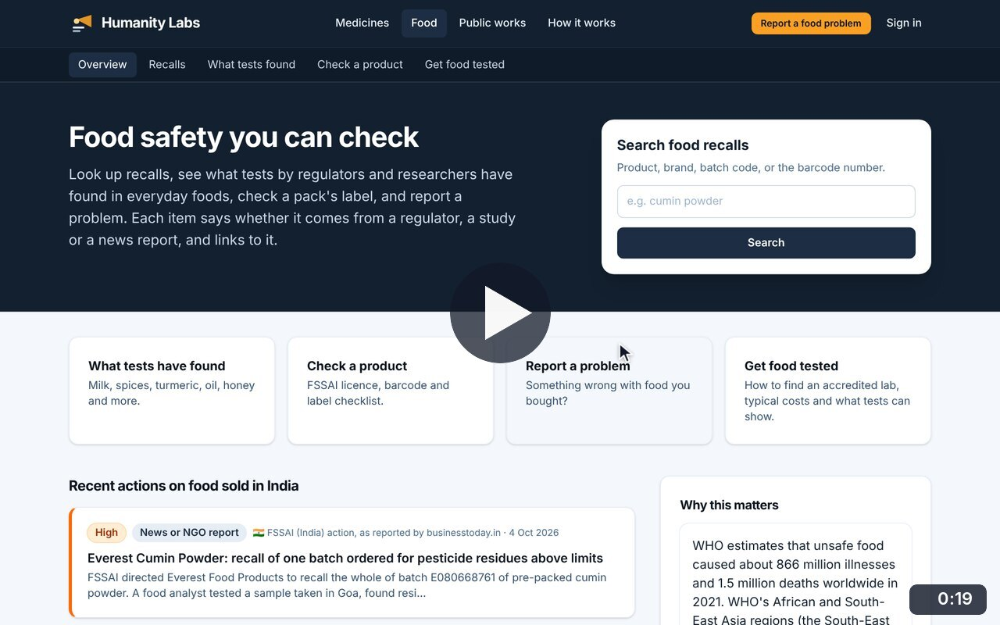</a>
 <b>Food Safety overview</b> · 0:19 
From the recall search and the four tools to recent actions on food sold in India, the latest recalls worldwide, why food safety matters and the sources, ending on the full recall list.
</td>
<td width="50%"></td>
</tr>
</table>

### Recall search

Search food recalls by product, brand, batch code or barcode, filter by country and page through the results. [Feature folder](assets/user-facing-features/food-safety/recall-search/README.md) · `/food/recalls`

<table>
<tr>
<td width="50%" valign="top">
<a href="assets/user-facing-features/food-safety/recall-search/recordings/01-search-food-recalls.mp4">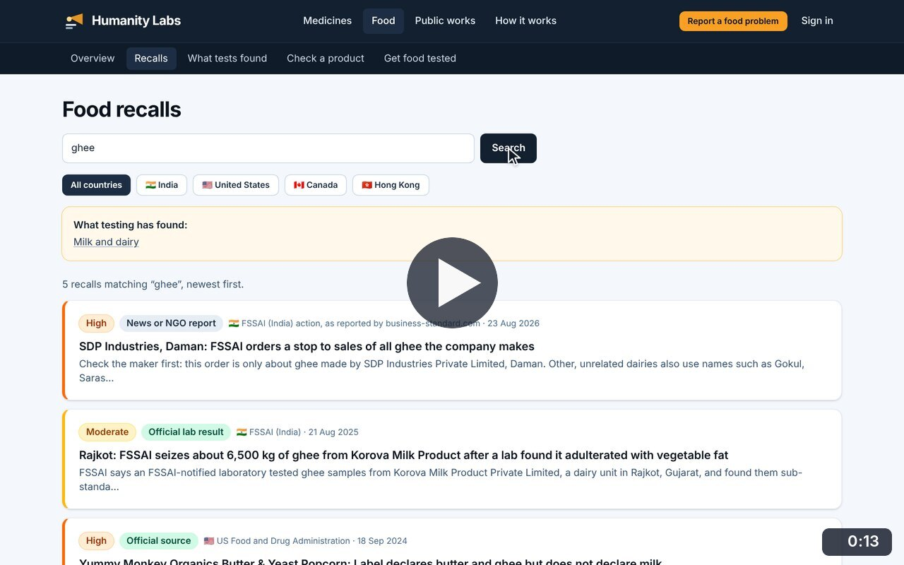</a>
 <b>Search food recalls</b> · 0:13 
Search for &quot;ghee&quot;: recalls and Indian actions about ghee appear, with a link to what testing has found in milk and dairy.
</td>
<td width="50%" valign="top">
<a href="assets/user-facing-features/food-safety/recall-search/recordings/02-filter-by-country-and-browse-pages.mp4">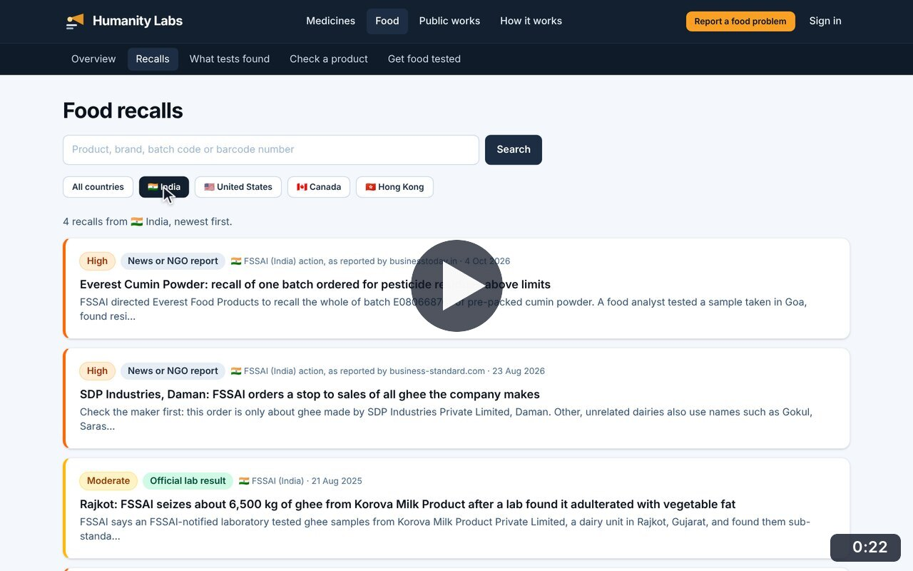</a>
 <b>Filter by country and browse pages</b> · 0:22 
Narrow the list to India, then Canada, page through older recalls and open the explanation of the labels.
</td>
</tr>
</table>

### Recall details

One recall in full: what to do if you have the product, why it was recalled, the affected products, barcodes and batch codes, and a link to the original notice. [Feature folder](assets/user-facing-features/food-safety/recall-details/README.md) · `/food/recalls/{id}`

<table>
<tr>
<td width="50%" valign="top">
<a href="assets/user-facing-features/food-safety/recall-details/recordings/01-read-an-official-recall.mp4">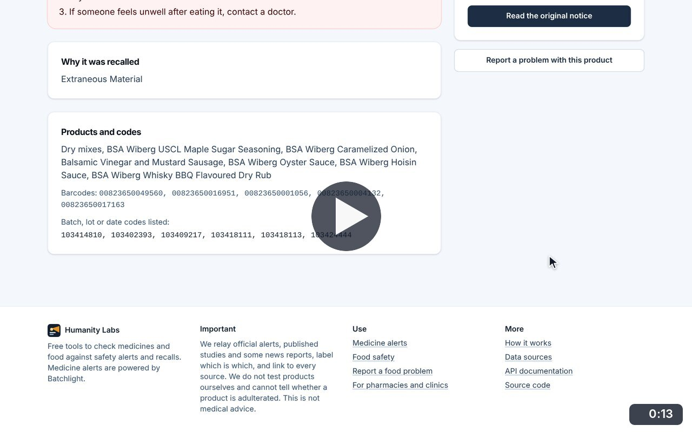</a>
 <b>Read an official recall</b> · 0:13 
Open a Canadian Food Inspection Agency recall: what to do if you have the product, why it was recalled, every affected product with its barcodes and batch codes, and the link to the original notice.
</td>
<td width="50%" valign="top">
<a href="assets/user-facing-features/food-safety/recall-details/recordings/02-recall-reported-in-the-news.mp4">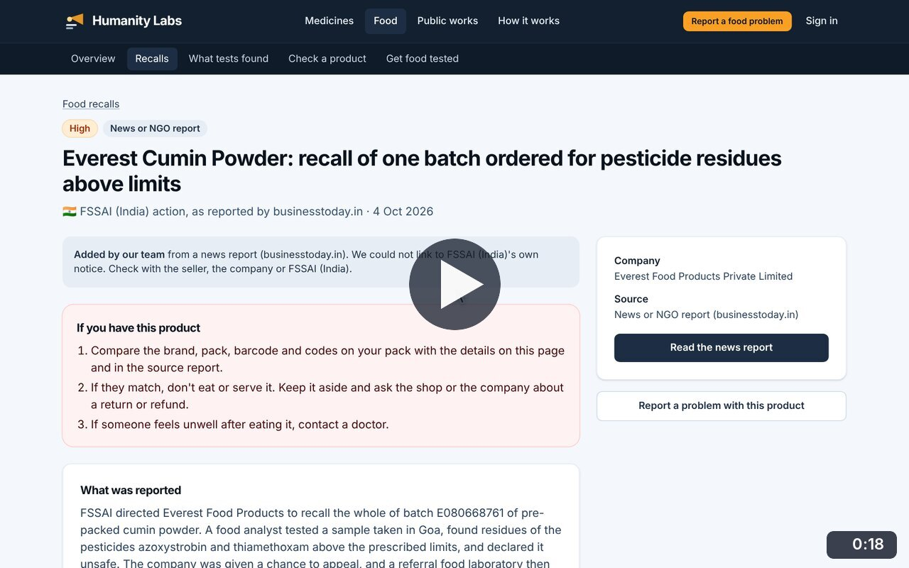</a>
 <b>A recall known from a news report</b> · 0:18 
Open an Indian recall added by the team from a news report: the page says it could not link to FSSAI&#x27;s own notice, shows the batch code, and &quot;Report a problem with this product&quot; opens the report form with the product name filled in.
</td>
</tr>
</table>

### What tests have found

Sourced summaries of what official tests, studies and news reports found in milk, spices, turmeric, oils, honey and more, with practical advice and related regulatory actions. [Feature folder](assets/user-facing-features/food-safety/test-findings/README.md) · `/food/reported`, `/food/reported/{topic}`

<table>
<tr>
<td width="50%" valign="top">
<a href="assets/user-facing-features/food-safety/test-findings/recordings/01-what-tests-have-found.mp4">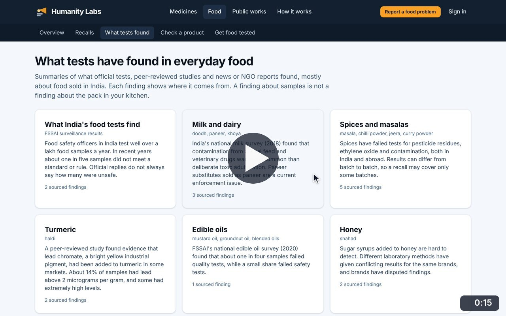</a>
 <b>What tests have found</b> · 0:15 
Browse the food topics, open milk and dairy, read each sourced finding, open the label explanation, then the practical advice.
</td>
<td width="50%" valign="top">
<a href="assets/user-facing-features/food-safety/test-findings/recordings/02-spices-and-related-actions.mp4">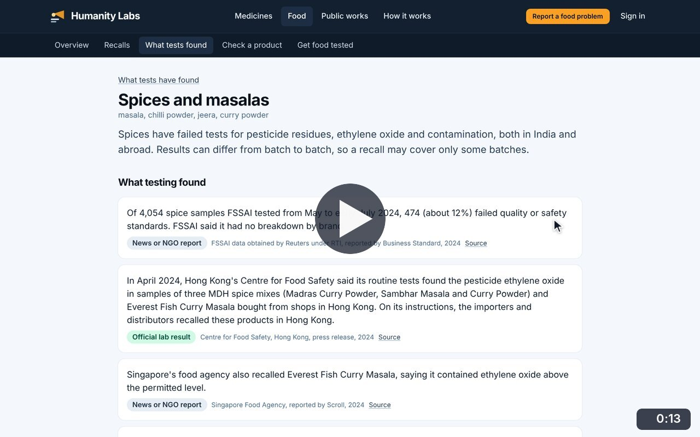</a>
 <b>Spices and related regulatory actions</b> · 0:13 
Open spices and masalas: findings from FSSAI, Hong Kong and Singapore, then the related regulatory actions, opening one.
</td>
</tr>
</table>

### Check a product

Check the format of an FSSAI licence number, verify a barcode and search recalls for it, and compare a pack against the label checklist. [Feature folder](assets/user-facing-features/food-safety/product-checks/README.md) · `/food/verify`

<table>
<tr>
<td width="50%" valign="top">
<a href="assets/user-facing-features/food-safety/product-checks/recordings/01-check-an-fssai-licence-number.mp4">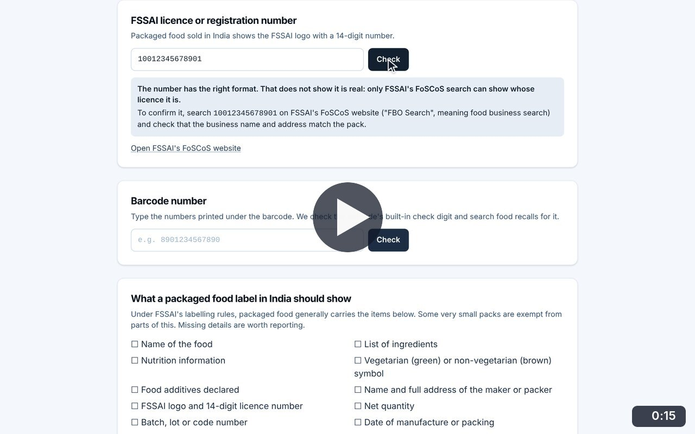</a>
 <b>Check an FSSAI licence number</b> · 0:15 
A number one digit short is caught; a correctly formed 14-digit number is accepted with a reminder that only FSSAI&#x27;s FoSCoS search shows whose licence it is. The number typed is an example in the correct format.
</td>
<td width="50%" valign="top">
<a href="assets/user-facing-features/food-safety/product-checks/recordings/02-check-a-barcode-against-recalls.mp4">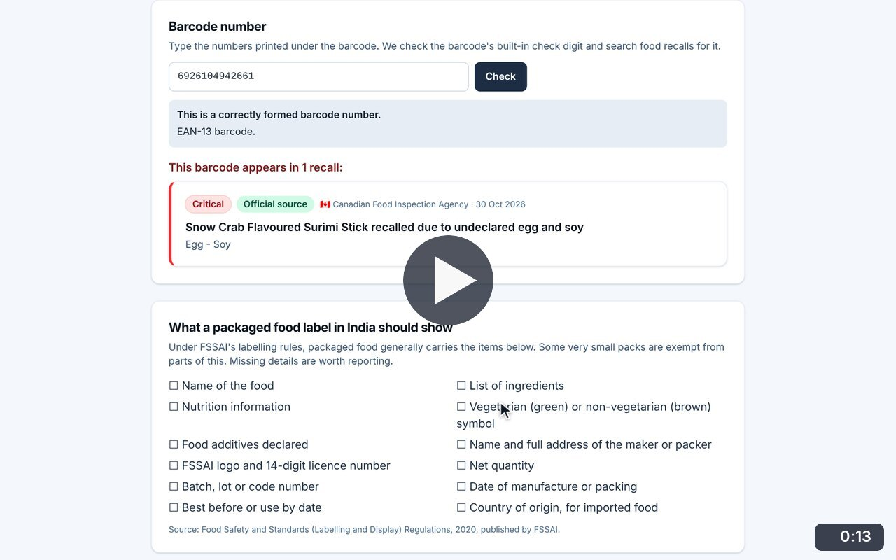</a>
 <b>Check a barcode against recalls</b> · 0:13 
Type the barcode from a pack: its check digit is verified, recalls are searched, and the matching Canadian recall opens.
</td>
</tr>
<tr>
<td width="50%" valign="top">
<a href="assets/user-facing-features/food-safety/product-checks/recordings/03-packaged-food-label-checklist.mp4">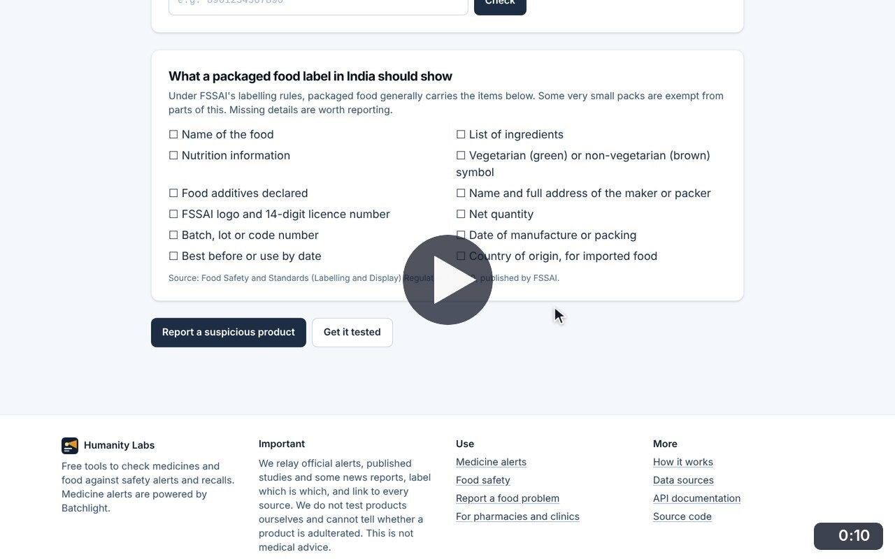</a>
 <b>Packaged food label checklist</b> · 0:10 
Go through what a packaged food label in India should show under FSSAI&#x27;s labelling rules, with the next steps if something is missing.
</td>
<td width="50%"></td>
</tr>
</table>

### Report a food problem

Report food that seemed wrong, with validation and a confirmation, plus the official complaint routes in India. [Feature folder](assets/user-facing-features/food-safety/report-a-problem/README.md) · `/food/report`

<table>
<tr>
<td width="50%" valign="top">
<a href="assets/user-facing-features/food-safety/report-a-problem/recordings/01-report-a-food-problem.mp4">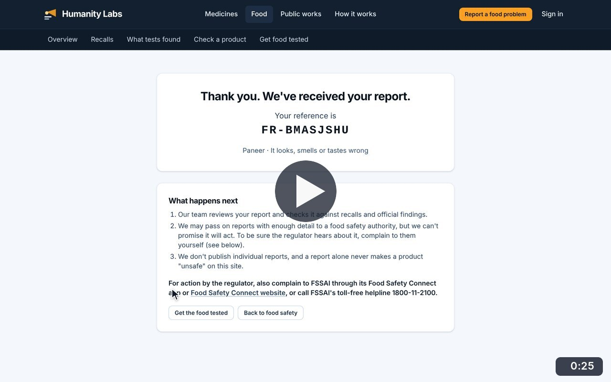</a>
 <b>Report a food problem</b> · 0:25 
Sending an empty form shows what is missing; the form is then completed and sent, and the confirmation explains what happens next. The text typed says it is a walkthrough, not a real report.
</td>
<td width="50%" valign="top">
<a href="assets/user-facing-features/food-safety/report-a-problem/recordings/02-official-complaint-routes.mp4">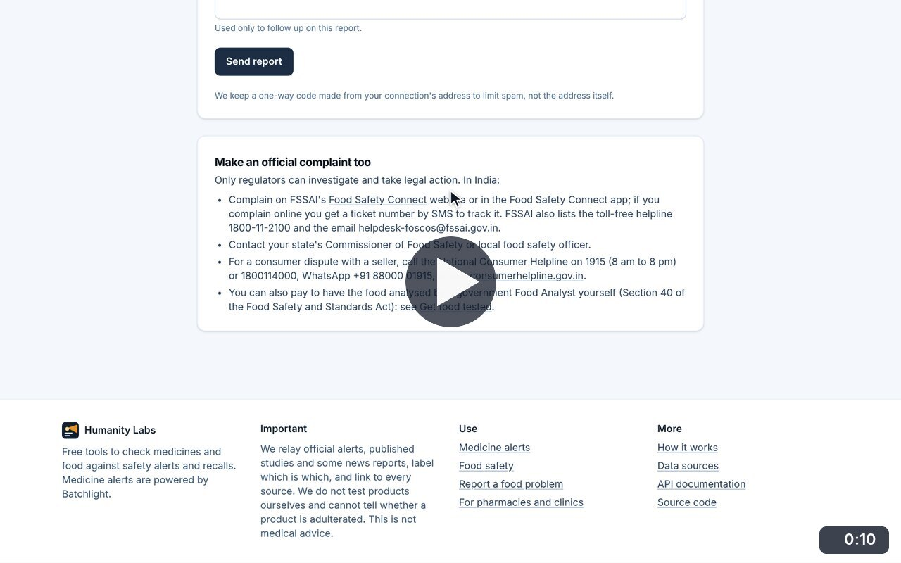</a>
 <b>Official complaint routes</b> · 0:10 
Below the form: how to complain to FSSAI, the state food safety commissioner and the National Consumer Helpline, and how to have food analysed by a government Food Analyst.
</td>
</tr>
</table>

### Get food tested

How to have a sample tested properly in India, sourced facts on testing, and a finder for labs checked by the team. [Feature folder](assets/user-facing-features/food-safety/food-testing/README.md) · `/food/testing`

<table>
<tr>
<td width="50%" valign="top">
<a href="assets/user-facing-features/food-safety/food-testing/recordings/01-how-to-get-food-tested.mp4">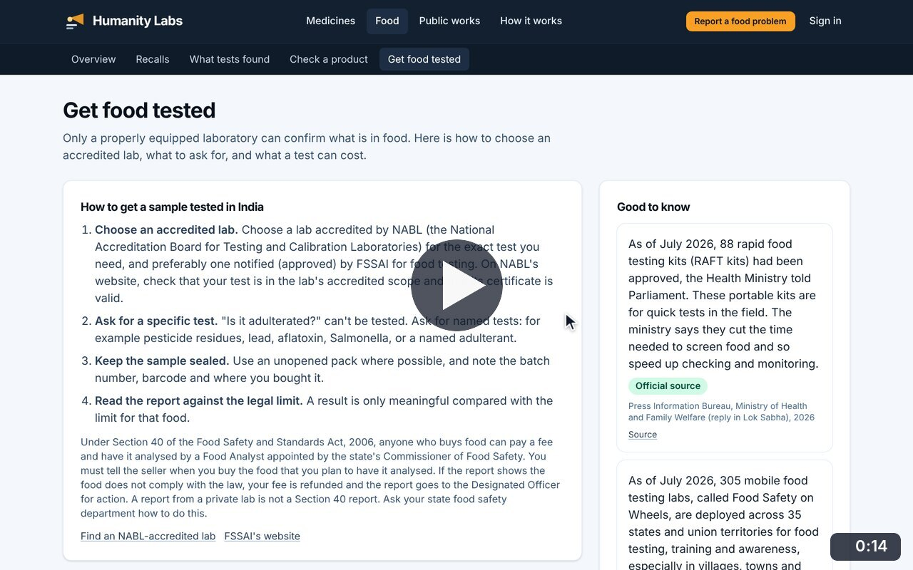</a>
 <b>How to get food tested</b> · 0:14 
The four steps to a meaningful test in India, Section 40 of the Food Safety and Standards Act, and sourced facts on rapid kits, mobile labs and costs.
</td>
<td width="50%" valign="top">
<a href="assets/user-facing-features/food-safety/food-testing/recordings/02-find-a-lab.mp4">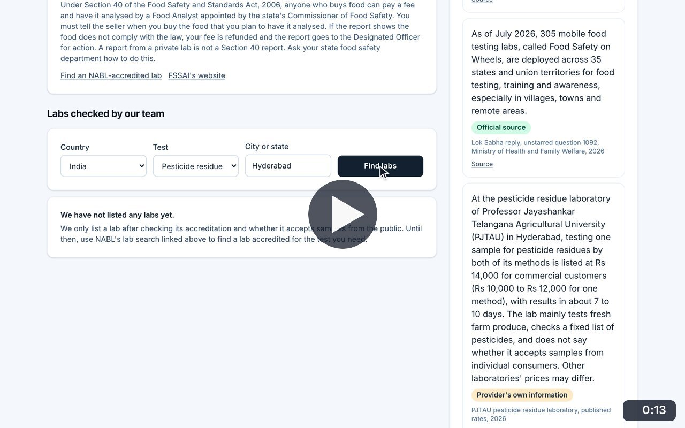</a>
 <b>Find a lab</b> · 0:13 
Use the lab finder for pesticide testing in Hyderabad. No lab has been checked and listed yet, so the page says so and points to NABL&#x27;s own search.
</td>
</tr>
</table>

---

## 2. Medicine Safety

Batchlight checks medicine batches against safety alerts from the US FDA, the UK MHRA, Health Canada and the WHO, plus a few Indian alerts added by the team. Anyone can check a batch; pharmacies, clinics and families can also watch their stock and be told when a new alert matches it. In the app: `/medicines`, `/check`, `/alerts`, `/manufacturers`, `/impact` and the `/app` workspace.

### Medicine Safety overview

Check a batch without an account, see the coverage counters, the latest serious alerts and how the workspace helps pharmacies, clinics and families. [Feature folder](assets/user-facing-features/medicine-safety/overview/README.md) · `/medicines`

<table>
<tr>
<td width="50%" valign="top">
<a href="assets/user-facing-features/medicine-safety/overview/recordings/01-medicine-safety-overview.mp4">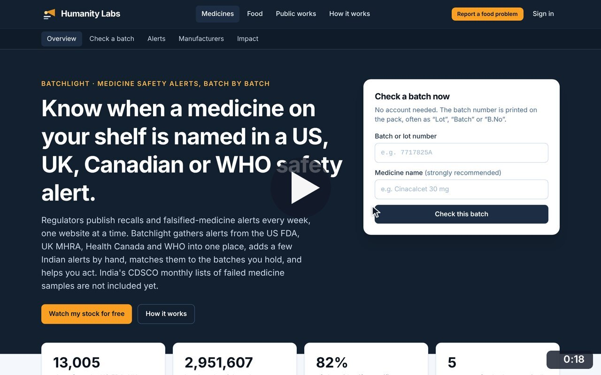</a>
 <b>Medicine Safety overview</b> · 0:18 
The batch check, the coverage counters, the latest serious alerts, why this matters in India, the three steps for pharmacies and families, and the sources.
</td>
<td width="50%"></td>
</tr>
</table>

### Batch check

Type a batch number and medicine name to see whether any alert lists the batch, mentions a similar product, or nothing was found. [Feature folder](assets/user-facing-features/medicine-safety/batch-check/README.md) · `/check`

<table>
<tr>
<td width="50%" valign="top">
<a href="assets/user-facing-features/medicine-safety/batch-check/recordings/01-batch-listed-in-an-alert.mp4">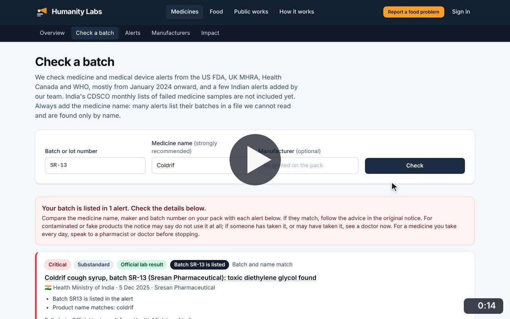</a>
 <b>A batch listed in an alert</b> · 0:14 
Check batch SR-13 of Coldrif: the batch is listed in an official test result, the result explains why it matched, and the alert opens.
</td>
<td width="50%" valign="top">
<a href="assets/user-facing-features/medicine-safety/batch-check/recordings/02-similar-name-without-the-batch.mp4">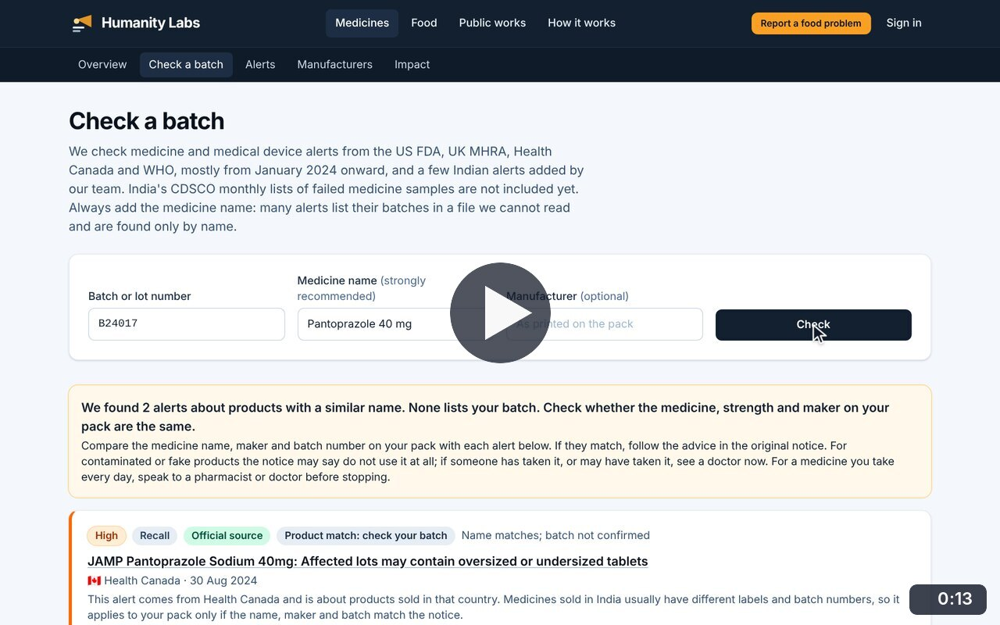</a>
 <b>A similar name, but not the batch</b> · 0:13 
Check batch B24017 of Pantoprazole 40 mg: alerts mention a similar product but not the batch, so the result asks the user to compare medicine, strength and maker.
</td>
</tr>
<tr>
<td width="50%" valign="top">
<a href="assets/user-facing-features/medicine-safety/batch-check/recordings/03-no-alert-found.mp4">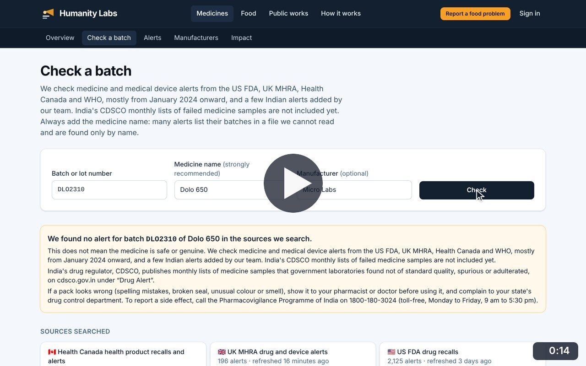</a>
 <b>No alert found</b> · 0:14 
Check batch DLO2310 of Dolo 650: no alert names it, the result says exactly which sources were searched, and that &quot;no alert found&quot; does not prove a medicine is genuine.
</td>
<td width="50%"></td>
</tr>
</table>

### Browse and filter alerts

All medicine and medical device alerts, newest first, with search and filters for source, severity and type. [Feature folder](assets/user-facing-features/medicine-safety/alerts/README.md) · `/alerts`

<table>
<tr>
<td width="50%" valign="top">
<a href="assets/user-facing-features/medicine-safety/alerts/recordings/01-browse-and-filter-alerts.mp4">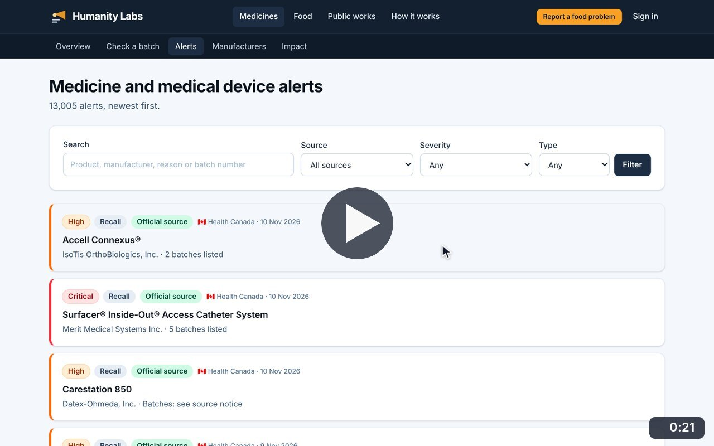</a>
 <b>Browse and filter alerts</b> · 0:21 
Scroll the newest alerts, then filter to WHO alerts and narrow to falsified medicines, and open the explanation of the labels.
</td>
<td width="50%" valign="top">
<a href="assets/user-facing-features/medicine-safety/alerts/recordings/02-search-alerts-and-browse-pages.mp4">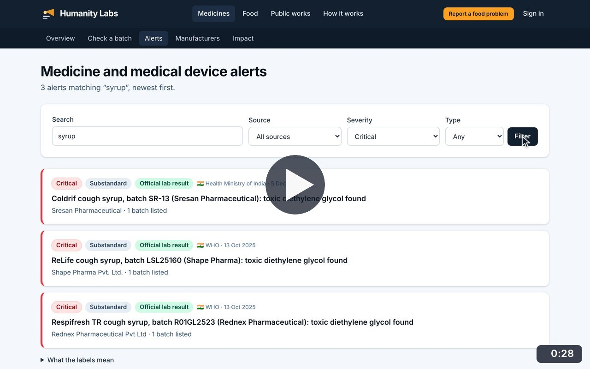</a>
 <b>Search alerts and browse pages</b> · 0:28 
Search for &quot;syrup&quot;, narrow to critical alerts to find the contaminated cough syrups reported in India, then page through all alerts.
</td>
</tr>
</table>

### Alert details

One alert in full: labels, advice for patients and pharmacies, affected batches, the reason and a link to the official notice. [Feature folder](assets/user-facing-features/medicine-safety/alert-details/README.md) · `/alerts/{id}`

<table>
<tr>
<td width="50%" valign="top">
<a href="assets/user-facing-features/medicine-safety/alert-details/recordings/01-read-an-alert.mp4">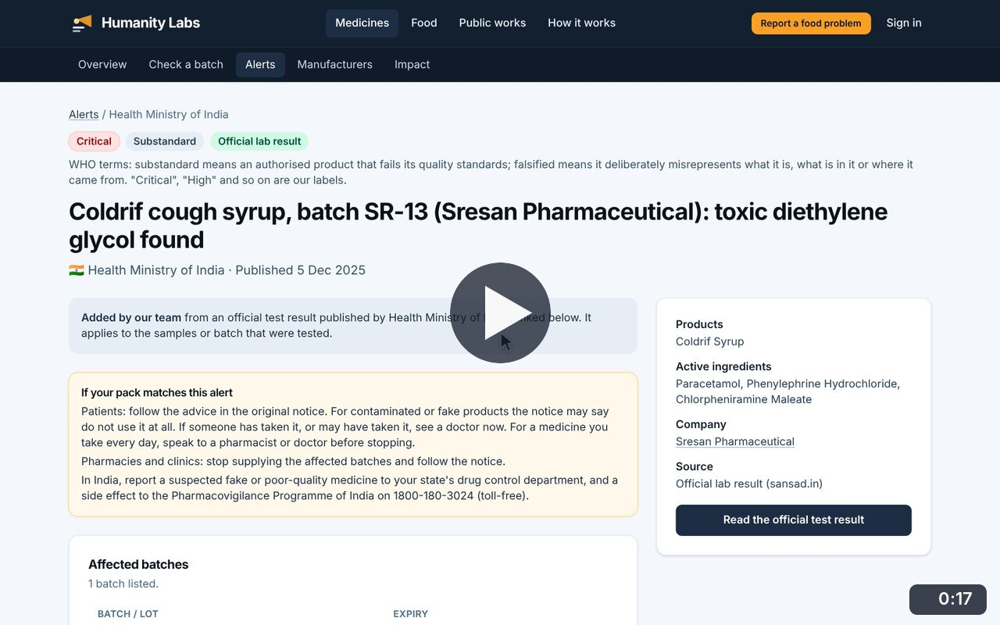</a>
 <b>Read an alert</b> · 0:17 
Open the Coldrif alert: its labels, advice for patients and pharmacies, the affected batch with expiry, the reason, and the links to the official test result and the manufacturer.
</td>
<td width="50%" valign="top">
<a href="assets/user-facing-features/medicine-safety/alert-details/recordings/02-who-falsified-medicine-alert.mp4">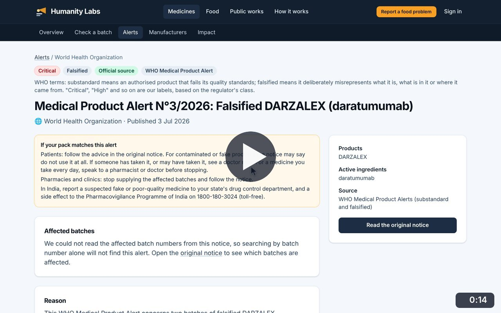</a>
 <b>A WHO falsified-medicine alert</b> · 0:14 
Open a WHO Medical Product Alert about falsified DARZALEX. Batch numbers could not be read from the notice, so the page says so and points to the original.
</td>
</tr>
</table>

### Manufacturer histories

Companies named in alerts, with counts of alerts and critical alerts, and each company's full alert history. [Feature folder](assets/user-facing-features/medicine-safety/manufacturer-histories/README.md) · `/manufacturers`, `/manufacturers/{slug}`

<table>
<tr>
<td width="50%" valign="top">
<a href="assets/user-facing-features/medicine-safety/manufacturer-histories/recordings/01-manufacturer-alert-histories.mp4">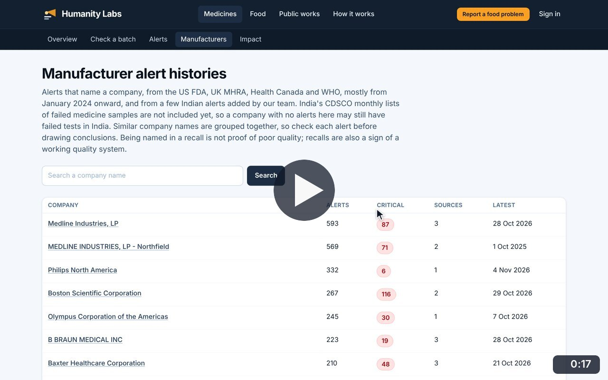</a>
 <b>Manufacturer alert histories</b> · 0:17 
Read the company table, search for Sun Pharmaceutical, open its history across sources and then one of its alerts.
</td>
<td width="50%"></td>
</tr>
</table>

### Impact

Live figures on action taken on affected stock, alert coverage and speed, reach, food safety activity, and alerts by source and severity. [Feature folder](assets/user-facing-features/medicine-safety/impact/README.md) · `/impact`

<table>
<tr>
<td width="50%" valign="top">
<a href="assets/user-facing-features/medicine-safety/impact/recordings/01-impact-figures.mp4">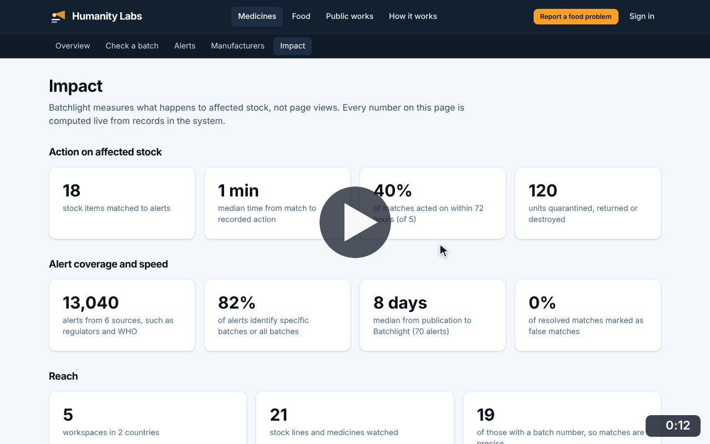</a>
 <b>Impact figures</b> · 0:12 
Every figure is computed live from records: action taken on affected stock, alert coverage and speed, reach, food safety activity, and alerts by source and severity.
</td>
<td width="50%"></td>
</tr>
</table>

### Accounts and sign-in

Create a free workspace, sign out and in, reset a forgotten password, and join a workspace from an invitation. [Feature folder](assets/user-facing-features/medicine-safety/accounts/README.md) · `/signup`, `/login`, `/forgot-password`, `/reset-password/{token}`, `/invite/{token}`

<table>
<tr>
<td width="50%" valign="top">
<a href="assets/user-facing-features/medicine-safety/accounts/recordings/01-create-a-free-workspace.mp4">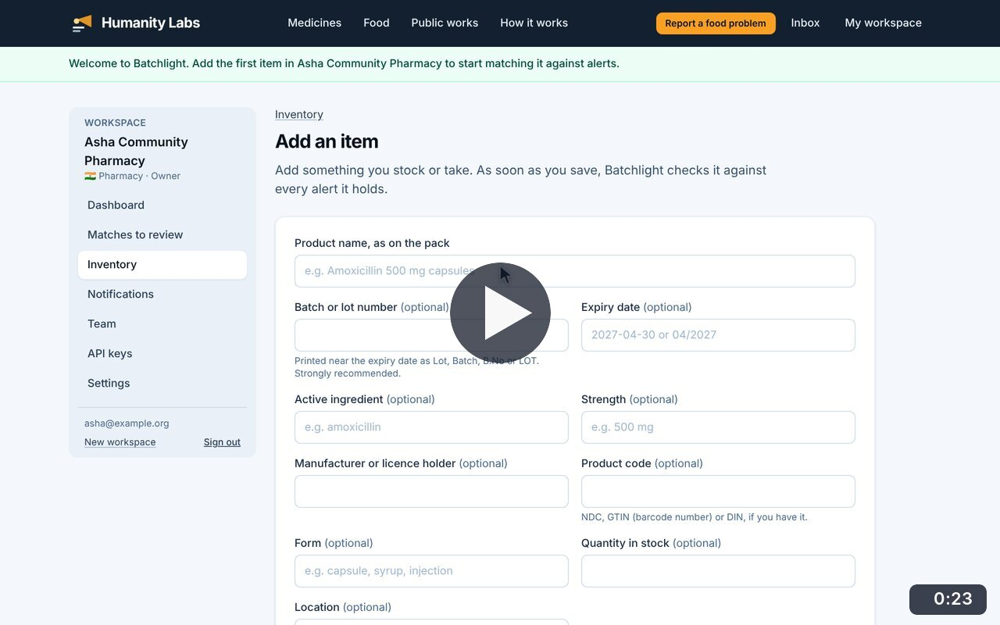</a>
 <b>Create a free workspace</b> · 0:23 
Sign up as a pharmacy in India. A password that is too short is caught; with a longer one the workspace is created and the first item can be added.
</td>
<td width="50%" valign="top">
<a href="assets/user-facing-features/medicine-safety/accounts/recordings/02-accept-a-team-invitation.mp4">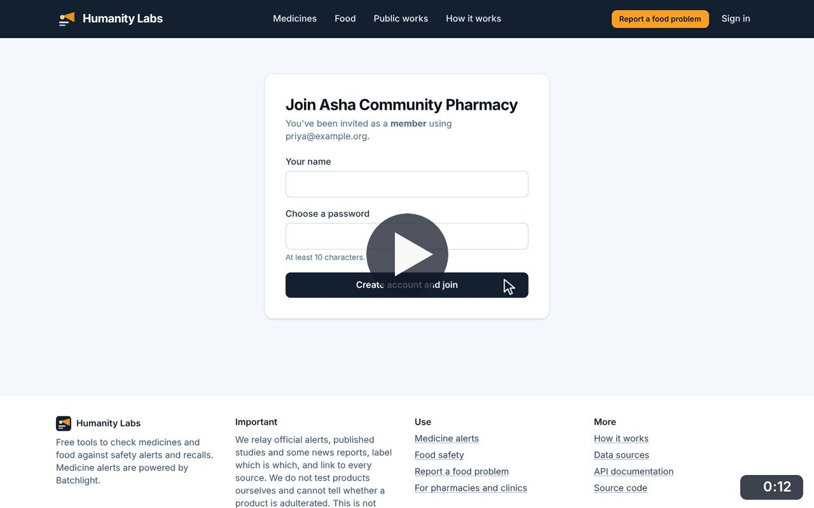</a>
 <b>Accept a team invitation</b> · 0:12 
Open the invitation link, create an account for the invited address and join the pharmacy&#x27;s workspace as a member.
</td>
</tr>
<tr>
<td width="50%" valign="top">
<a href="assets/user-facing-features/medicine-safety/accounts/recordings/03-sign-out-and-sign-in.mp4">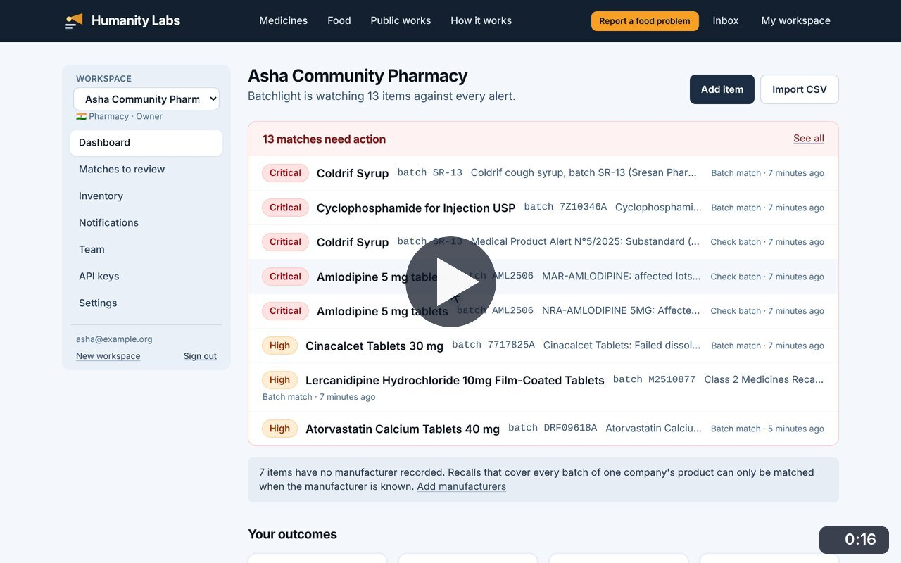</a>
 <b>Sign out and sign in</b> · 0:16 
Sign out from the workspace, then sign back in with email and password.
</td>
<td width="50%" valign="top">
<a href="assets/user-facing-features/medicine-safety/accounts/recordings/04-reset-a-forgotten-password.mp4">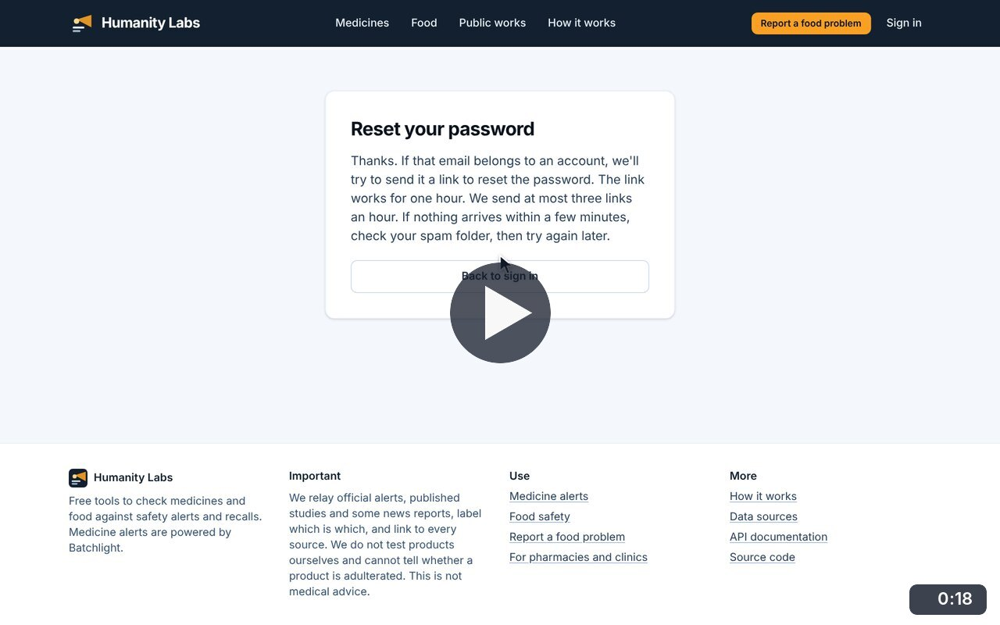</a>
 <b>Reset a forgotten password</b> · 0:18 
Ask for a reset link: the page answers the same way whether or not the address has an account. The link arrives by email; opening it lets the user choose a new password.
</td>
</tr>
</table>

### Workspace dashboard

What the workspace is watching, the matches that need action, outcomes recorded so far and the sources watching the stock. [Feature folder](assets/user-facing-features/medicine-safety/workspace-dashboard/README.md) · `/app`

<table>
<tr>
<td width="50%" valign="top">
<a href="assets/user-facing-features/medicine-safety/workspace-dashboard/recordings/01-workspace-dashboard.mp4">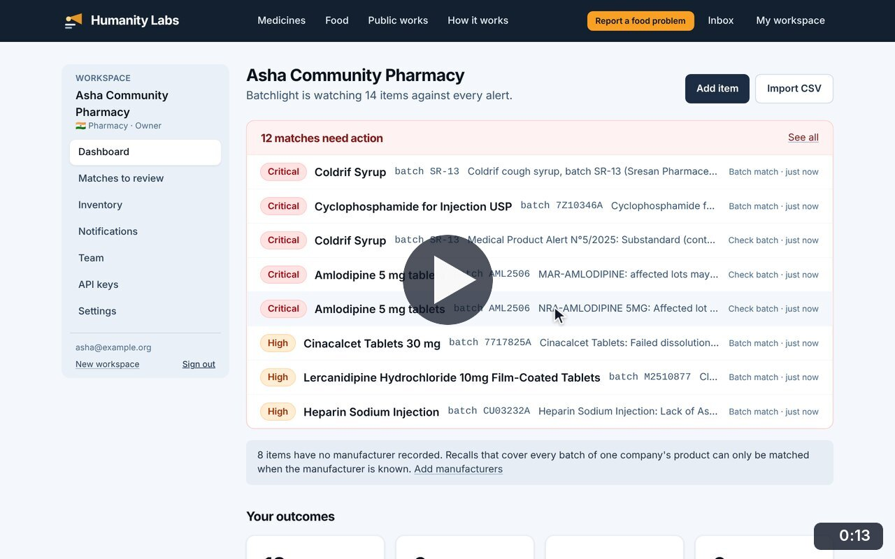</a>
 <b>Workspace dashboard</b> · 0:13 
What the workspace is watching, the matches that need action (most severe first), the outcomes recorded so far, and the sources watching the stock.
</td>
<td width="50%"></td>
</tr>
</table>

### Inventory

List stock with batch, expiry and quantity; add, search, edit and remove items; export the list as CSV. Each item shows whether alerts may affect it. [Feature folder](assets/user-facing-features/medicine-safety/inventory/README.md) · `/app/inventory`, `/app/inventory/new`, `/app/inventory/{id}/edit`

<table>
<tr>
<td width="50%" valign="top">
<a href="assets/user-facing-features/medicine-safety/inventory/recordings/01-add-an-item.mp4">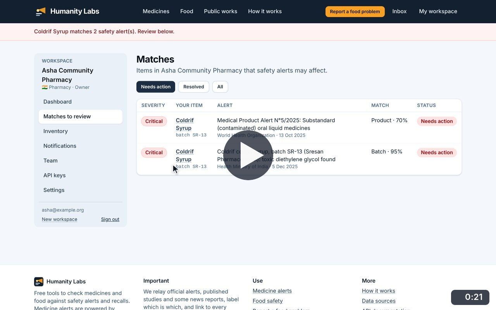</a>
 <b>Add an item</b> · 0:21 
Add Coldrif cough syrup, batch SR-13, by hand. On saving, Batchlight checks it against every alert at once and reports the matches.
</td>
<td width="50%" valign="top">
<a href="assets/user-facing-features/medicine-safety/inventory/recordings/02-search-edit-and-remove-items.mp4">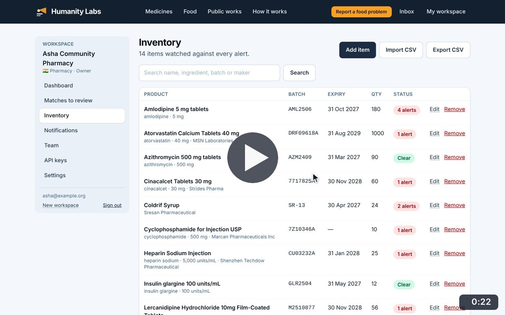</a>
 <b>Search, edit and remove items</b> · 0:22 
Search the stock, edit an item&#x27;s quantity, then remove an item from the list after confirming. The list shows each item&#x27;s status: clear, or how many alerts may affect it.
</td>
</tr>
</table>

### Import from a spreadsheet

Upload a CSV exported from a pharmacy system; common column names are recognised and every row is checked against every alert at once. [Feature folder](assets/user-facing-features/medicine-safety/inventory-import/README.md) · `/app/inventory/import`

<table>
<tr>
<td width="50%" valign="top">
<a href="assets/user-facing-features/medicine-safety/inventory-import/recordings/01-import-stock-from-a-spreadsheet.mp4">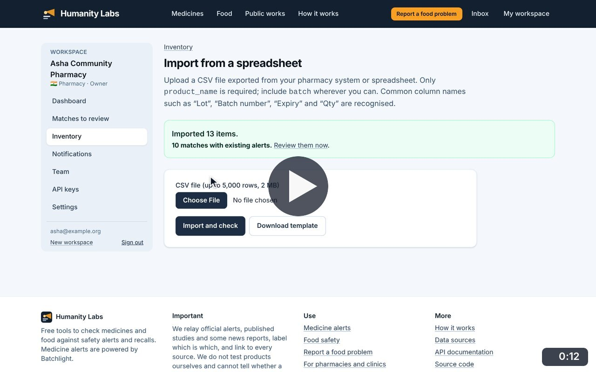</a>
 <b>Import stock from a spreadsheet</b> · 0:12 
Choose a CSV of the pharmacy&#x27;s stock and import it. Every row is checked against every alert; the summary links straight to the matches.
</td>
<td width="50%"></td>
</tr>
</table>

### Matches

Stock items that alerts may affect: why each matched, what to do, recording the outcome, and reopening a resolved match. [Feature folder](assets/user-facing-features/medicine-safety/matches/README.md) · `/app/matches`, `/app/matches/{id}`

<table>
<tr>
<td width="50%" valign="top">
<a href="assets/user-facing-features/medicine-safety/matches/recordings/01-review-a-match-and-record-the-outcome.mp4">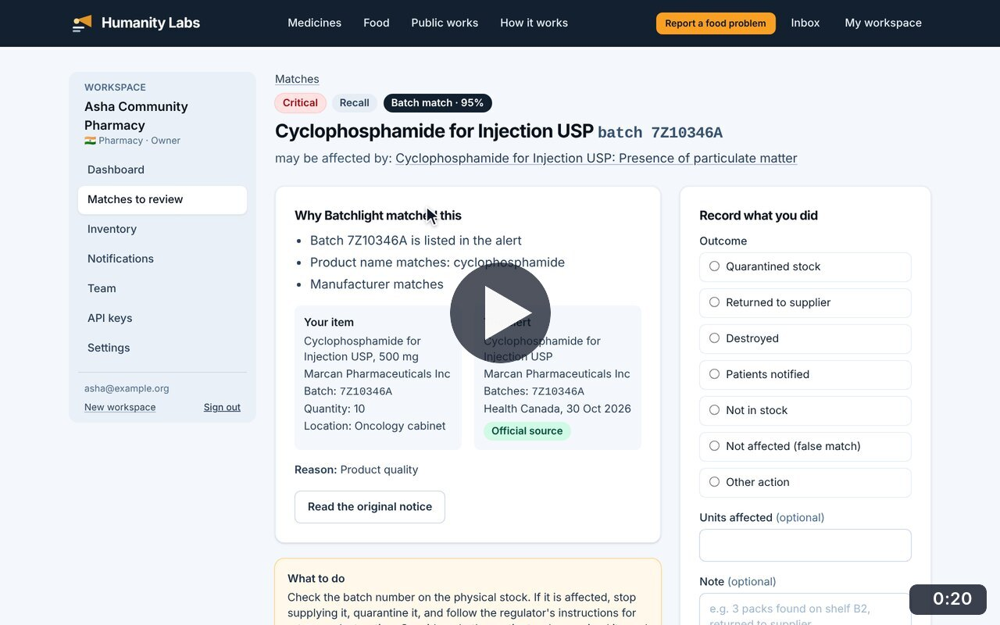</a>
 <b>Review a match and record the outcome</b> · 0:20 
Open the cyclophosphamide match: why it matched (batch, name and maker), the stock record beside the alert and what to do. Record that the stock was quarantined, with units and a note.
</td>
<td width="50%" valign="top">
<a href="assets/user-facing-features/medicine-safety/matches/recordings/02-filter-matches-and-reopen-one.mp4">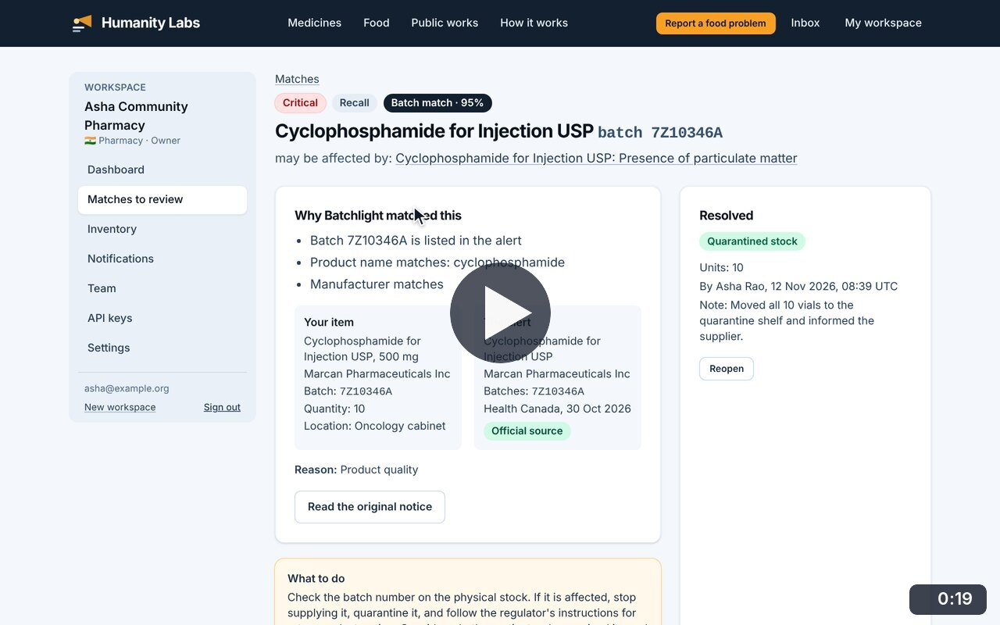</a>
 <b>Filter matches and reopen one</b> · 0:19 
Switch between matches that need action, resolved and all; open the resolved match to see who recorded what and when, and reopen it.
</td>
</tr>
</table>

### Notifications

When a newly published alert matches something in stock, everyone in the workspace is notified in the app (and by an email digest if switched on). [Feature folder](assets/user-facing-features/medicine-safety/notifications/README.md) · `/app/notifications`

<table>
<tr>
<td width="50%" valign="top">
<a href="assets/user-facing-features/medicine-safety/notifications/recordings/01-new-alert-matches-your-stock.mp4">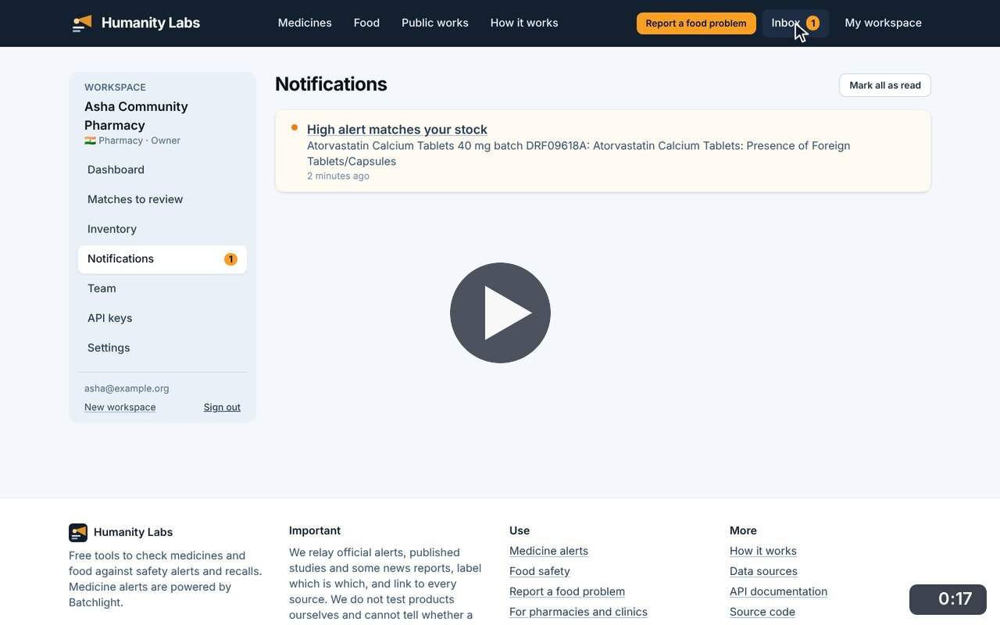</a>
 <b>A new alert matches your stock</b> · 0:17 
After the US FDA source refreshed, a newly published recall of atorvastatin batch DRF09618A matched the pharmacy&#x27;s stock. The inbox badge shows it; mark it as read, then open the match it points to.
</td>
<td width="50%"></td>
</tr>
</table>

### Team and invitations

Invite colleagues as owner, manager or member, see pending invitations, change roles and revoke invitations. [Feature folder](assets/user-facing-features/medicine-safety/team/README.md) · `/app/team`

<table>
<tr>
<td width="50%" valign="top">
<a href="assets/user-facing-features/medicine-safety/team/recordings/01-invite-colleagues.mp4">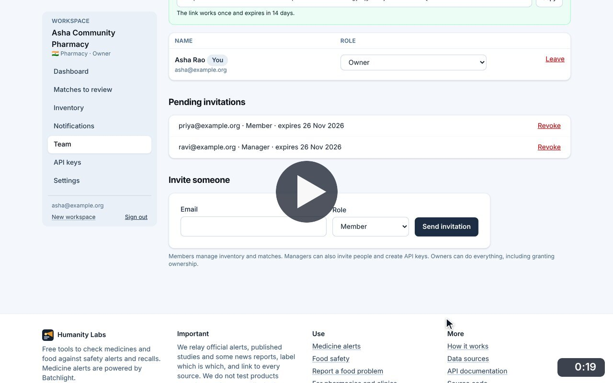</a>
 <b>Invite colleagues</b> · 0:19 
Invite a pharmacist as a member and a colleague as a manager. Each invitation gets a single-use link, also sent by email, and appears under pending invitations.
</td>
<td width="50%" valign="top">
<a href="assets/user-facing-features/medicine-safety/team/recordings/02-change-roles-and-revoke-an-invitation.mp4">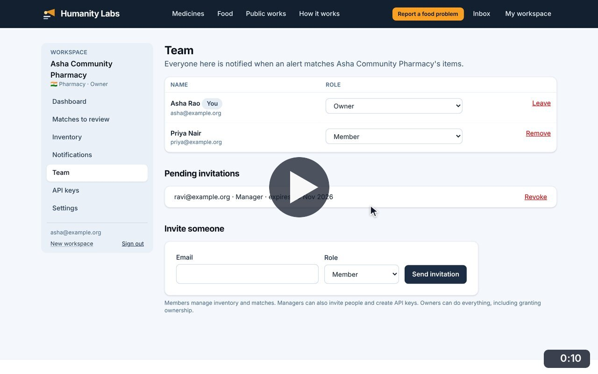</a>
 <b>Change roles and revoke an invitation</b> · 0:10 
The new member now appears in the team. Make her a manager, then revoke the invitation that is still pending.
</td>
</tr>
<tr>
<td width="50%" valign="top">
<a href="assets/user-facing-features/medicine-safety/team/recordings/03-remove-a-member.mp4">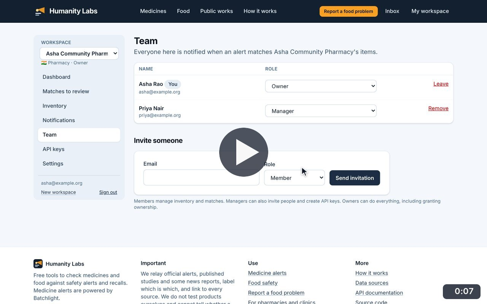</a>
 <b>Remove a member</b> · 0:07 
Remove a member from the workspace after confirming; she loses access to its stock and matches straight away.
</td>
<td width="50%"></td>
</tr>
</table>

### Settings

Workspace name, type, country and email digest, the user's profile and password. [Feature folder](assets/user-facing-features/medicine-safety/settings/README.md) · `/app/settings`

<table>
<tr>
<td width="50%" valign="top">
<a href="assets/user-facing-features/medicine-safety/settings/recordings/01-workspace-profile-and-password.mp4">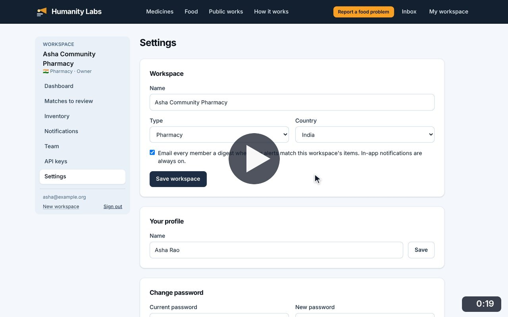</a>
 <b>Workspace, profile and password settings</b> · 0:19 
Turn the email digest off and save, turn it back on, then change the password.
</td>
<td width="50%"></td>
</tr>
</table>

### Multiple workspaces

Create another workspace, for example a household alongside a pharmacy, and switch between them. [Feature folder](assets/user-facing-features/medicine-safety/multiple-workspaces/README.md) · `/app/workspaces/new`

<table>
<tr>
<td width="50%" valign="top">
<a href="assets/user-facing-features/medicine-safety/multiple-workspaces/recordings/01-create-and-switch-workspaces.mp4">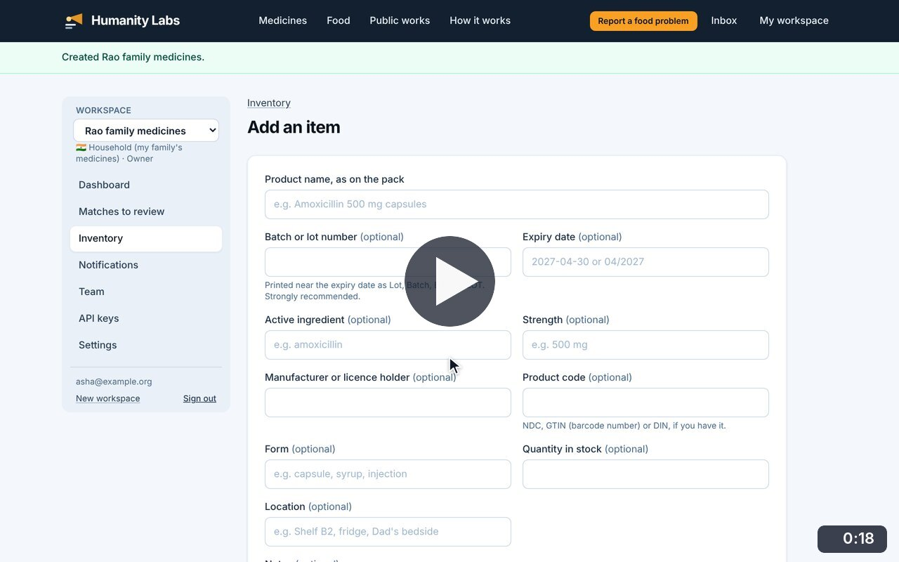</a>
 <b>Create and switch workspaces</b> · 0:18 
Create a second workspace for the family&#x27;s own medicines, then switch back to the pharmacy from the workspace menu.
</td>
<td width="50%"></td>
</tr>
</table>

### API keys

Create a key so a pharmacy system can sync stock and pull matches automatically; the full key is shown once, and keys can be revoked. [Feature folder](assets/user-facing-features/medicine-safety/api-keys/README.md) · `/app/api-keys`

<table>
<tr>
<td width="50%" valign="top">
<a href="assets/user-facing-features/medicine-safety/api-keys/recordings/01-create-and-revoke-an-api-key.mp4">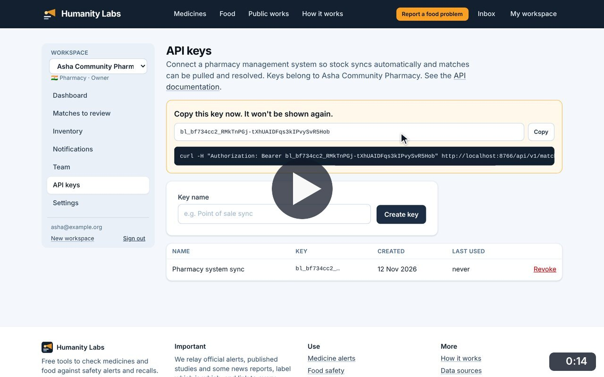</a>
 <b>Create and revoke an API key</b> · 0:14 
Create a key for the pharmacy system. The full key is shown once, to copy into that system; the list keeps only its start. Revoking it, after confirming, stops it working.
</td>
<td width="50%"></td>
</tr>
</table>

### API documentation

Interactive documentation for the public alerts API and the workspace API, with live requests. [Feature folder](assets/user-facing-features/medicine-safety/api-documentation/README.md) · `/api/docs`

<table>
<tr>
<td width="50%" valign="top">
<a href="assets/user-facing-features/medicine-safety/api-documentation/recordings/01-try-the-api.mp4">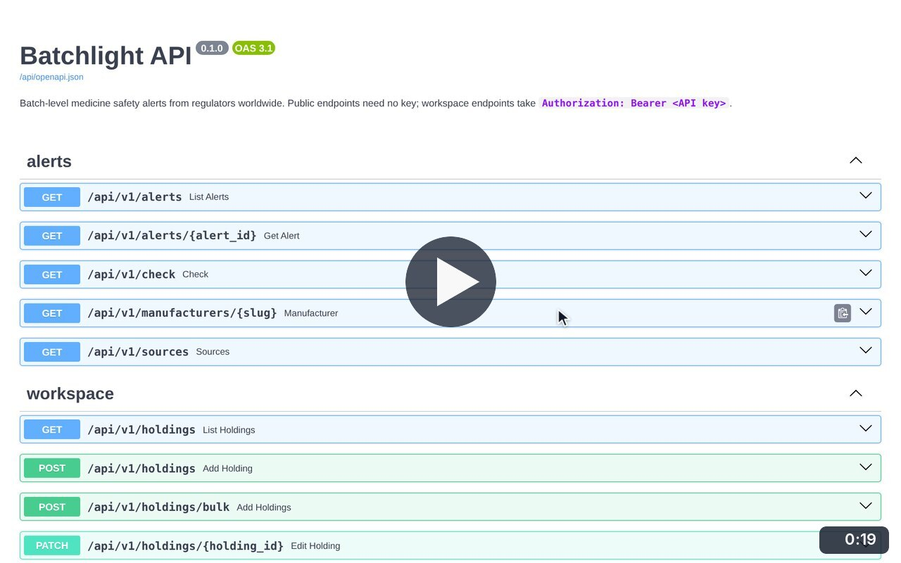</a>
 <b>Try the API</b> · 0:19 
Open the interactive API documentation, expand the batch check endpoint, try it with batch SR-13 of Coldrif and read the live JSON response.
</td>
<td width="50%"></td>
</tr>
</table>

---

## 3. Infrastructure Transparency

Look up a public works project in India and read its Project Passport: who approved and funded it, who won the contract, the price and the dates, each answer linked to the official record. When a record is not published, the passport says so instead of guessing. In the app: `/infrastructure` ("Public works" in the menu).

### Public works overview

Search public works, see what the data covers today, and browse every state and union territory. [Feature folder](assets/user-facing-features/infrastructure-transparency/overview/README.md) · `/infrastructure`

<table>
<tr>
<td width="50%" valign="top">
<a href="assets/user-facing-features/infrastructure-transparency/overview/recordings/01-public-works-overview.mp4">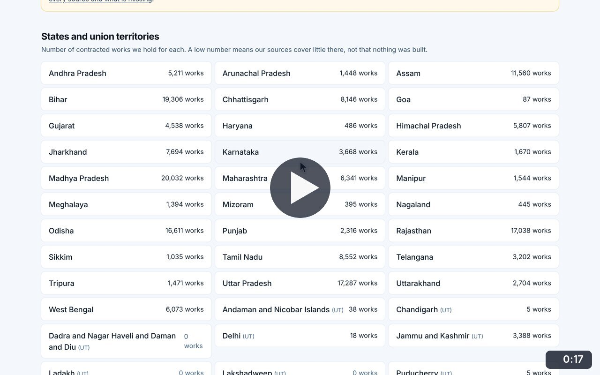</a>
 <b>Public works overview</b> · 0:17 
The search, the coverage counters, what the data covers today, and the grid of states and union territories with the number of works held for each.
</td>
<td width="50%"></td>
</tr>
</table>

### Project search

Search by project, place, contractor or tender number and filter by state, type of work and kind of record. [Feature folder](assets/user-facing-features/infrastructure-transparency/project-search/README.md) · `/infrastructure/projects`

<table>
<tr>
<td width="50%" valign="top">
<a href="assets/user-facing-features/infrastructure-transparency/project-search/recordings/01-search-public-works.mp4">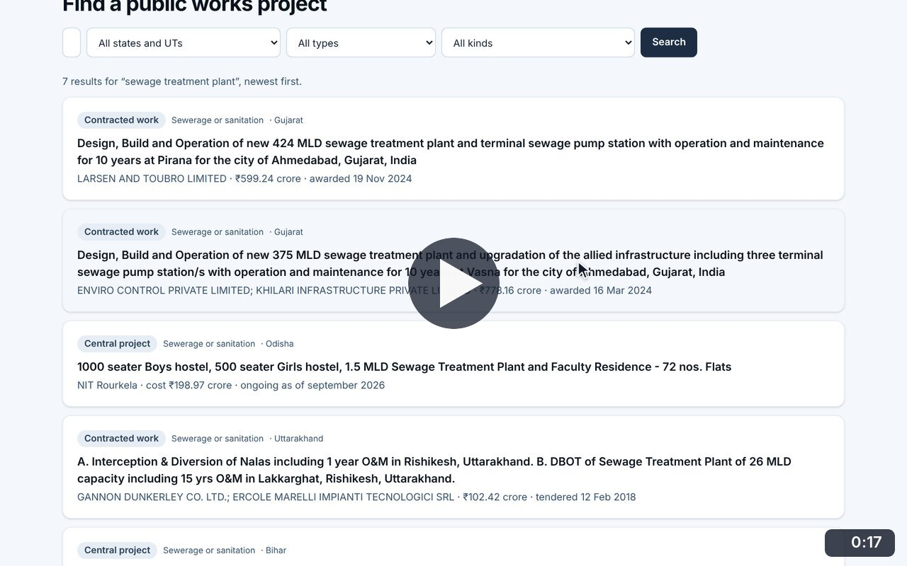</a>
 <b>Search public works</b> · 0:17 
Search for &quot;sewage treatment plant&quot; from the overview: World Bank contracts and central projects appear with contractor, price and dates, and the first passport opens.
</td>
<td width="50%" valign="top">
<a href="assets/user-facing-features/infrastructure-transparency/project-search/recordings/02-filter-by-state-type-and-kind.mp4">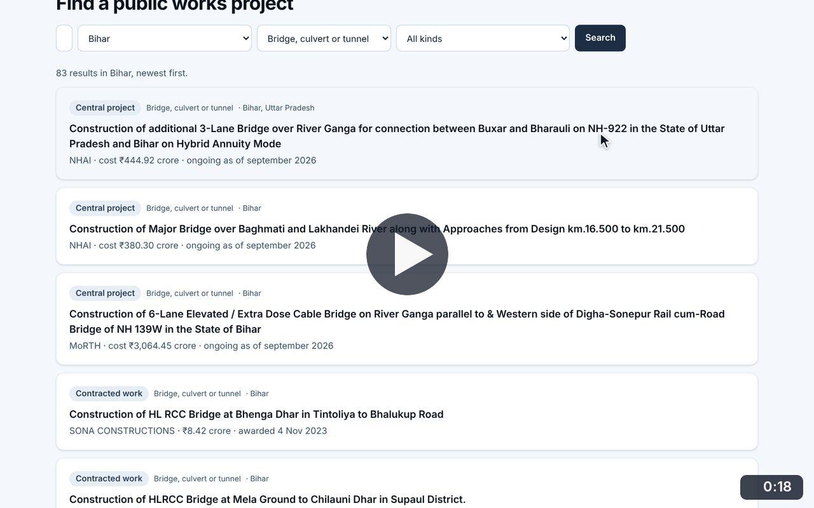</a>
 <b>Filter by state, type of work and kind of record</b> · 0:18 
From the Bihar page, search its projects, narrow to bridges, culverts and tunnels, then to central projects only.
</td>
</tr>
</table>

### Project Passport

One page per project or programme answering plain questions, each labelled and linked to its source, with what is not published, who is involved, the history and audit reports. [Feature folder](assets/user-facing-features/infrastructure-transparency/project-passport/README.md) · `/infrastructure/projects/{id}`

<table>
<tr>
<td width="50%" valign="top">
<a href="assets/user-facing-features/infrastructure-transparency/project-passport/recordings/01-read-a-project-passport.mp4">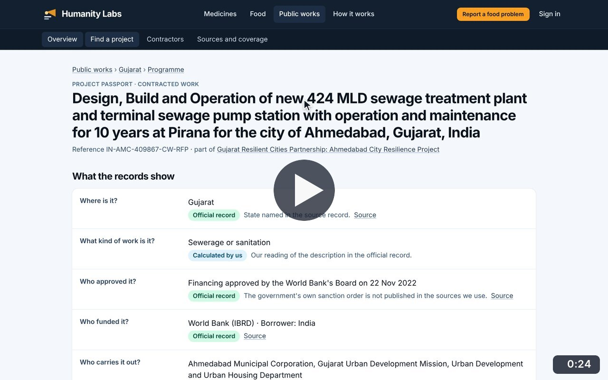</a>
 <b>Read a Project Passport</b> · 0:24 
Open the passport of a sewage treatment contract in Ahmedabad: every answer is labelled and linked to its source; then what is not published, who is involved, the history and what the labels mean.
</td>
<td width="50%" valign="top">
<a href="assets/user-facing-features/infrastructure-transparency/project-passport/recordings/02-cost-and-delay-of-a-central-project.mp4">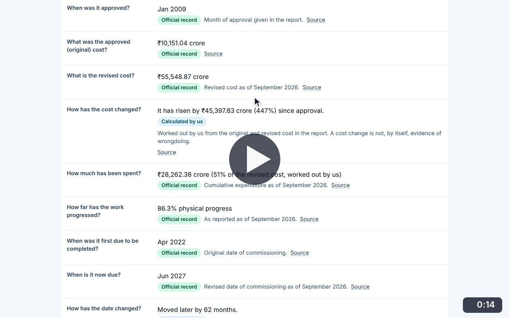</a>
 <b>Cost and delay of a central project</b> · 0:14 
From the Andhra Pradesh page, open the Polavaram Irrigation Project: approved and revised cost, the increase worked out from them, money spent, progress and the change in completion date.
</td>
</tr>
<tr>
<td width="50%" valign="top">
<a href="assets/user-facing-features/infrastructure-transparency/project-passport/recordings/03-from-a-programme-to-its-contracts.mp4">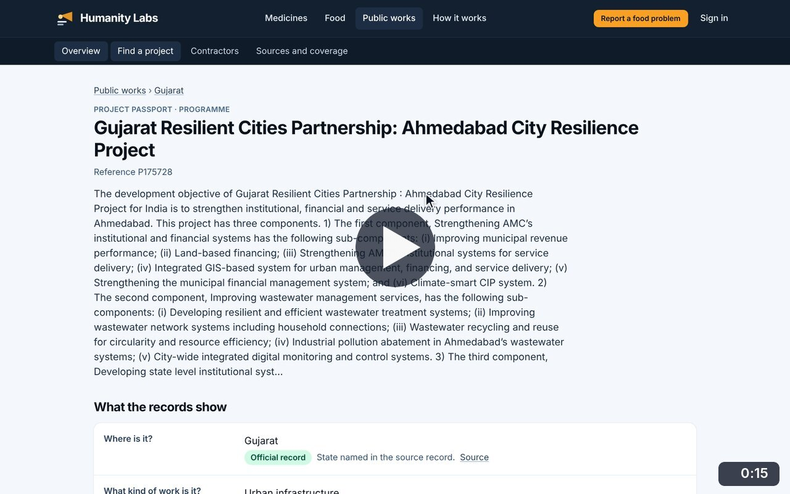</a>
 <b>From a programme to its contracts</b> · 0:15 
From a contract&#x27;s passport, open the World Bank programme it belongs to and the list of contracted works in that programme, then open another contract.
</td>
<td width="50%"></td>
</tr>
</table>

### State pages

Public works in one state: works by type, what is missing for that state, and its largest ongoing central projects. [Feature folder](assets/user-facing-features/infrastructure-transparency/state-pages/README.md) · `/infrastructure/states/{slug}`

<table>
<tr>
<td width="50%" valign="top">
<a href="assets/user-facing-features/infrastructure-transparency/state-pages/recordings/01-public-works-in-a-state.mp4">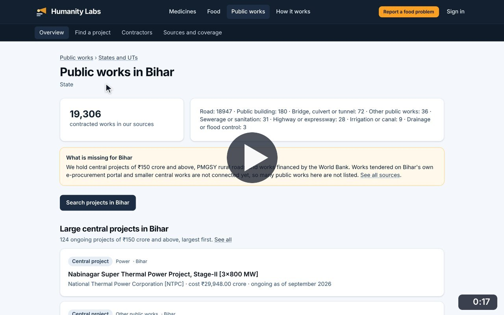</a>
 <b>Public works in a state</b> · 0:17 
From the states grid, open Bihar: the number of works by type, what is missing for Bihar, its largest ongoing central projects, and the full list of them.
</td>
<td width="50%"></td>
</tr>
</table>

### Contractors

Search contractors named in award records and read each name's profile and history, kept separate per source and state. [Feature folder](assets/user-facing-features/infrastructure-transparency/contractors/README.md) · `/infrastructure/contractors`, `/infrastructure/contractors/{id}`

<table>
<tr>
<td width="50%" valign="top">
<a href="assets/user-facing-features/infrastructure-transparency/contractors/recordings/01-search-contractors.mp4">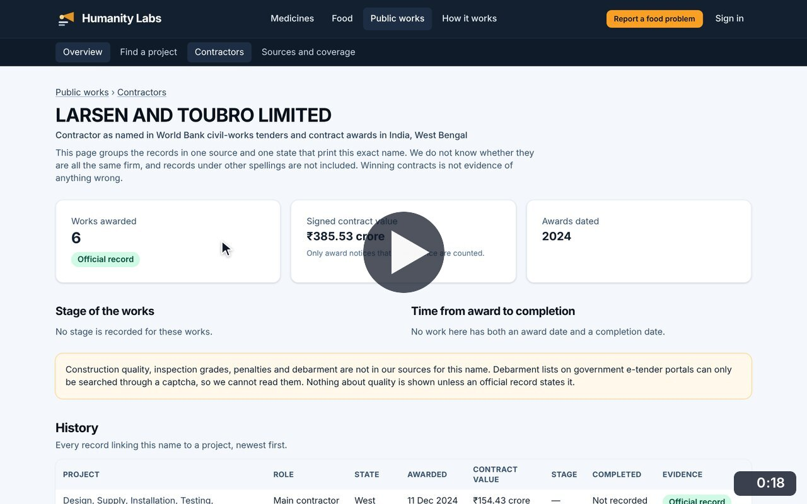</a>
 <b>Search contractors and read a profile</b> · 0:18 
Search for &quot;larsen&quot;: each printed name in each source and state is listed separately. Open one to see works awarded, signed contract value, history with evidence labels, and the same name in other records.
</td>
<td width="50%" valign="top">

 <b>Every work under a contractor name</b> · 0:24 
Open the name with the most works, BMS EXPENDITURE in PMGSY rural roads in Uttar Pradesh: 3,708 works, how long works took from award to completion, and its history. &quot;See all&quot; lists every project under that name, and one road&#x27;s passport opens.
</td>
</tr>
</table>

### Sources and coverage

Every connected source, the important sources checked but not connected yet, and what is rarely published anywhere. [Feature folder](assets/user-facing-features/infrastructure-transparency/sources-and-coverage/README.md) · `/infrastructure/sources`

<table>
<tr>
<td width="50%" valign="top">

 <b>Sources and coverage</b> · 0:13 
The connected sources with what each provides, record counts and refresh times; the important sources checked but not connected yet, and why; and what is rarely published anywhere.
</td>
<td width="50%"></td>
</tr>
</table>

---

## 4. Shared pages

Pages that serve all three products: the home page, the list of data sources and the explanation of how the service works. In the app: `/`, `/sources` and `/about`.

### Home page

Check a medicine batch or a food product straight from the home page, and see the latest serious alerts and what testing has found in everyday food in India. [Feature folder](assets/user-facing-features/shared/home/README.md) · `/`

<table>
<tr>
<td width="50%" valign="top">

 <b>Tour the home page</b> · 0:14 
Scroll from the two checks at the top through the latest serious food recalls and medicine alerts, what testing has found in India, and what the service does and does not do.
</td>
<td width="50%" valign="top">

 <b>Check a medicine and a food from the home page</b> · 0:23 
Check batch SR-13 of Coldrif cough syrup and find the alert that lists it, then return home and search food recalls for &quot;ghee&quot;.
</td>
</tr>
</table>

### Data sources

Every connected medicine and food source, how many alerts it holds and when it was last refreshed, with a plain note on what is not covered yet. [Feature folder](assets/user-facing-features/shared/data-sources/README.md) · `/sources`

<table>
<tr>
<td width="50%" valign="top">

 <b>Data sources and freshness</b> · 0:12 
Read what is not covered yet, then each medicine and food source with the number of alerts held and its last successful refresh, and the licences the data is used under.
</td>
<td width="50%"></td>
</tr>
</table>

### How it works

Where the data comes from, the evidence rules every alert follows, what the service does not do, and how privacy is handled. [Feature folder](assets/user-facing-features/shared/how-it-works/README.md) · `/about`

<table>
<tr>
<td width="50%" valign="top">

 <b>How it works</b> · 0:15 
Read how the medicine and food modules work, the evidence rules, what the service is not, and its privacy approach, then continue to Food Safety.
</td>
<td width="50%"></td>
</tr>
</table>

---

## 5. What was entered during the recordings

The alerts, recalls, test findings and public works records are as the app collected them from its sources; none was edited. Some features only exist for a signed-in user with a stock list, or respond to what a user types, so the following was entered through the app itself while recording:

- **A pharmacy workspace**, "Asha Community Pharmacy", with 14 stock lines: one typed in, 13 imported from a CSV file. Six lines carry batch numbers taken from real recalls (Coldrif SR-13, cinacalcet 7717825A, heparin CU03232A, lercanidipine M2510877, cyclophosphamide 7Z10346A and atorvastatin DRF09618A), so the matches shown are real matches against those alerts. A second workspace, "Rao family medicines", was created to show switching.
- **Team members and invitations** for addresses at example.org, one recorded outcome on a match, and an API key that was then revoked.
- **The notification.** The app's own ingestion of US FDA drug recalls was run during the recordings. It fetched a recall of atorvastatin batch DRF09618A, published on 4 November 2026, which matched the stock list and notified the workspace. That batch was put in the stock list because the recall had been seen in the source beforehand.
- **One food problem report.** Its text says it is a walkthrough recording, not a real report.
- **Example inputs.** The FSSAI licence numbers typed are examples in the correct format, not real licences. The batch numbers in the "similar name" and "no alert found" checks are examples; the barcode is from a real Canadian recall.
- **The Impact page** computes its figures from the database, which here holds the walkthrough workspaces and three demo workspaces made earlier during development. Its alert coverage figures are real; the figures on action taken, reach and food reports describe that test activity, not real use.

Everything was recorded against a private copy of the development database, so the original data was not changed. Emails (invitations, the password reset link and digests) were not sent: the app ran with its development email setting, which writes messages to its log, and the reset link was opened from there.

## 6. Not recorded

- **Curator tools** (`/admin`): for the team that adds alerts and reviews food reports, not for the public.
- **Email messages:** invitations, password reset links and alert digests arrive by email. The in-app side of each is recorded.
- **File downloads:** the CSV template and the stock export download a file, which a screen recording cannot show. The inventory recordings point to both buttons.
- **The phone layout:** all recordings use a desktop window (1280 × 800). On a phone the same pages work, with the menu folded behind a Menu button.

## 7. How the recordings were made

- **Real interactions.** Playwright drove Chromium against the running app. Every step is a real mouse move, click, key press, selection or file upload; pages scroll smoothly.
- **Video.** Chromium's screencast frames (a 1280 × 800 window at 1.5× density) were encoded by ffmpeg at a constant 30 fps as H.264 (CRF 28), giving sharp text at a small size. Headless Chromium shows no pointer, so a small pointer is drawn in the page; clicks show a brief ripple.
- **API documentation.** That page loads its interface from a public CDN that the recording machine could not reach, so the same package (swagger-ui-dist 5) was served from a local copy.
- **Review.** Each recording was checked frame by frame. Takes where a step failed were recorded again; one notification marked as read by a failed take was set back to unread first.
