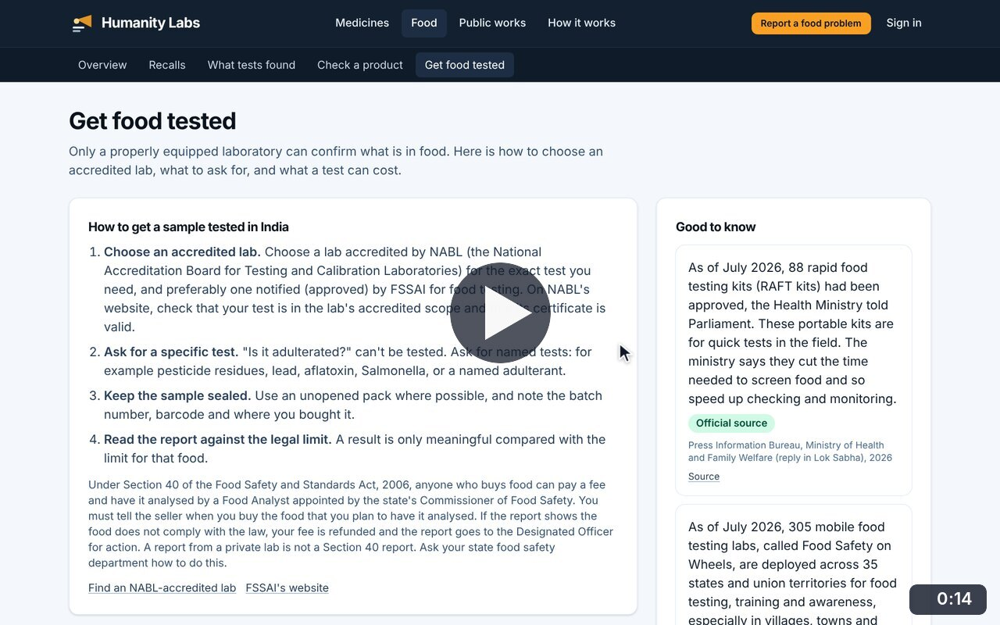
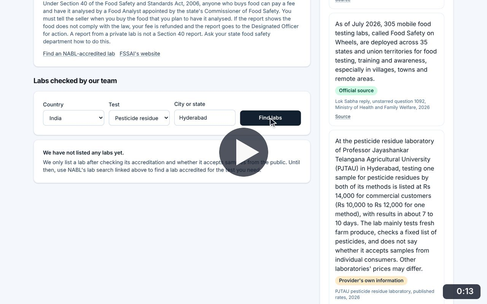
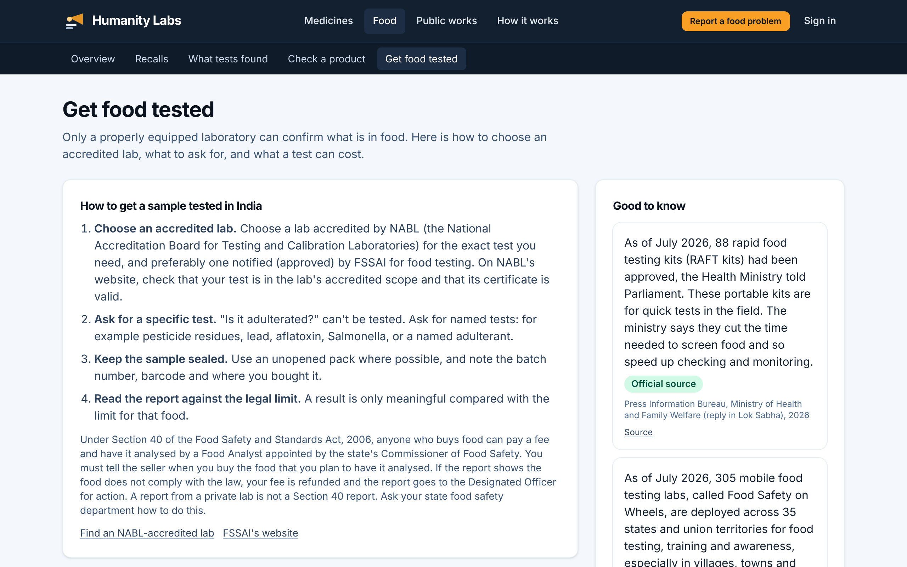

# Get food tested

**Food Safety** · In the app: `/food/testing`

How to have a sample tested properly in India, sourced facts on testing, and a finder for labs checked by the team.

## Recordings (2)

Click a thumbnail to open the video (MP4, 1920 × 1200, 30 fps).

<table>
<tr>
<td width="50%" valign="top">

 <b>How to get food tested</b> · 0:14 
The four steps to a meaningful test in India, Section 40 of the Food Safety and Standards Act, and sourced facts on rapid kits, mobile labs and costs.
</td>
<td width="50%" valign="top">

 <b>Find a lab</b> · 0:13 
Use the lab finder for pesticide testing in Hyderabad. No lab has been checked and listed yet, so the page says so and points to NABL&#x27;s own search.
</td>
</tr>
</table>

## Screenshots (1)

<table>
<tr>
<td width="50%" valign="top">

 <b>Get food tested</b> 
How to have a sample tested properly in India: choosing an accredited lab, asking for a specific test, and what a result means, with sourced facts on rapid test kits and mobile testing labs.
</td>
<td width="50%"></td>
</tr>
</table>

---

[All walkthroughs](../../../../USER_FACING_WALKTHROUGHS.md#get-food-tested) · [All screenshots](../../../../USER_FACING_FEATURES.md) · [All features](../../README.md)
