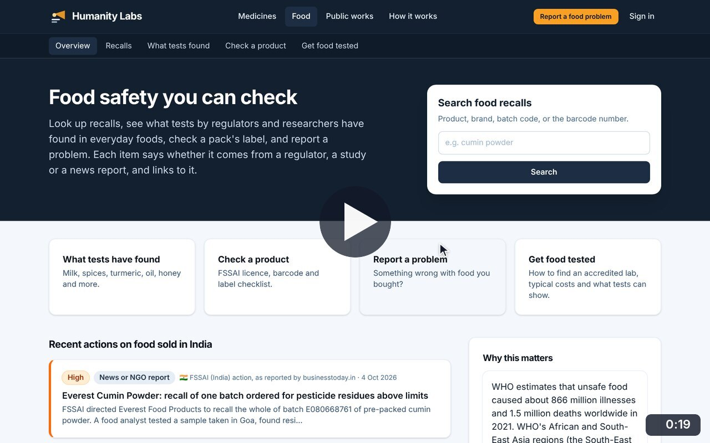
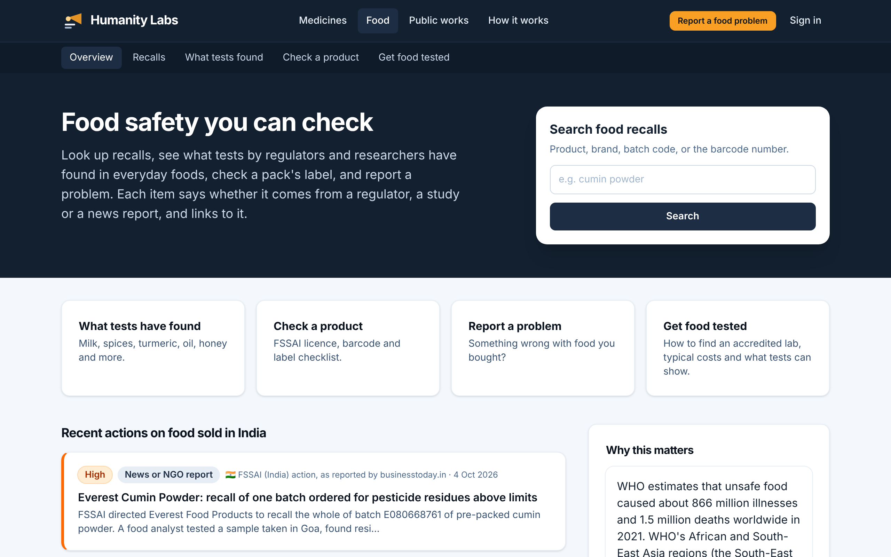
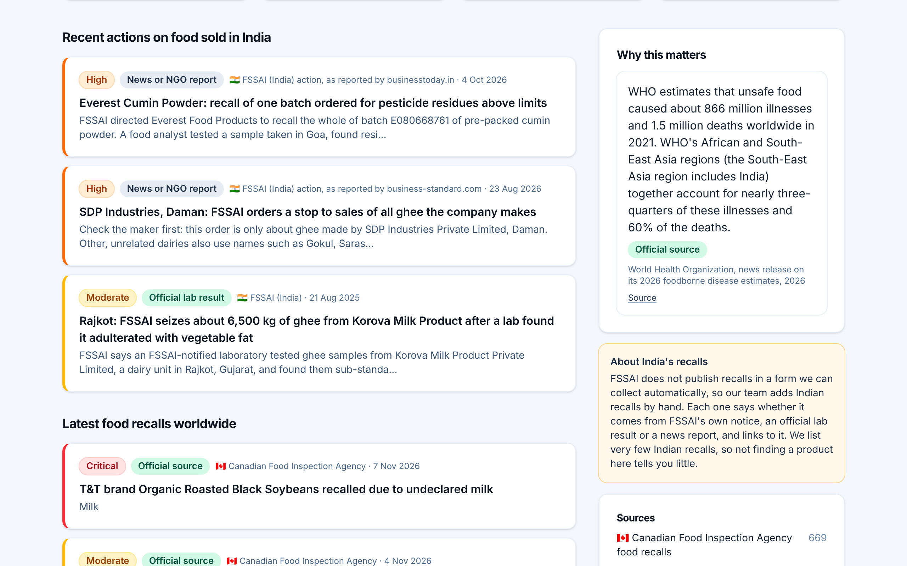

# Food Safety overview

**Food Safety** · In the app: `/food`

The starting point: a recall search, the four food tools, recent actions on food sold in India and the latest recalls worldwide.

## Recordings (1)

Click a thumbnail to open the video (MP4, 1920 × 1200, 30 fps).

<table>
<tr>
<td width="50%" valign="top">

 <b>Food Safety overview</b> · 0:19 
From the recall search and the four tools to recent actions on food sold in India, the latest recalls worldwide, why food safety matters and the sources, ending on the full recall list.
</td>
<td width="50%"></td>
</tr>
</table>

## Screenshots (2)

<table>
<tr>
<td width="50%" valign="top">

 <b>Food Safety home</b> 
Search food recalls by product, brand, batch code or barcode, and jump to the four main tools: test findings, product checks, problem reports and lab testing.
</td>
<td width="50%" valign="top">

 <b>Recent actions on food sold in India</b> 
Indian food safety actions added by the team, each labelled as an official notice, an official lab result or a news report, next to the latest recalls worldwide and a note on how few recalls India publishes.
</td>
</tr>
</table>

---

[All walkthroughs](../../../../USER_FACING_WALKTHROUGHS.md#food-safety-overview) · [All screenshots](../../../../USER_FACING_FEATURES.md) · [All features](../../README.md)
