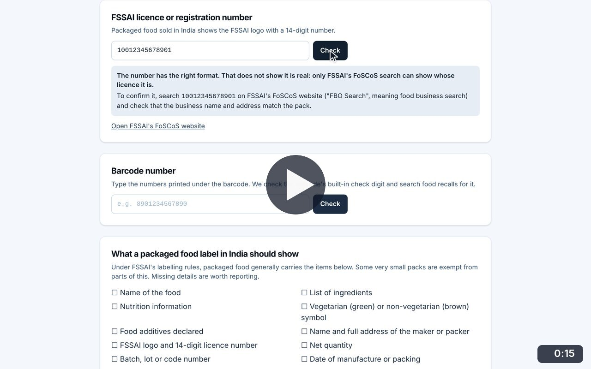
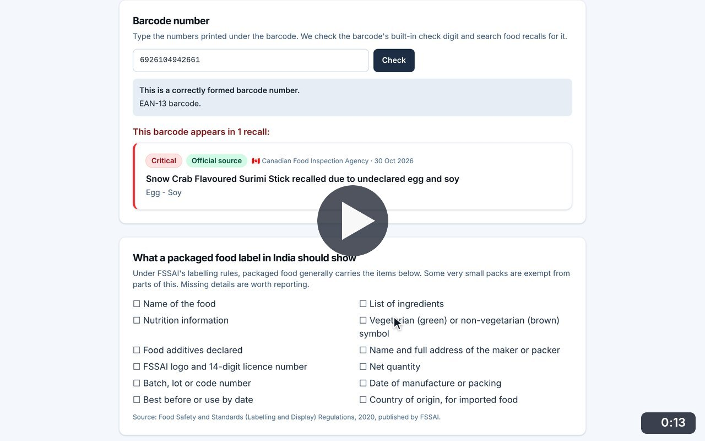
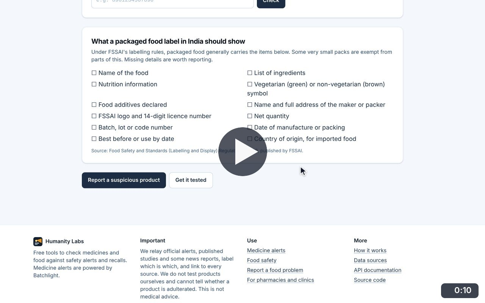
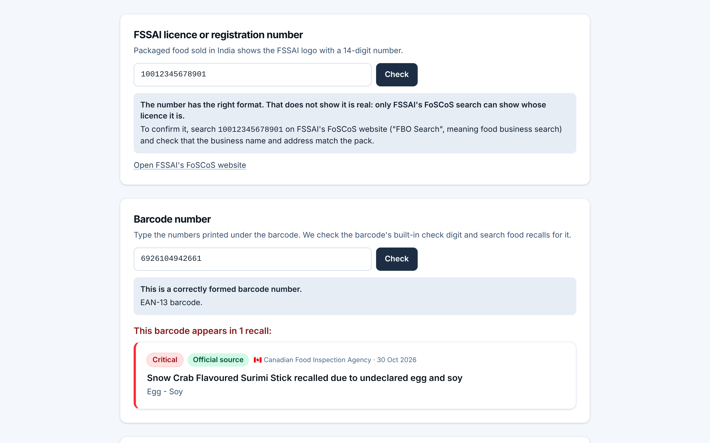
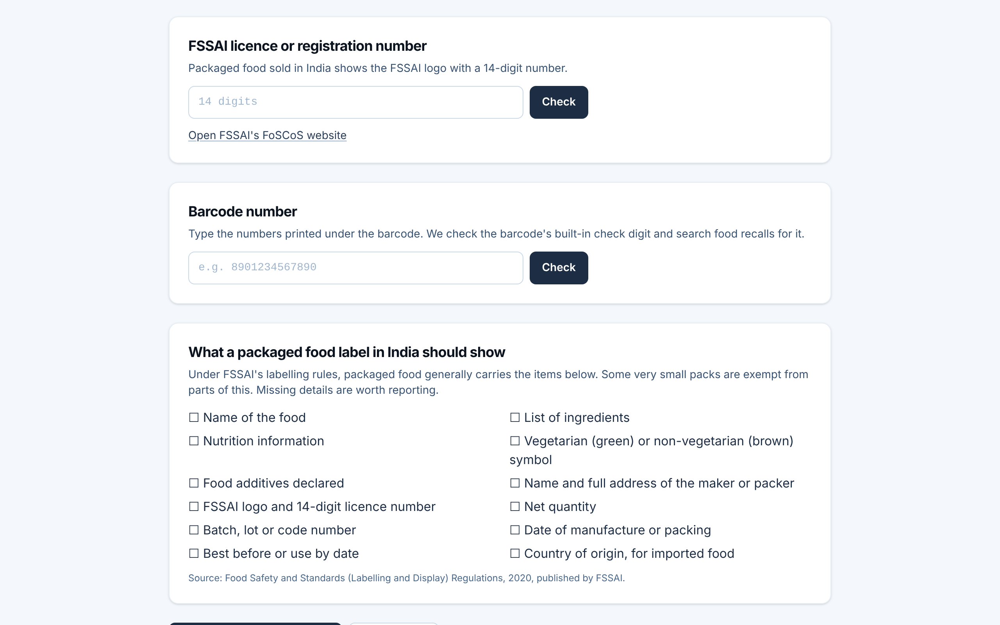

# Check a product

**Food Safety** · In the app: `/food/verify`

Check the format of an FSSAI licence number, verify a barcode and search recalls for it, and compare a pack against the label checklist.

## Recordings (3)

Click a thumbnail to open the video (MP4, 1920 × 1200, 30 fps).

<table>
<tr>
<td width="50%" valign="top">

 <b>Check an FSSAI licence number</b> · 0:15 
A number one digit short is caught; a correctly formed 14-digit number is accepted with a reminder that only FSSAI&#x27;s FoSCoS search shows whose licence it is. The number typed is an example in the correct format.
</td>
<td width="50%" valign="top">

 <b>Check a barcode against recalls</b> · 0:13 
Type the barcode from a pack: its check digit is verified, recalls are searched, and the matching Canadian recall opens.
</td>
</tr>
<tr>
<td width="50%" valign="top">

 <b>Packaged food label checklist</b> · 0:10 
Go through what a packaged food label in India should show under FSSAI&#x27;s labelling rules, with the next steps if something is missing.
</td>
<td width="50%"></td>
</tr>
</table>

## Screenshots (2)

<table>
<tr>
<td width="50%" valign="top">

 <b>Check a licence number and a barcode</b> 
Type the FSSAI licence number or the barcode printed on a pack. The licence check confirms only the format and points to FSSAI&#x27;s own search. The barcode&#x27;s check digit is verified and food recalls are searched for it; here the barcode appears in a Canadian recall.
</td>
<td width="50%" valign="top">

 <b>Label checklist</b> 
The three product checks on one page, ending with a checklist of what a packaged food label in India should show under FSSAI&#x27;s labelling rules.
</td>
</tr>
</table>

---

[All walkthroughs](../../../../USER_FACING_WALKTHROUGHS.md#check-a-product) · [All screenshots](../../../../USER_FACING_FEATURES.md) · [All features](../../README.md)
