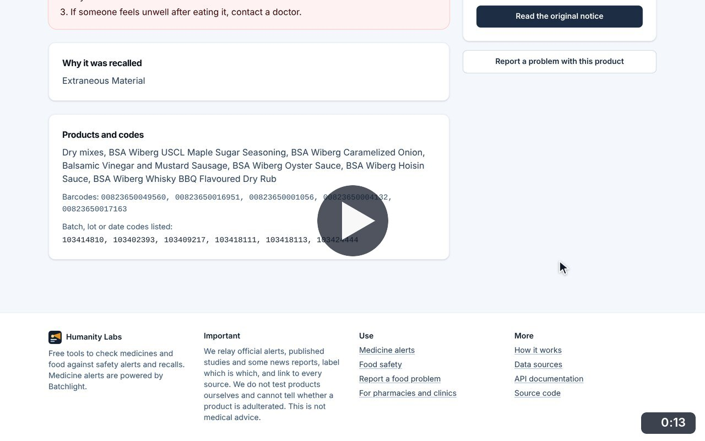
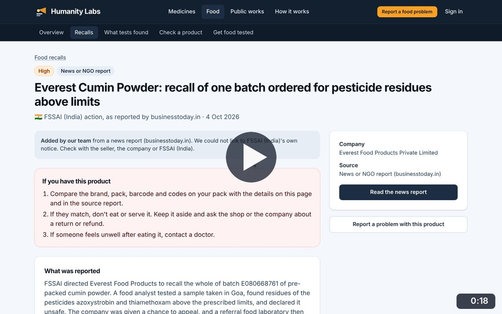
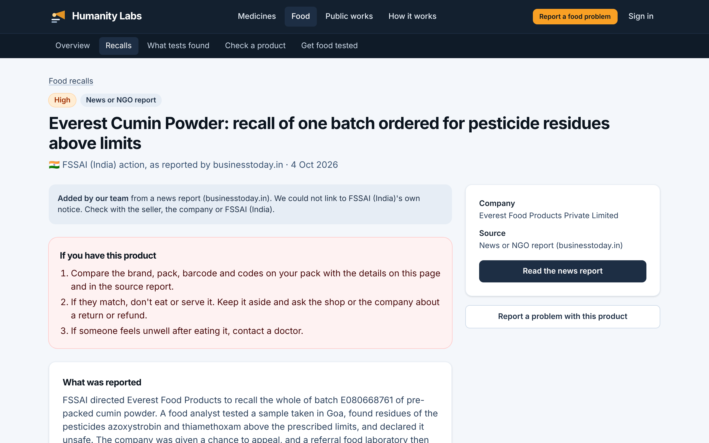
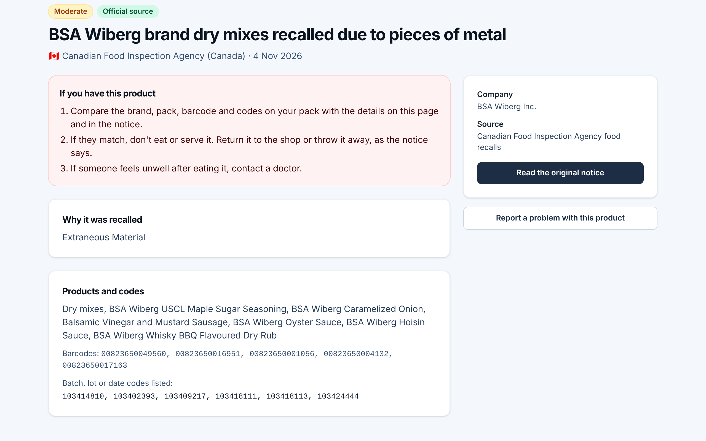

# Recall details

**Food Safety** · In the app: `/food/recalls/{id}`

One recall in full: what to do if you have the product, why it was recalled, the affected products, barcodes and batch codes, and a link to the original notice.

## Recordings (2)

Click a thumbnail to open the video (MP4, 1920 × 1200, 30 fps).

<table>
<tr>
<td width="50%" valign="top">

 <b>Read an official recall</b> · 0:13 
Open a Canadian Food Inspection Agency recall: what to do if you have the product, why it was recalled, every affected product with its barcodes and batch codes, and the link to the original notice.
</td>
<td width="50%" valign="top">

 <b>A recall known from a news report</b> · 0:18 
Open an Indian recall added by the team from a news report: the page says it could not link to FSSAI&#x27;s own notice, shows the batch code, and &quot;Report a problem with this product&quot; opens the report form with the product name filled in.
</td>
</tr>
</table>

## Screenshots (2)

<table>
<tr>
<td width="50%" valign="top">

 <b>Recall detail</b> 
One recall in full: what to do if you have the product, what was reported, the company, and a link to the source. A banner says when the entry comes from a news report and not from the regulator&#x27;s own notice.
</td>
<td width="50%" valign="top">

 <b>Barcodes and batch codes</b> 
A Canadian recall with every affected product, barcode and batch code listed, so a pack can be matched exactly.
</td>
</tr>
</table>

---

[All walkthroughs](../../../../USER_FACING_WALKTHROUGHS.md#recall-details) · [All screenshots](../../../../USER_FACING_FEATURES.md) · [All features](../../README.md)
