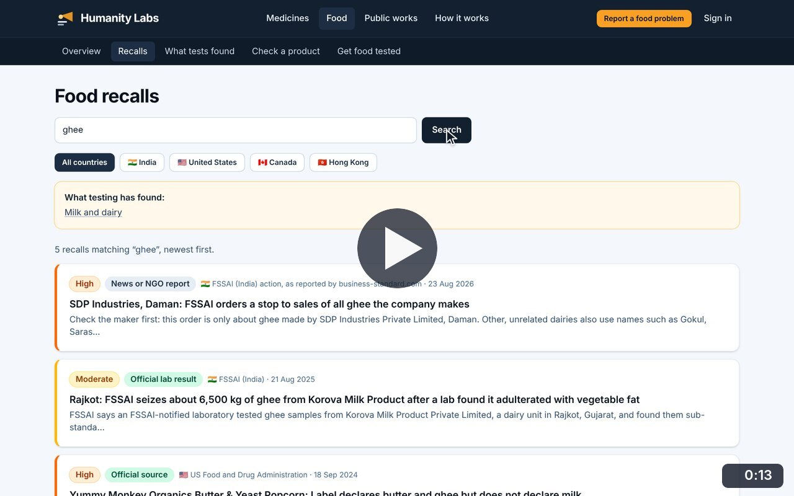
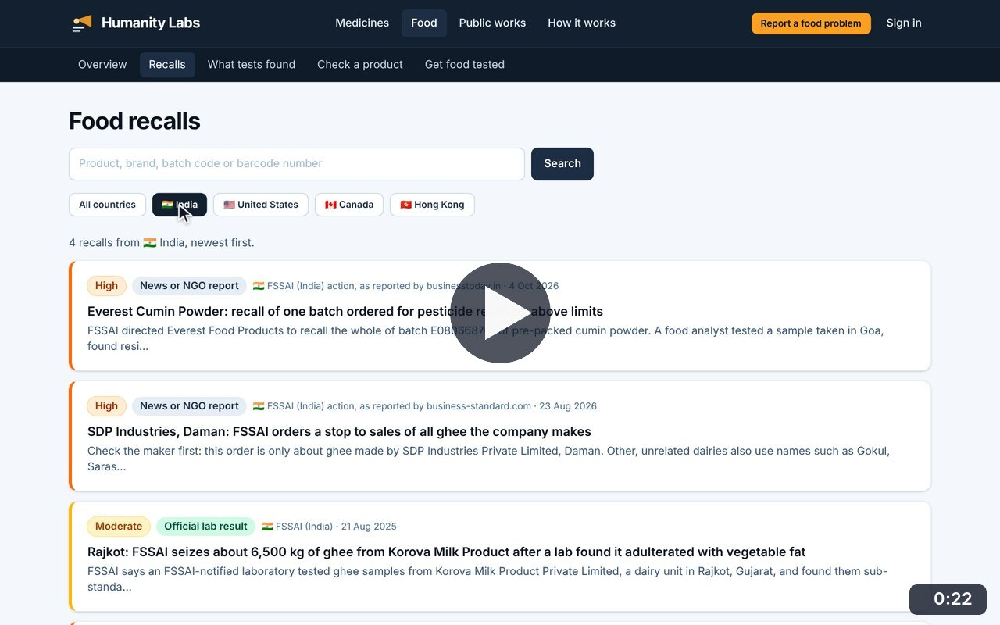
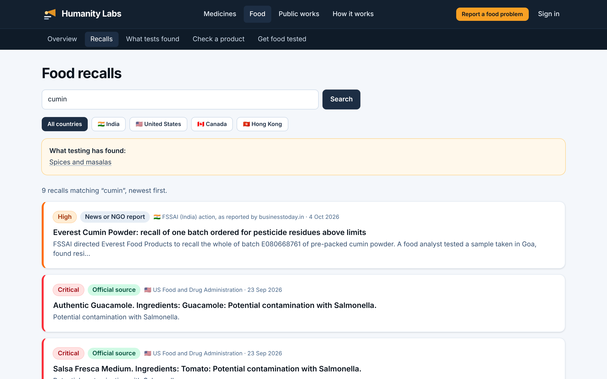
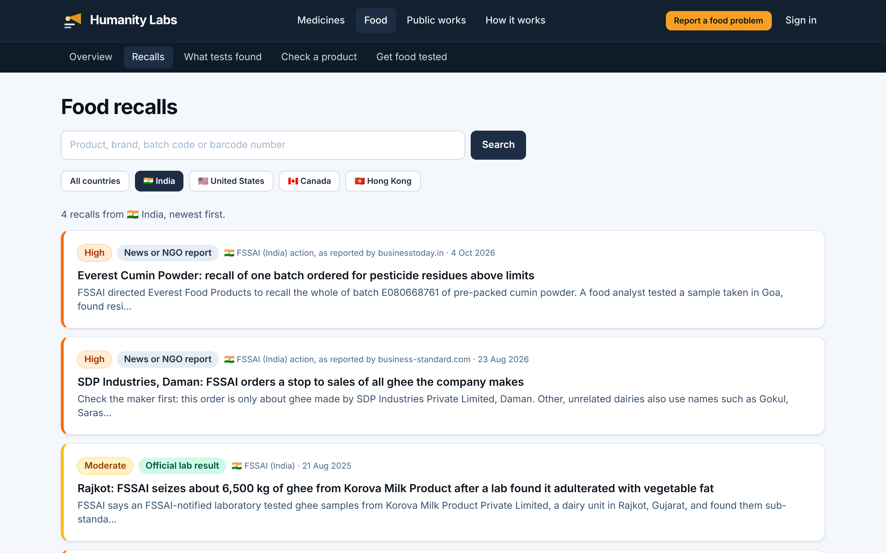

# Recall search

**Food Safety** · In the app: `/food/recalls`

Search food recalls by product, brand, batch code or barcode, filter by country and page through the results.

## Recordings (2)

Click a thumbnail to open the video (MP4, 1920 × 1200, 30 fps).

<table>
<tr>
<td width="50%" valign="top">

 <b>Search food recalls</b> · 0:13 
Search for &quot;ghee&quot;: recalls and Indian actions about ghee appear, with a link to what testing has found in milk and dairy.
</td>
<td width="50%" valign="top">

 <b>Filter by country and browse pages</b> · 0:22 
Narrow the list to India, then Canada, page through older recalls and open the explanation of the labels.
</td>
</tr>
</table>

## Screenshots (2)

<table>
<tr>
<td width="50%" valign="top">

 <b>Recall search</b> 
A search for &quot;cumin&quot; finds nine recalls. Results can be narrowed by country, and a hint links to what testing has found for that kind of food.
</td>
<td width="50%" valign="top">

 <b>Recalls filtered by country</b> 
The same list narrowed to India. Each card shows the severity, the evidence label, who acted and when.
</td>
</tr>
</table>

---

[All walkthroughs](../../../../USER_FACING_WALKTHROUGHS.md#recall-search) · [All screenshots](../../../../USER_FACING_FEATURES.md) · [All features](../../README.md)
