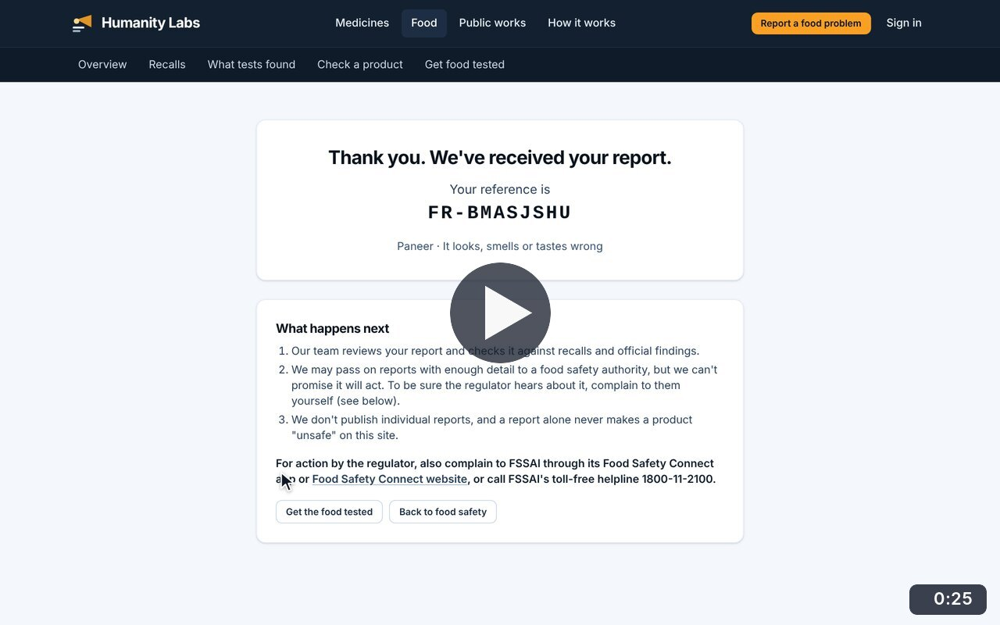
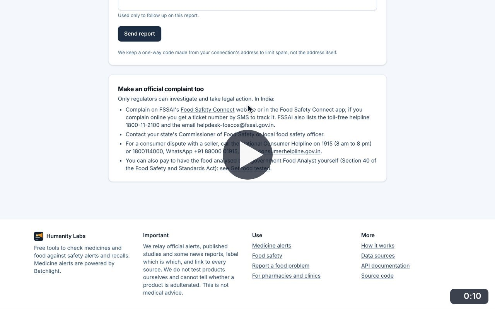
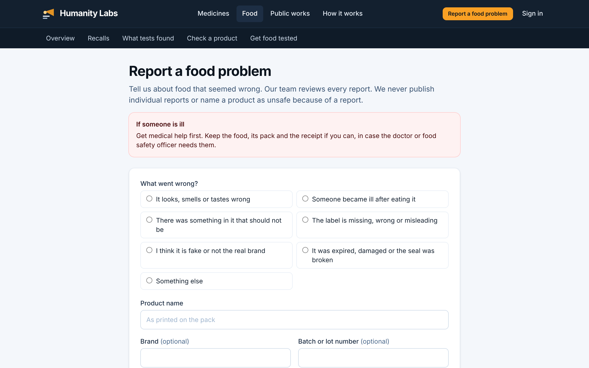
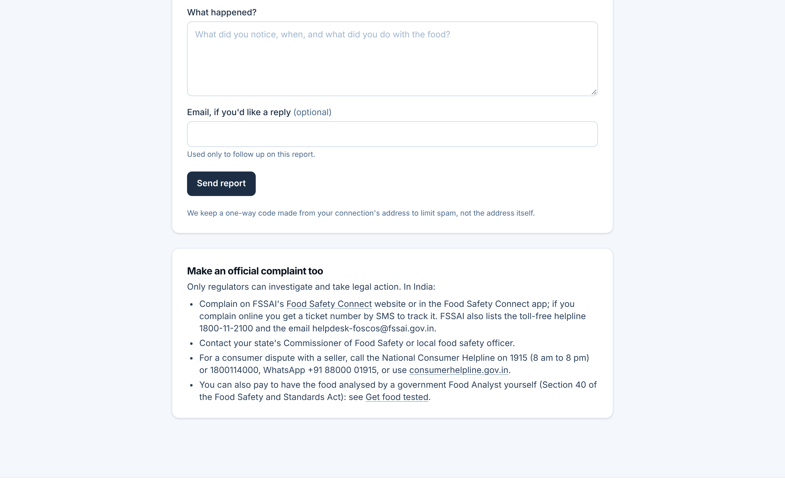

# Report a food problem

**Food Safety** · In the app: `/food/report`

Report food that seemed wrong, with validation and a confirmation, plus the official complaint routes in India.

## Recordings (2)

Click a thumbnail to open the video (MP4, 1920 × 1200, 30 fps).

<table>
<tr>
<td width="50%" valign="top">

 <b>Report a food problem</b> · 0:25 
Sending an empty form shows what is missing; the form is then completed and sent, and the confirmation explains what happens next. The text typed says it is a walkthrough, not a real report.
</td>
<td width="50%" valign="top">

 <b>Official complaint routes</b> · 0:10 
Below the form: how to complain to FSSAI, the state food safety commissioner and the National Consumer Helpline, and how to have food analysed by a government Food Analyst.
</td>
</tr>
</table>

## Screenshots (2)

<table>
<tr>
<td width="50%" valign="top">

 <b>Report a food problem</b> 
A short form for reporting food that seemed wrong, with advice to get medical help first if someone is ill. Reports are reviewed by the team and never published as findings.
</td>
<td width="50%" valign="top">

 <b>Official complaint routes</b> 
The end of the report form, followed by the official routes in India: FSSAI&#x27;s Food Safety Connect, the state food safety commissioner and the National Consumer Helpline.
</td>
</tr>
</table>

---

[All walkthroughs](../../../../USER_FACING_WALKTHROUGHS.md#report-a-food-problem) · [All screenshots](../../../../USER_FACING_FEATURES.md) · [All features](../../README.md)
