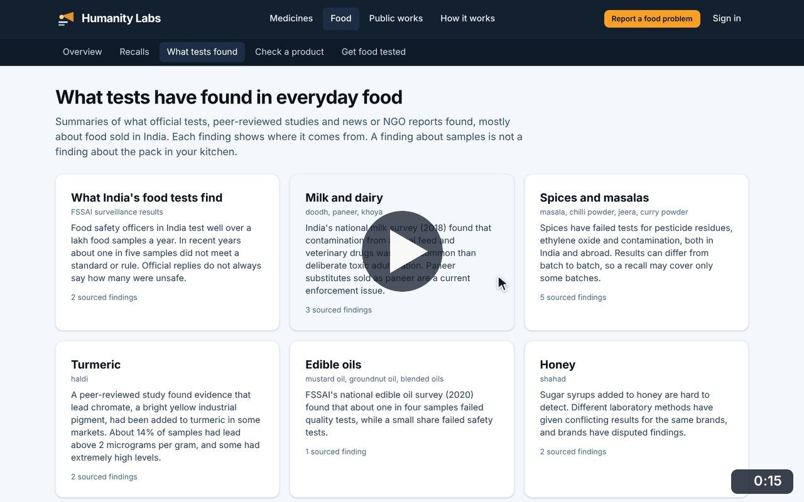
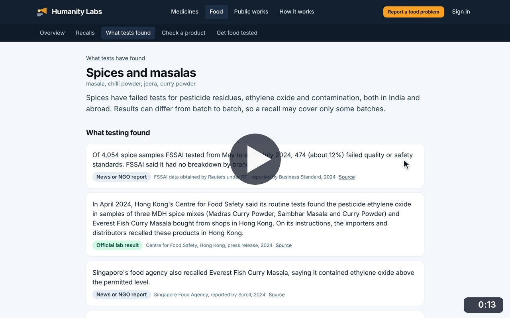
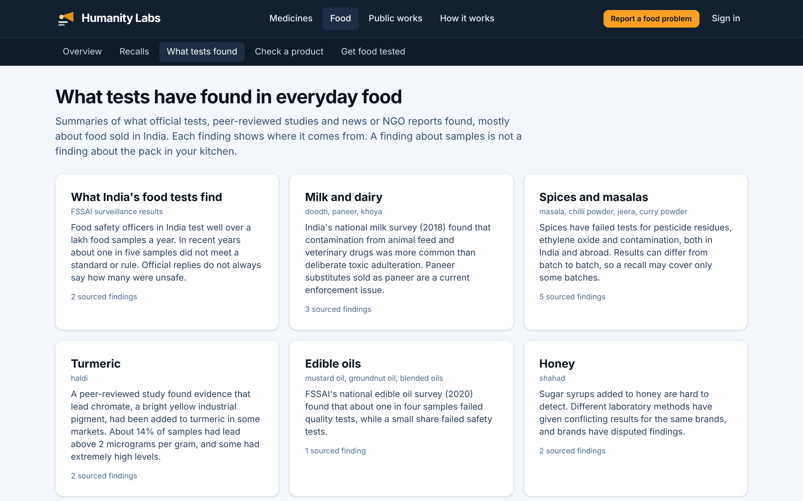
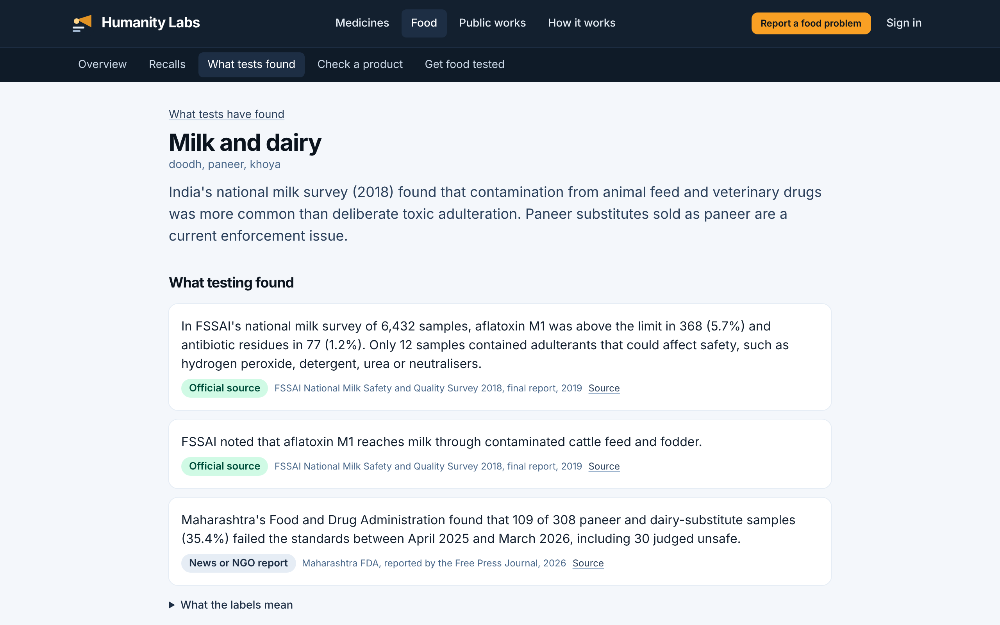
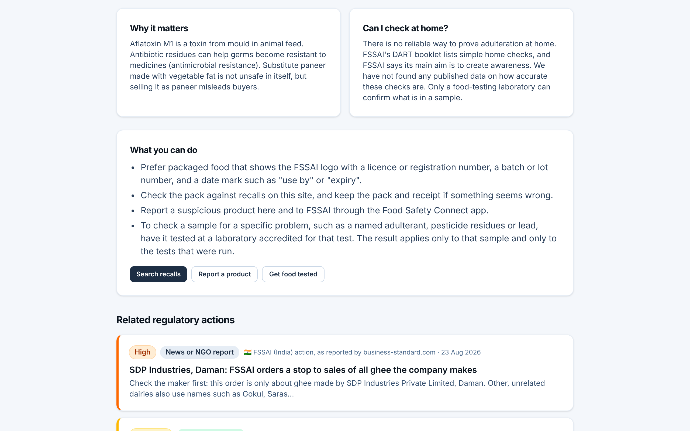

# What tests have found

**Food Safety** · In the app: `/food/reported`, `/food/reported/{topic}`

Sourced summaries of what official tests, studies and news reports found in milk, spices, turmeric, oils, honey and more, with practical advice and related regulatory actions.

## Recordings (2)

Click a thumbnail to open the video (MP4, 1920 × 1200, 30 fps).

<table>
<tr>
<td width="50%" valign="top">

 <b>What tests have found</b> · 0:15 
Browse the food topics, open milk and dairy, read each sourced finding, open the label explanation, then the practical advice.
</td>
<td width="50%" valign="top">

 <b>Spices and related regulatory actions</b> · 0:13 
Open spices and masalas: findings from FSSAI, Hong Kong and Singapore, then the related regulatory actions, opening one.
</td>
</tr>
</table>

## Screenshots (3)

<table>
<tr>
<td width="50%" valign="top">

 <b>What tests have found</b> 
Summaries of official tests, peer-reviewed studies and news reports about everyday foods in India, grouped by food type, with the number of sourced findings on each card.
</td>
<td width="50%" valign="top">

 <b>Findings for one food</b> 
The milk and dairy page. Each finding carries an evidence label and a link to the survey, study or report it comes from.
</td>
</tr>
<tr>
<td width="50%" valign="top">

 <b>Why it matters and what you can do</b> 
Practical guidance for each food: why the finding matters, whether it can be checked at home, what to do next, and related regulatory actions.
</td>
<td width="50%"></td>
</tr>
</table>

---

[All walkthroughs](../../../../USER_FACING_WALKTHROUGHS.md#what-tests-have-found) · [All screenshots](../../../../USER_FACING_FEATURES.md) · [All features](../../README.md)
