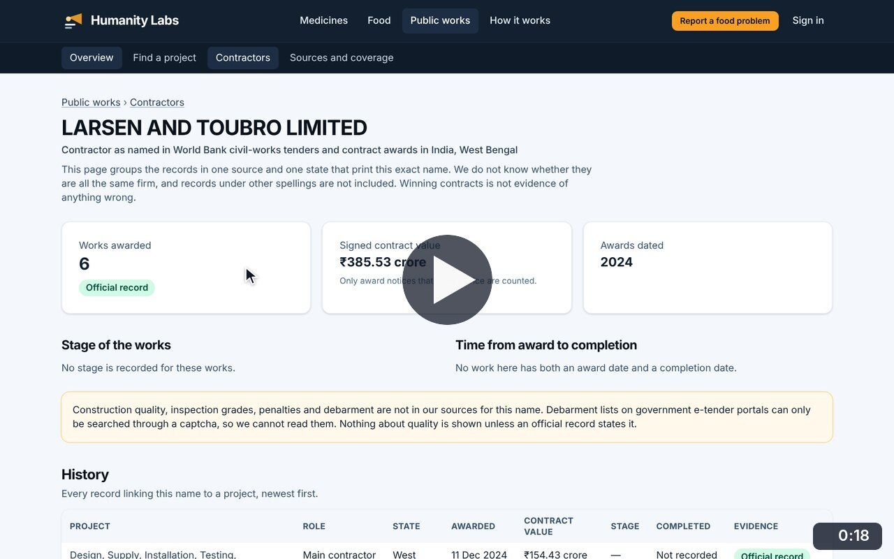
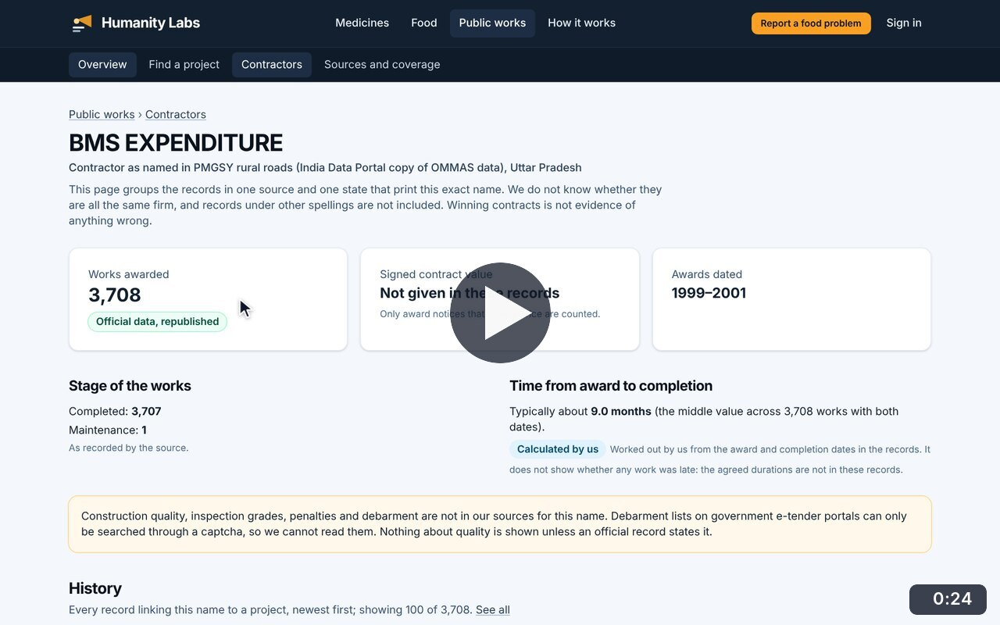
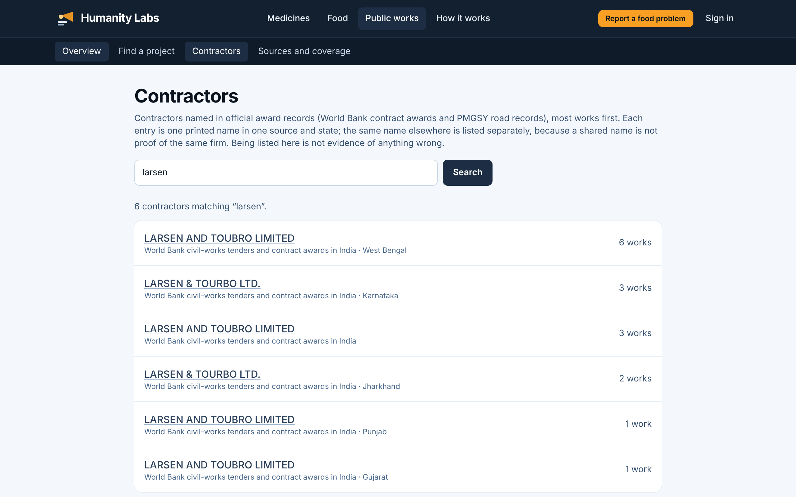
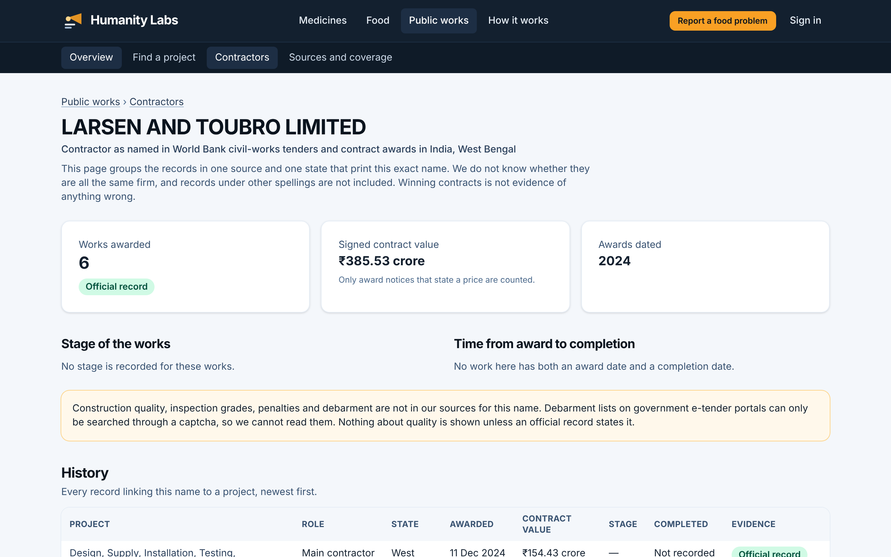
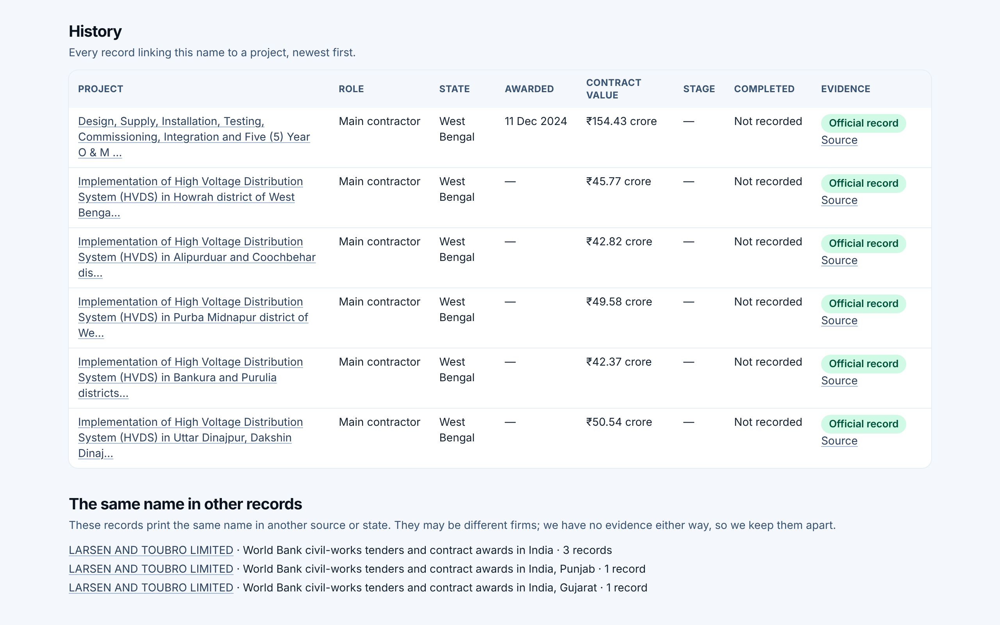

# Contractors

**Infrastructure Transparency** · In the app: `/infrastructure/contractors`, `/infrastructure/contractors/{id}`

Search contractors named in award records and read each name's profile and history, kept separate per source and state.

## Recordings (2)

Click a thumbnail to open the video (MP4, 1920 × 1200, 30 fps).

<table>
<tr>
<td width="50%" valign="top">

 <b>Search contractors and read a profile</b> · 0:18 
Search for &quot;larsen&quot;: each printed name in each source and state is listed separately. Open one to see works awarded, signed contract value, history with evidence labels, and the same name in other records.
</td>
<td width="50%" valign="top">

 <b>Every work under a contractor name</b> · 0:24 
Open the name with the most works, BMS EXPENDITURE in PMGSY rural roads in Uttar Pradesh: 3,708 works, how long works took from award to completion, and its history. &quot;See all&quot; lists every project under that name, and one road&#x27;s passport opens.
</td>
</tr>
</table>

## Screenshots (3)

<table>
<tr>
<td width="50%" valign="top">

 <b>Contractor search</b> 
Search contractors named in official award records. Each entry is one printed name in one source, because a shared name is not proof of the same firm.
</td>
<td width="50%" valign="top">

 <b>Contractor profile</b> 
Works awarded to one contractor name, the signed contract value where notices state it, the years covered and the stage of the works.
</td>
</tr>
<tr>
<td width="50%" valign="top">

 <b>Contractor history</b> 
Every record that links the name to a project: role, state, award date, contract value, stage and completion, each with its evidence label and source link.
</td>
<td width="50%"></td>
</tr>
</table>

---

[All walkthroughs](../../../../USER_FACING_WALKTHROUGHS.md#contractors) · [All screenshots](../../../../USER_FACING_FEATURES.md) · [All features](../../README.md)
