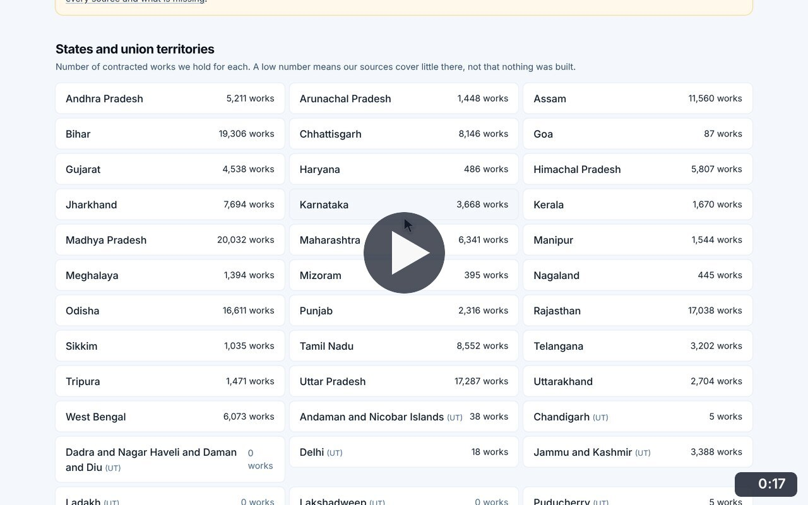
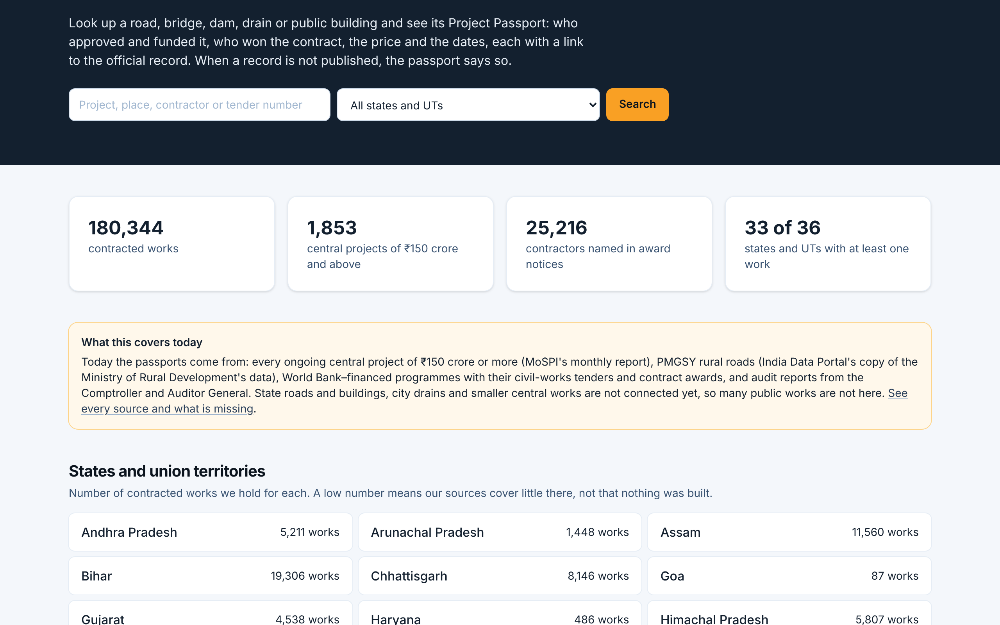
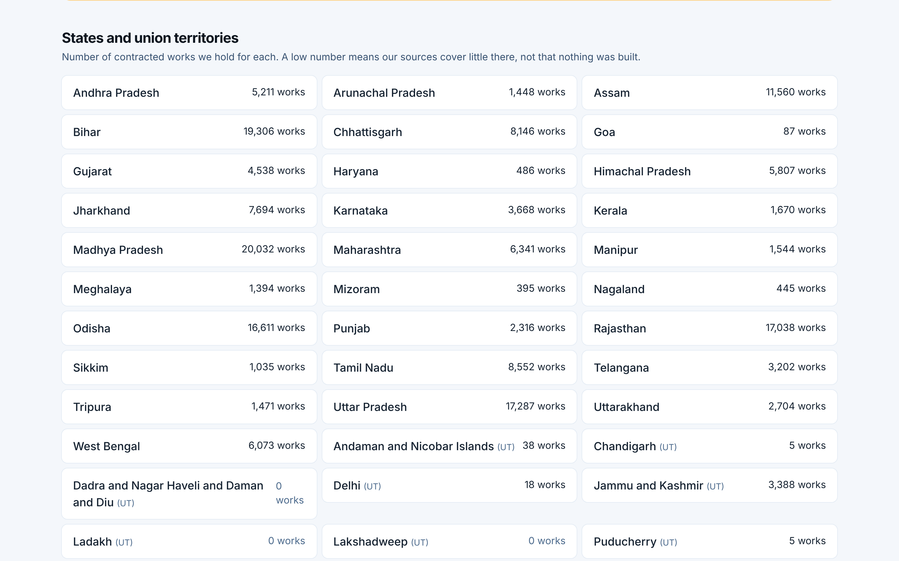

# Public works overview

**Infrastructure Transparency** · In the app: `/infrastructure`

Search public works, see what the data covers today, and browse every state and union territory.

## Recordings (1)

Click a thumbnail to open the video (MP4, 1920 × 1200, 30 fps).

<table>
<tr>
<td width="50%" valign="top">

 <b>Public works overview</b> · 0:17 
The search, the coverage counters, what the data covers today, and the grid of states and union territories with the number of works held for each.
</td>
<td width="50%"></td>
</tr>
</table>

## Screenshots (2)

<table>
<tr>
<td width="50%" valign="top">

 <b>Public works home</b> 
Search for a road, bridge, dam, drain or public building by project, place, contractor or tender number. The counters show what is held, and a note says exactly what the data covers today.
</td>
<td width="50%" valign="top">

 <b>States and union territories</b> 
Every state and union territory with the number of contracted works held, and a reminder that a low number means little coverage, not that nothing was built.
</td>
</tr>
</table>

---

[All walkthroughs](../../../../USER_FACING_WALKTHROUGHS.md#public-works-overview) · [All screenshots](../../../../USER_FACING_FEATURES.md) · [All features](../../README.md)
