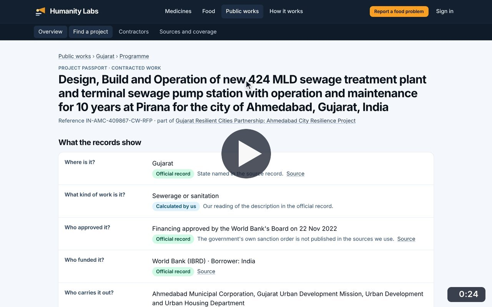
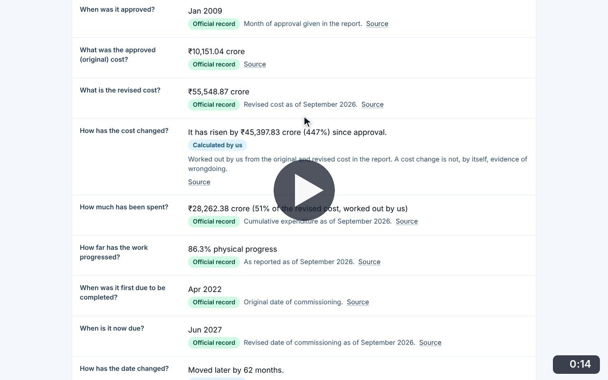
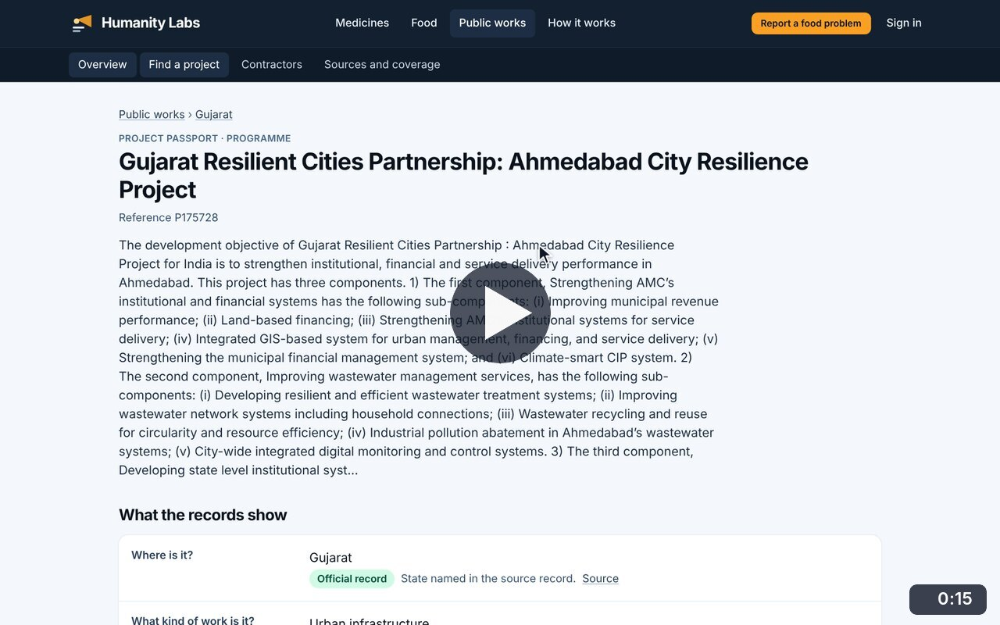
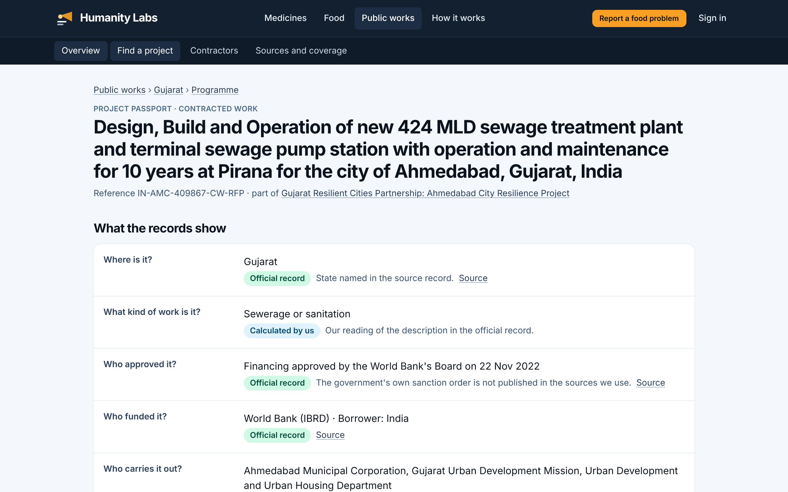
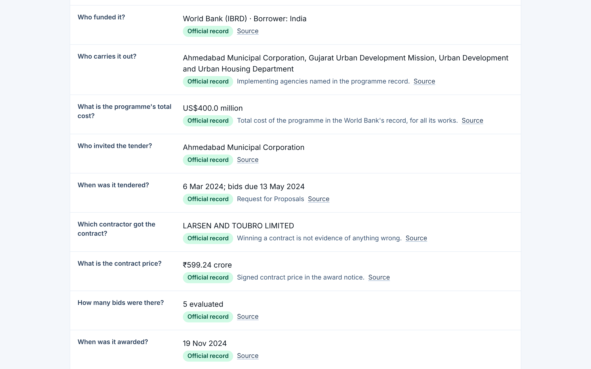
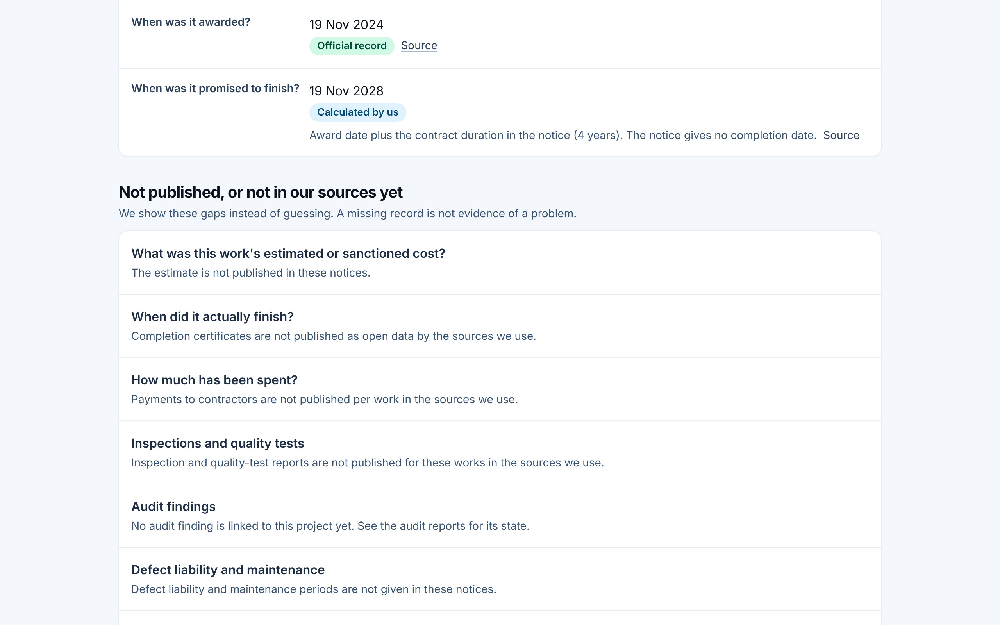
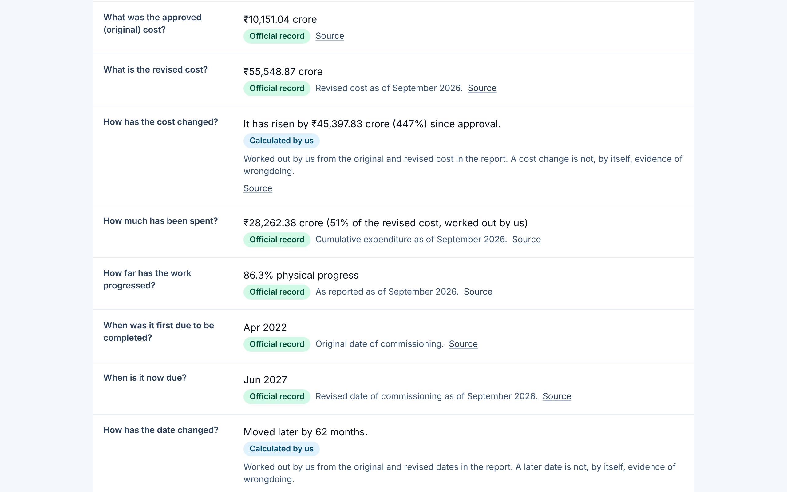

# Project Passport

**Infrastructure Transparency** · In the app: `/infrastructure/projects/{id}`

One page per project or programme answering plain questions, each labelled and linked to its source, with what is not published, who is involved, the history and audit reports.

## Recordings (3)

Click a thumbnail to open the video (MP4, 1920 × 1200, 30 fps).

<table>
<tr>
<td width="50%" valign="top">

 <b>Read a Project Passport</b> · 0:24 
Open the passport of a sewage treatment contract in Ahmedabad: every answer is labelled and linked to its source; then what is not published, who is involved, the history and what the labels mean.
</td>
<td width="50%" valign="top">

 <b>Cost and delay of a central project</b> · 0:14 
From the Andhra Pradesh page, open the Polavaram Irrigation Project: approved and revised cost, the increase worked out from them, money spent, progress and the change in completion date.
</td>
</tr>
<tr>
<td width="50%" valign="top">

 <b>From a programme to its contracts</b> · 0:15 
From a contract&#x27;s passport, open the World Bank programme it belongs to and the list of contracted works in that programme, then open another contract.
</td>
<td width="50%"></td>
</tr>
</table>

## Screenshots (4)

<table>
<tr>
<td width="50%" valign="top">

 <b>Project Passport</b> 
One page per project that answers plain questions: where it is, what kind of work, who approved it, who funded it. Every answer is labelled (official record, calculated by us) and links to its source.
</td>
<td width="50%" valign="top">

 <b>Contract, price and dates</b> 
Further down the same passport: who invited the tender, when, which contractor won, the signed contract price, how many bids were evaluated and when the contract was awarded.
</td>
</tr>
<tr>
<td width="50%" valign="top">

 <b>What is not published</b> 
The passport lists what the records do not show, such as actual completion, payments, inspections and audit findings, instead of guessing. A missing record is not treated as evidence of a problem.
</td>
<td width="50%" valign="top">

 <b>Cost, progress and delays</b> 
A large central project: approved and revised cost, money spent, physical progress and the original and revised completion dates, as given in the government&#x27;s monthly report. The cost increase and the delay are worked out from those figures and labelled as calculations.
</td>
</tr>
</table>

---

[All walkthroughs](../../../../USER_FACING_WALKTHROUGHS.md#project-passport) · [All screenshots](../../../../USER_FACING_FEATURES.md) · [All features](../../README.md)
