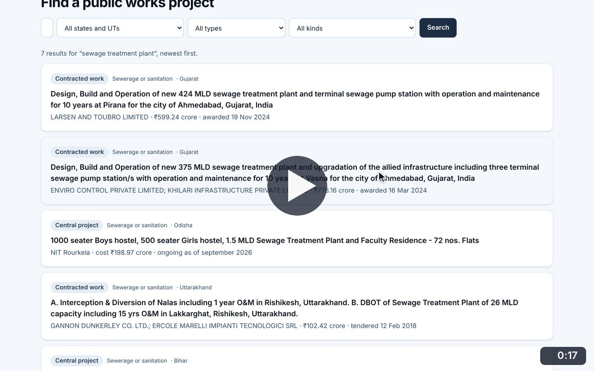
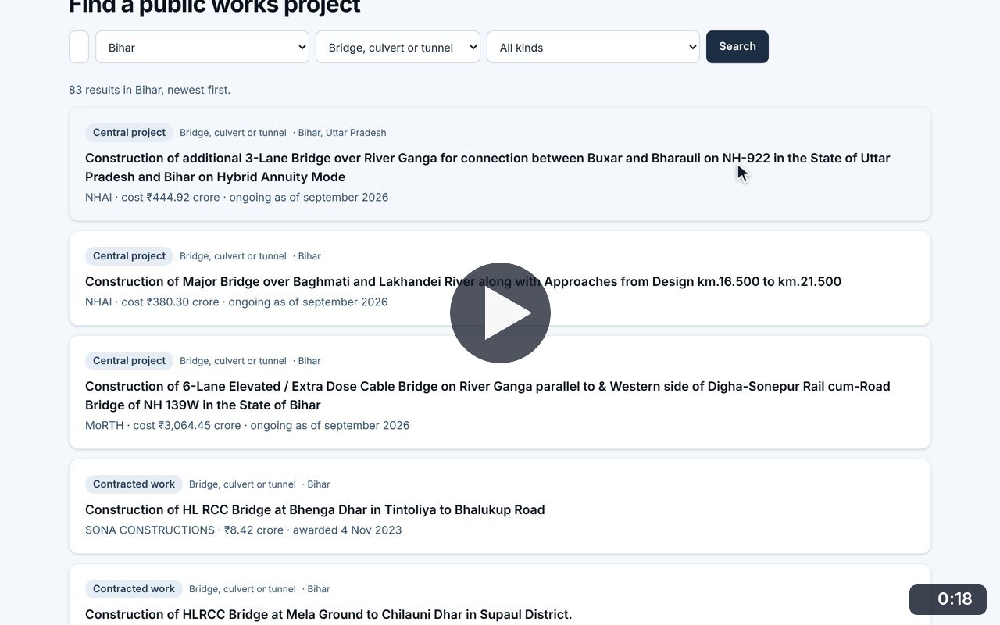
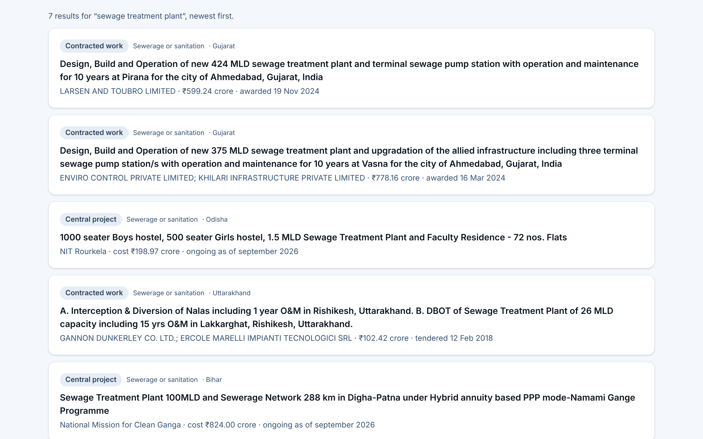
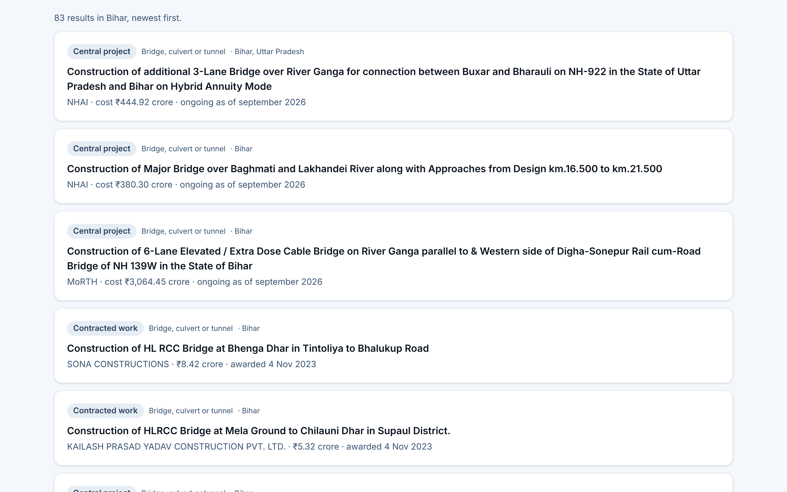

# Project search

**Infrastructure Transparency** · In the app: `/infrastructure/projects`

Search by project, place, contractor or tender number and filter by state, type of work and kind of record.

## Recordings (2)

Click a thumbnail to open the video (MP4, 1920 × 1200, 30 fps).

<table>
<tr>
<td width="50%" valign="top">

 <b>Search public works</b> · 0:17 
Search for &quot;sewage treatment plant&quot; from the overview: World Bank contracts and central projects appear with contractor, price and dates, and the first passport opens.
</td>
<td width="50%" valign="top">

 <b>Filter by state, type of work and kind of record</b> · 0:18 
From the Bihar page, search its projects, narrow to bridges, culverts and tunnels, then to central projects only.
</td>
</tr>
</table>

## Screenshots (2)

<table>
<tr>
<td width="50%" valign="top">

 <b>Project search results</b> 
Results for &quot;sewage treatment plant&quot;. Each card shows the kind of record, the type of work, the state, the contractor or agency, the price and the award date or status.
</td>
<td width="50%" valign="top">

 <b>Search by state and type of work</b> 
Bridges, culverts and tunnels in Bihar: 83 records, from large central projects to individual contracted works.
</td>
</tr>
</table>

---

[All walkthroughs](../../../../USER_FACING_WALKTHROUGHS.md#project-search) · [All screenshots](../../../../USER_FACING_FEATURES.md) · [All features](../../README.md)
