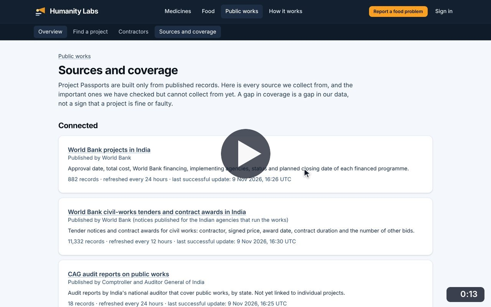
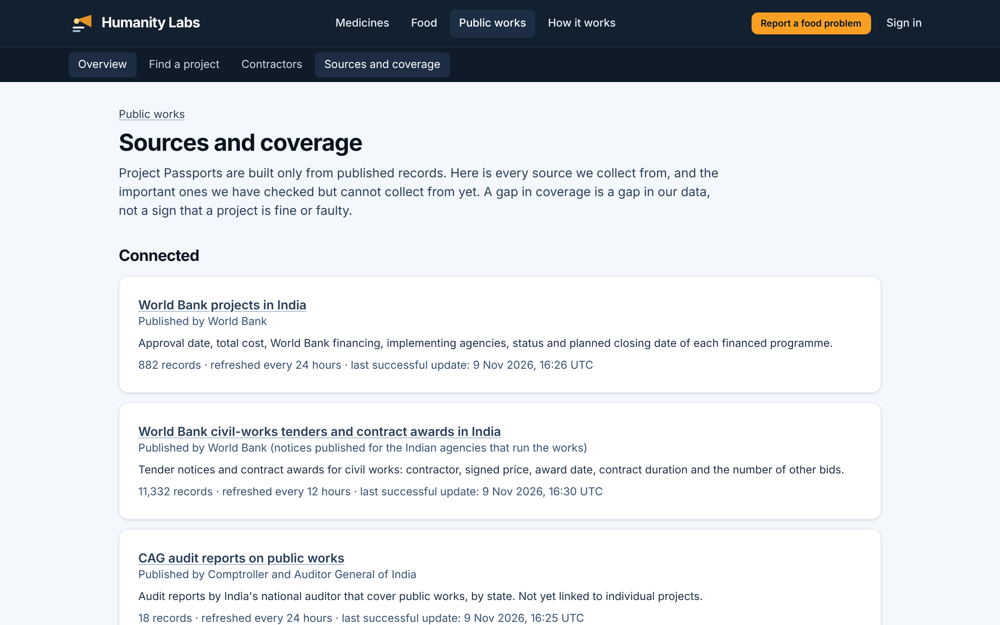
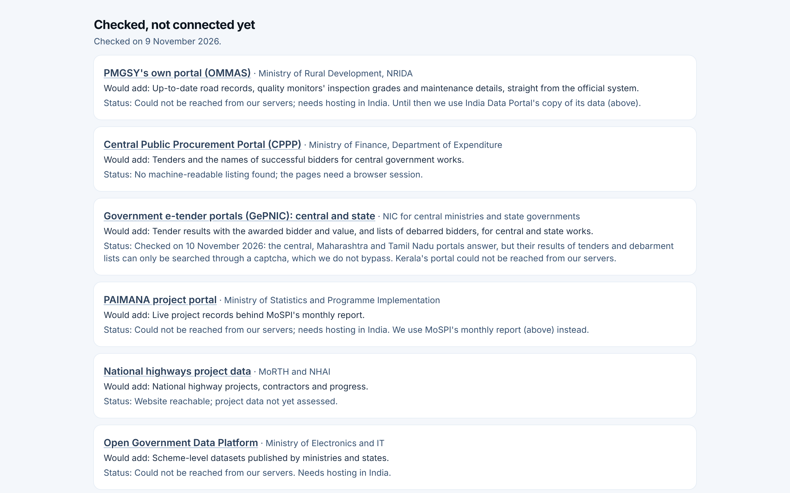

# Sources and coverage

**Infrastructure Transparency** · In the app: `/infrastructure/sources`

Every connected source, the important sources checked but not connected yet, and what is rarely published anywhere.

## Recordings (1)

Click a thumbnail to open the video (MP4, 1920 × 1200, 30 fps).

<table>
<tr>
<td width="50%" valign="top">

 <b>Sources and coverage</b> · 0:13 
The connected sources with what each provides, record counts and refresh times; the important sources checked but not connected yet, and why; and what is rarely published anywhere.
</td>
<td width="50%"></td>
</tr>
</table>

## Screenshots (2)

<table>
<tr>
<td width="50%" valign="top">

 <b>Sources and coverage</b> 
Every connected source with what it provides, how many records are held, how often it refreshes and the last successful update.
</td>
<td width="50%" valign="top">

 <b>Sources checked but not connected yet</b> 
The important sources that were checked but cannot be collected from yet, with what each would add and the reason it is not connected.
</td>
</tr>
</table>

---

[All walkthroughs](../../../../USER_FACING_WALKTHROUGHS.md#sources-and-coverage) · [All screenshots](../../../../USER_FACING_FEATURES.md) · [All features](../../README.md)
