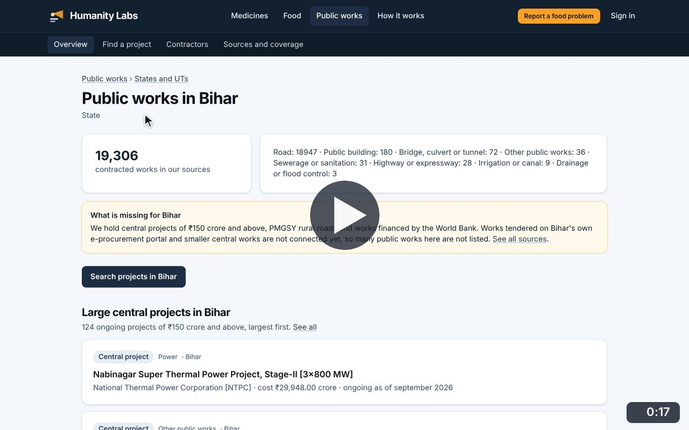
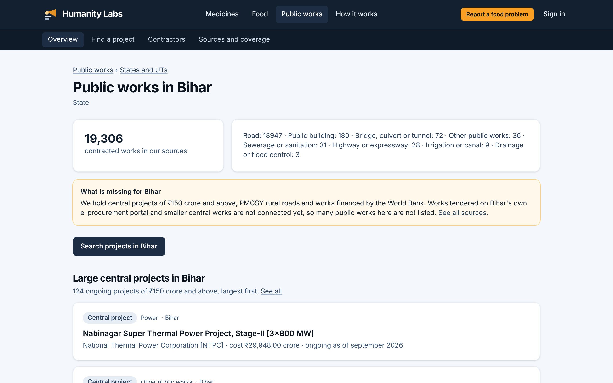

# State pages

**Infrastructure Transparency** · In the app: `/infrastructure/states/{slug}`

Public works in one state: works by type, what is missing for that state, and its largest ongoing central projects.

## Recordings (1)

Click a thumbnail to open the video (MP4, 1920 × 1200, 30 fps).

<table>
<tr>
<td width="50%" valign="top">

 <b>Public works in a state</b> · 0:17 
From the states grid, open Bihar: the number of works by type, what is missing for Bihar, its largest ongoing central projects, and the full list of them.
</td>
<td width="50%"></td>
</tr>
</table>

## Screenshots (1)

<table>
<tr>
<td width="50%" valign="top">

 <b>State overview</b> 
Public works in one state: the number of works by type, what is missing from the sources for that state, and its largest ongoing central projects.
</td>
<td width="50%"></td>
</tr>
</table>

---

[All walkthroughs](../../../../USER_FACING_WALKTHROUGHS.md#state-pages) · [All screenshots](../../../../USER_FACING_FEATURES.md) · [All features](../../README.md)
