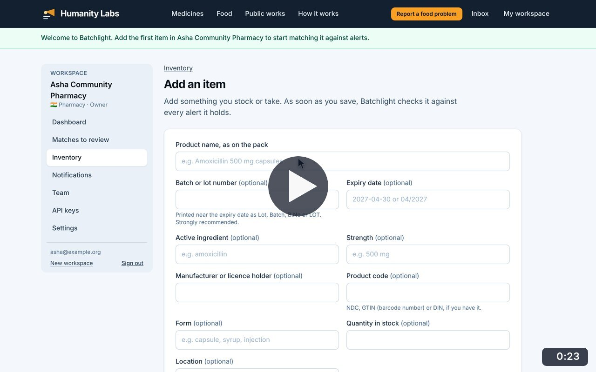
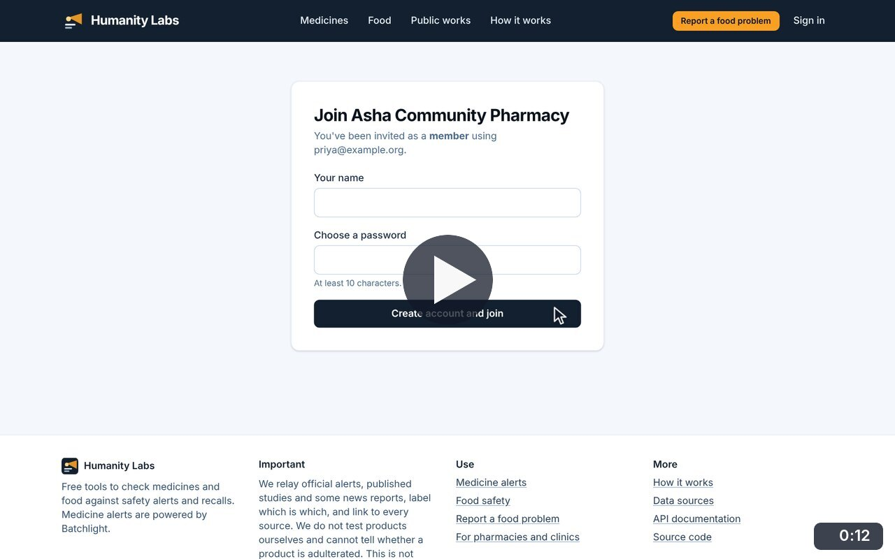
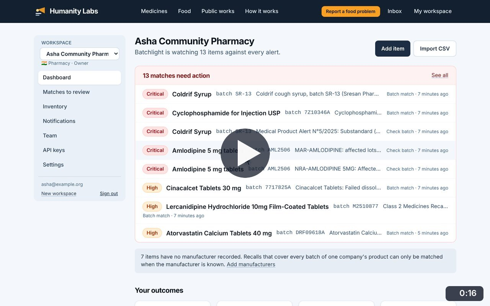
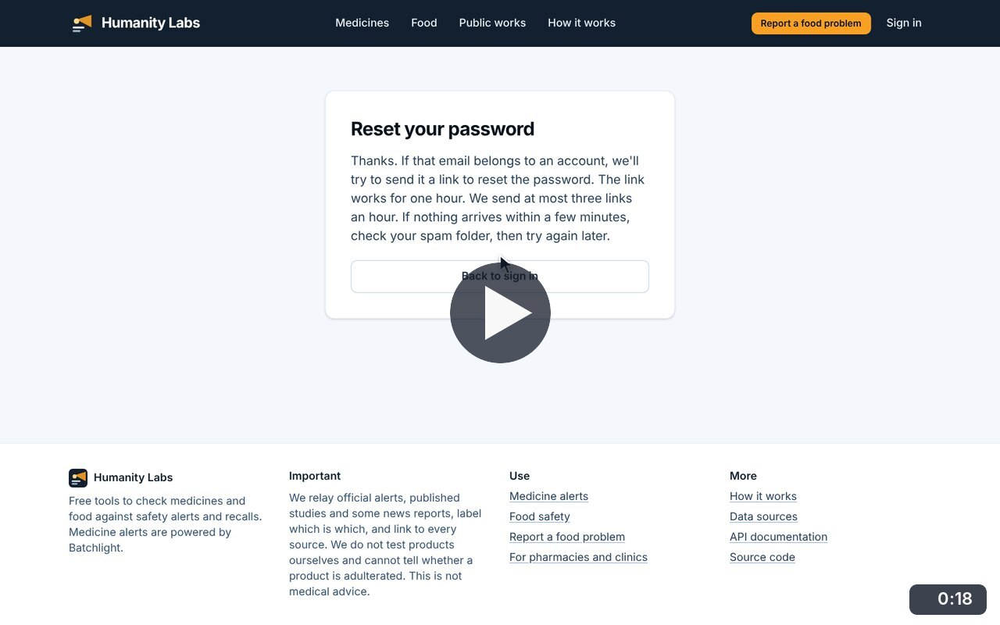
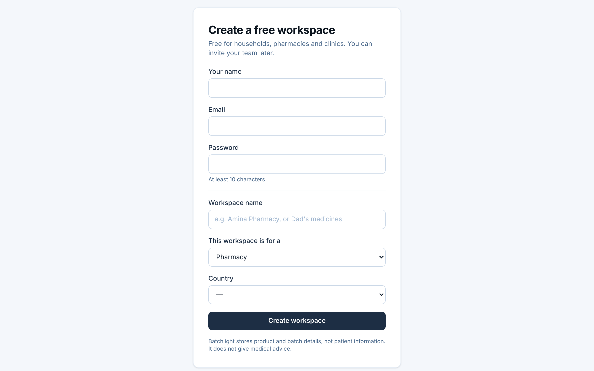

# Accounts and sign-in

**Medicine Safety** · In the app: `/signup`, `/login`, `/forgot-password`, `/reset-password/{token}`, `/invite/{token}`

Create a free workspace, sign out and in, reset a forgotten password, and join a workspace from an invitation.

## Recordings (4)

Click a thumbnail to open the video (MP4, 1920 × 1200, 30 fps).

<table>
<tr>
<td width="50%" valign="top">

 <b>Create a free workspace</b> · 0:23 
Sign up as a pharmacy in India. A password that is too short is caught; with a longer one the workspace is created and the first item can be added.
</td>
<td width="50%" valign="top">

 <b>Accept a team invitation</b> · 0:12 
Open the invitation link, create an account for the invited address and join the pharmacy&#x27;s workspace as a member.
</td>
</tr>
<tr>
<td width="50%" valign="top">

 <b>Sign out and sign in</b> · 0:16 
Sign out from the workspace, then sign back in with email and password.
</td>
<td width="50%" valign="top">

 <b>Reset a forgotten password</b> · 0:18 
Ask for a reset link: the page answers the same way whether or not the address has an account. The link arrives by email; opening it lets the user choose a new password.
</td>
</tr>
</table>

## Screenshots (1)

<table>
<tr>
<td width="50%" valign="top">

 <b>Create a free workspace</b> 
Sign-up for pharmacies, clinics, hospitals, distributors and households. It asks for a name, an email address, a password and a few details about the workspace.
</td>
<td width="50%"></td>
</tr>
</table>

---

[All walkthroughs](../../../../USER_FACING_WALKTHROUGHS.md#accounts-and-sign-in) · [All screenshots](../../../../USER_FACING_FEATURES.md) · [All features](../../README.md)
