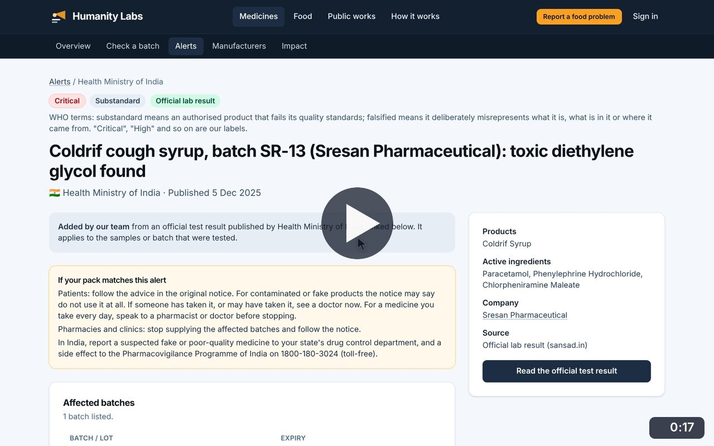
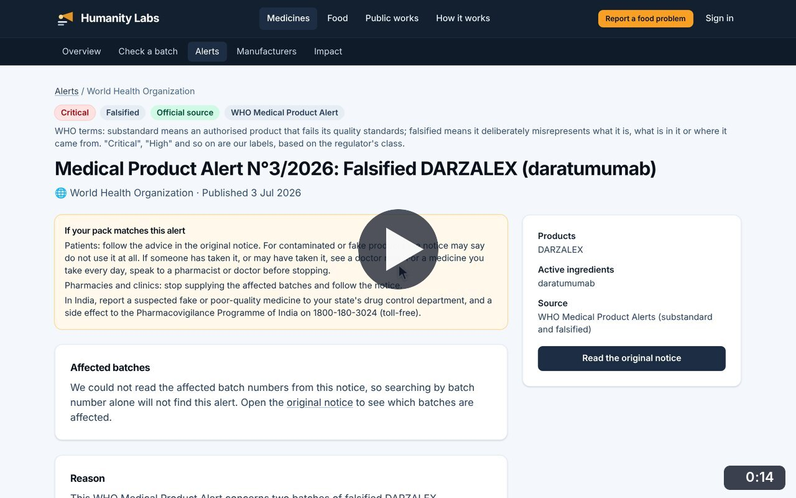
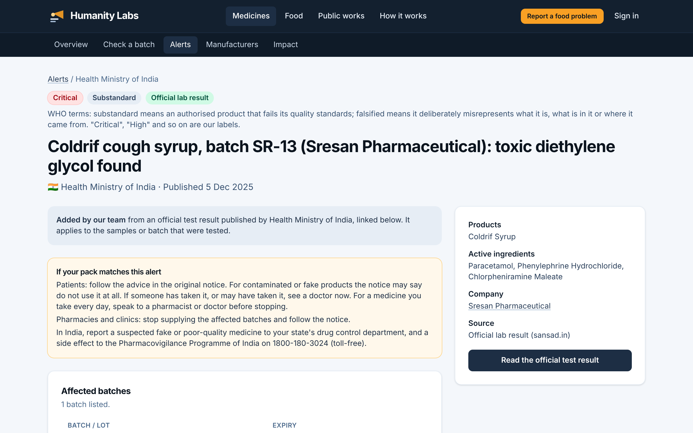
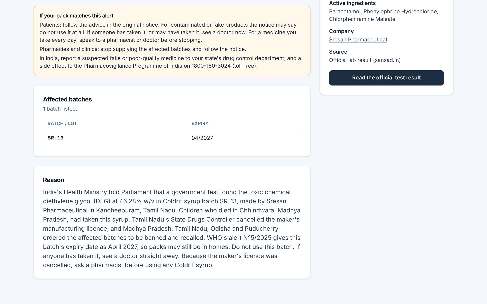
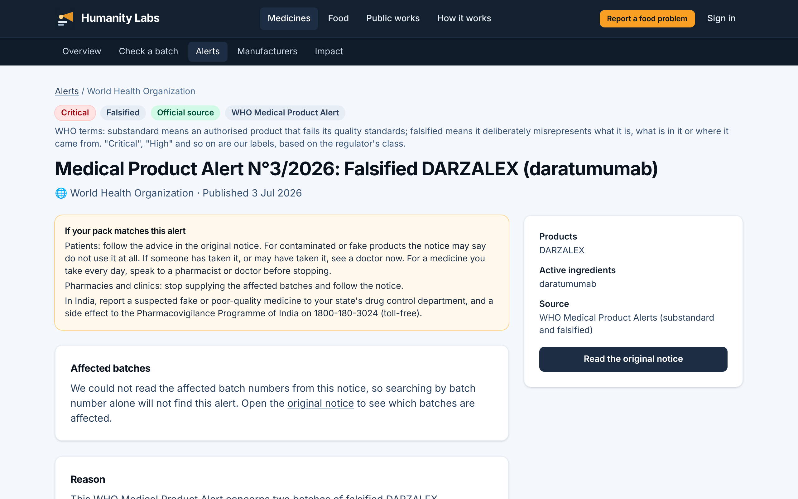

# Alert details

**Medicine Safety** · In the app: `/alerts/{id}`

One alert in full: labels, advice for patients and pharmacies, affected batches, the reason and a link to the official notice.

## Recordings (2)

Click a thumbnail to open the video (MP4, 1920 × 1200, 30 fps).

<table>
<tr>
<td width="50%" valign="top">

 <b>Read an alert</b> · 0:17 
Open the Coldrif alert: its labels, advice for patients and pharmacies, the affected batch with expiry, the reason, and the links to the official test result and the manufacturer.
</td>
<td width="50%" valign="top">

 <b>A WHO falsified-medicine alert</b> · 0:14 
Open a WHO Medical Product Alert about falsified DARZALEX. Batch numbers could not be read from the notice, so the page says so and points to the original.
</td>
</tr>
</table>

## Screenshots (3)

<table>
<tr>
<td width="50%" valign="top">

 <b>Alert detail</b> 
One alert in full: severity, type and evidence labels, advice for patients and pharmacies, product, ingredients and company, and a button to the official test result.
</td>
<td width="50%" valign="top">

 <b>Affected batches and reason</b> 
The batches the alert names, with expiry dates, and the reason in plain language with what the authorities did.
</td>
</tr>
<tr>
<td width="50%" valign="top">

 <b>WHO falsified-medicine alert</b> 
A WHO Medical Product Alert about a falsified cancer medicine. When batch numbers cannot be read from a notice, the page says so and points to the original.
</td>
<td width="50%"></td>
</tr>
</table>

---

[All walkthroughs](../../../../USER_FACING_WALKTHROUGHS.md#alert-details) · [All screenshots](../../../../USER_FACING_FEATURES.md) · [All features](../../README.md)
