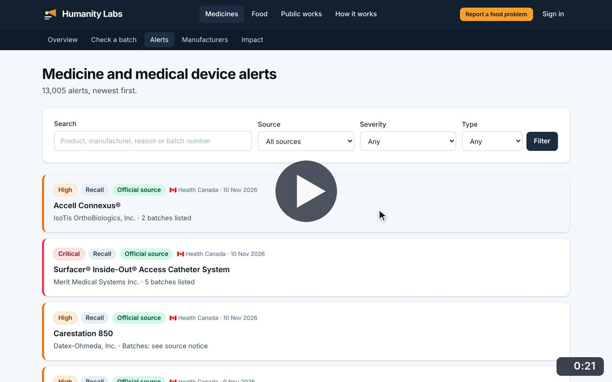
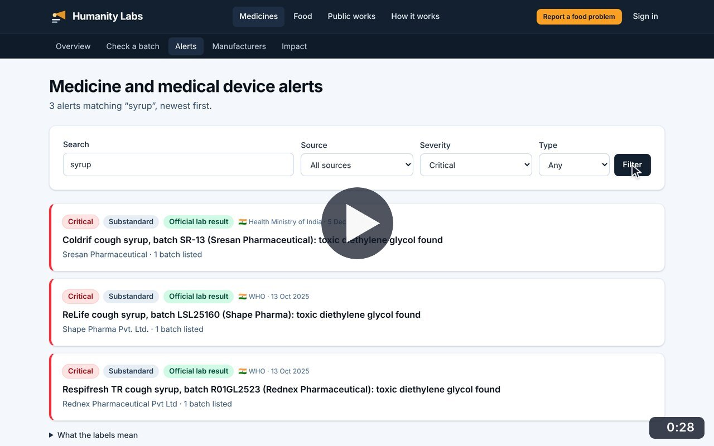
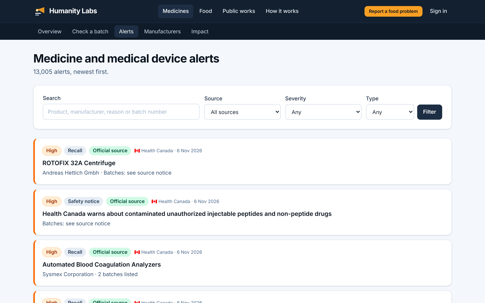
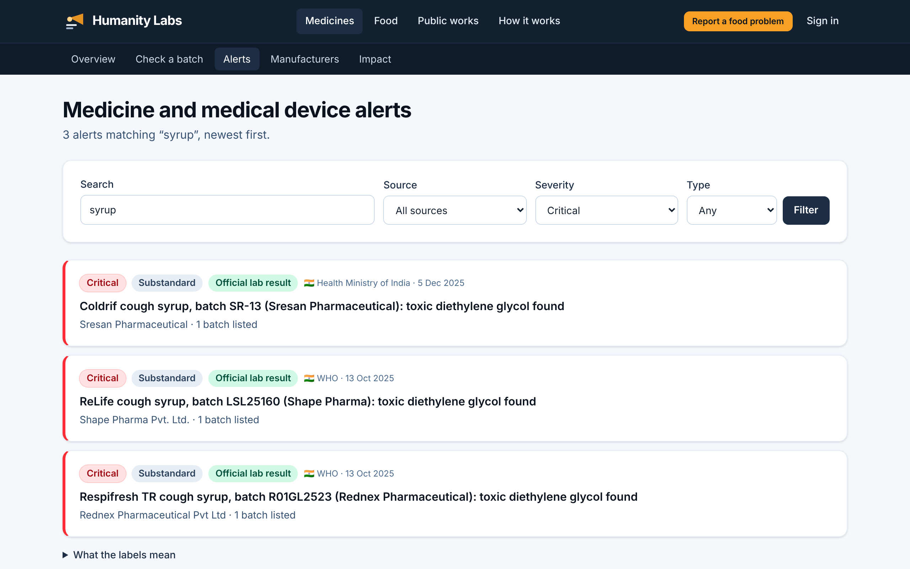

# Browse and filter alerts

**Medicine Safety** · In the app: `/alerts`

All medicine and medical device alerts, newest first, with search and filters for source, severity and type.

## Recordings (2)

Click a thumbnail to open the video (MP4, 1920 × 1200, 30 fps).

<table>
<tr>
<td width="50%" valign="top">

 <b>Browse and filter alerts</b> · 0:21 
Scroll the newest alerts, then filter to WHO alerts and narrow to falsified medicines, and open the explanation of the labels.
</td>
<td width="50%" valign="top">

 <b>Search alerts and browse pages</b> · 0:28 
Search for &quot;syrup&quot;, narrow to critical alerts to find the contaminated cough syrups reported in India, then page through all alerts.
</td>
</tr>
</table>

## Screenshots (2)

<table>
<tr>
<td width="50%" valign="top">

 <b>Browse all alerts</b> 
More than 13,000 medicine and medical device alerts, newest first, with search and filters for source, severity and type.
</td>
<td width="50%" valign="top">

 <b>Search and filter</b> 
A search for &quot;syrup&quot; limited to critical alerts returns the contaminated cough syrups reported in India, each with its evidence label.
</td>
</tr>
</table>

---

[All walkthroughs](../../../../USER_FACING_WALKTHROUGHS.md#browse-and-filter-alerts) · [All screenshots](../../../../USER_FACING_FEATURES.md) · [All features](../../README.md)
