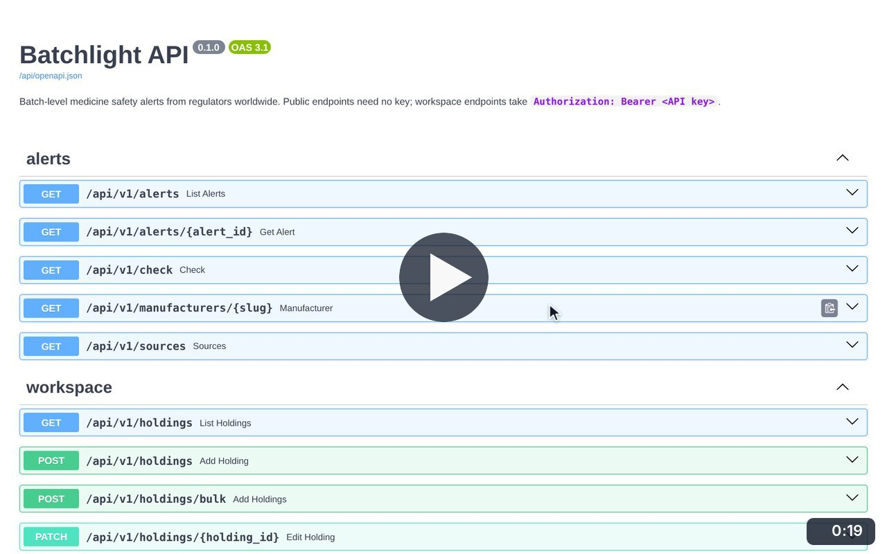
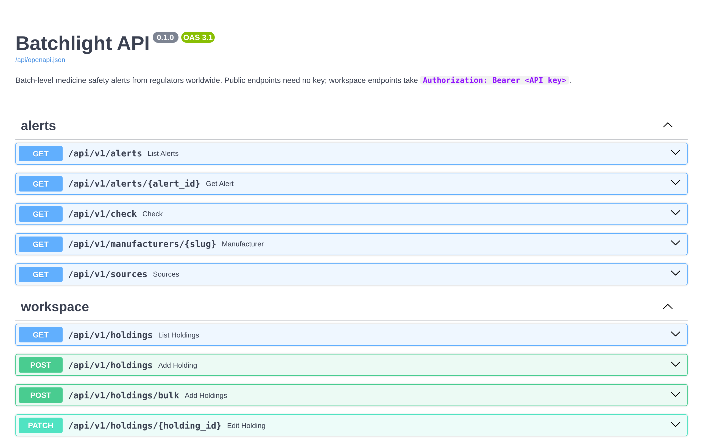

# API documentation

**Medicine Safety** · In the app: `/api/docs`

Interactive documentation for the public alerts API and the workspace API, with live requests.

## Recordings (1)

Click a thumbnail to open the video (MP4, 1920 × 1200, 30 fps).

<table>
<tr>
<td width="50%" valign="top">

 <b>Try the API</b> · 0:19 
Open the interactive API documentation, expand the batch check endpoint, try it with batch SR-13 of Coldrif and read the live JSON response.
</td>
<td width="50%"></td>
</tr>
</table>

## Screenshots (1)

<table>
<tr>
<td width="50%" valign="top">

 <b>API documentation</b> 
Interactive documentation for the public alerts API and the workspace API.
</td>
<td width="50%"></td>
</tr>
</table>

---

[All walkthroughs](../../../../USER_FACING_WALKTHROUGHS.md#api-documentation) · [All screenshots](../../../../USER_FACING_FEATURES.md) · [All features](../../README.md)
