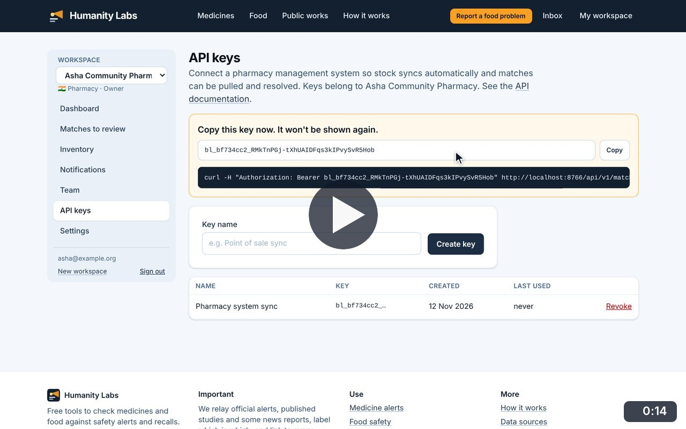
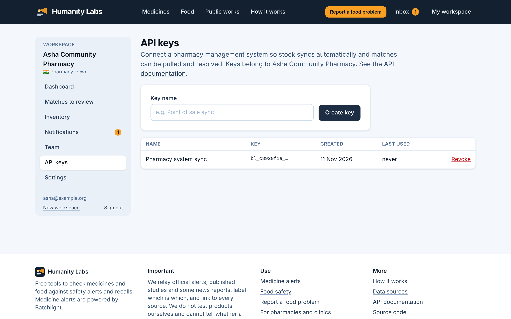

# API keys

**Medicine Safety** · In the app: `/app/api-keys`

Create a key so a pharmacy system can sync stock and pull matches automatically; the full key is shown once, and keys can be revoked.

## Recordings (1)

Click a thumbnail to open the video (MP4, 1920 × 1200, 30 fps).

<table>
<tr>
<td width="50%" valign="top">

 <b>Create and revoke an API key</b> · 0:14 
Create a key for the pharmacy system. The full key is shown once, to copy into that system; the list keeps only its start. Revoking it, after confirming, stops it working.
</td>
<td width="50%"></td>
</tr>
</table>

## Screenshots (1)

<table>
<tr>
<td width="50%" valign="top">

 <b>API keys</b> 
Create a key so a pharmacy management system can sync stock and pull matches automatically. Only the start of each key is shown after it is created.
</td>
<td width="50%"></td>
</tr>
</table>

---

[All walkthroughs](../../../../USER_FACING_WALKTHROUGHS.md#api-keys) · [All screenshots](../../../../USER_FACING_FEATURES.md) · [All features](../../README.md)
