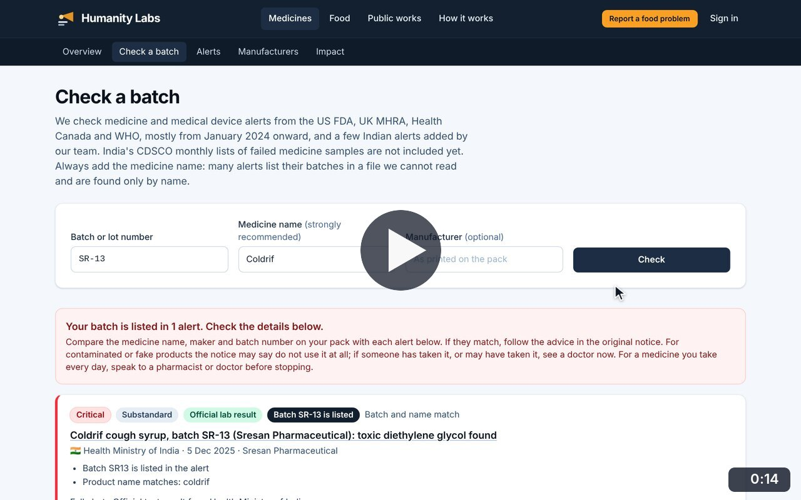
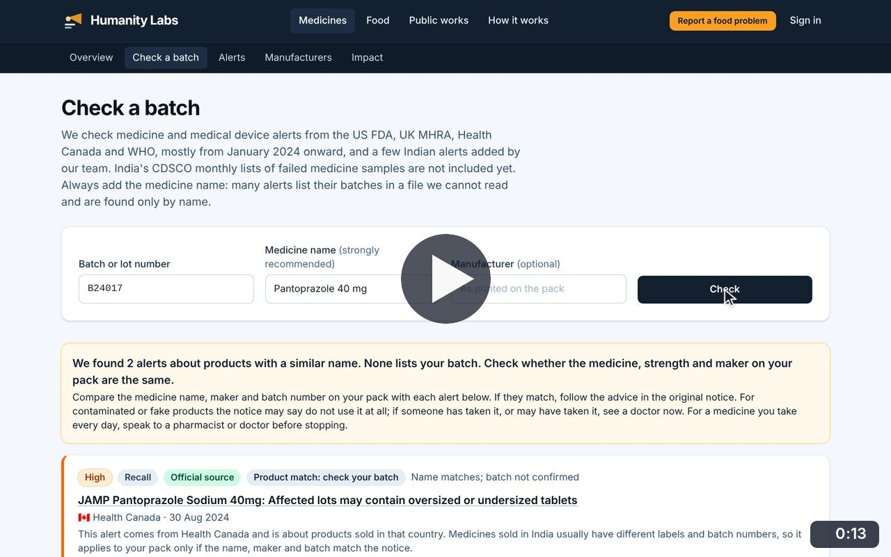
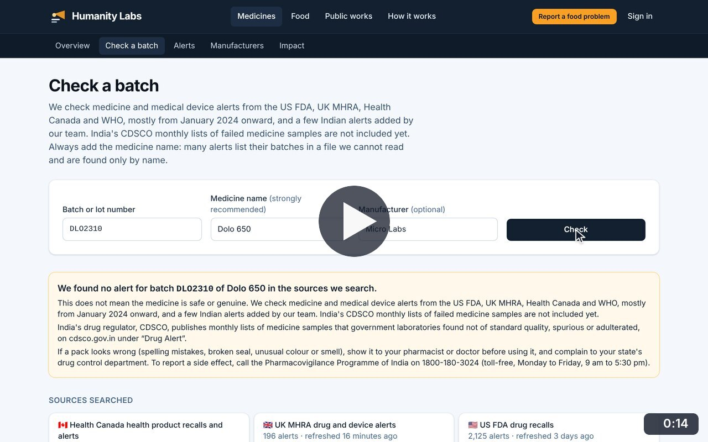
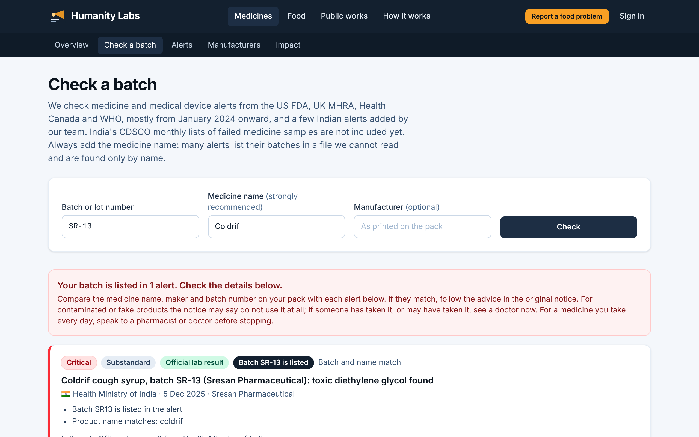
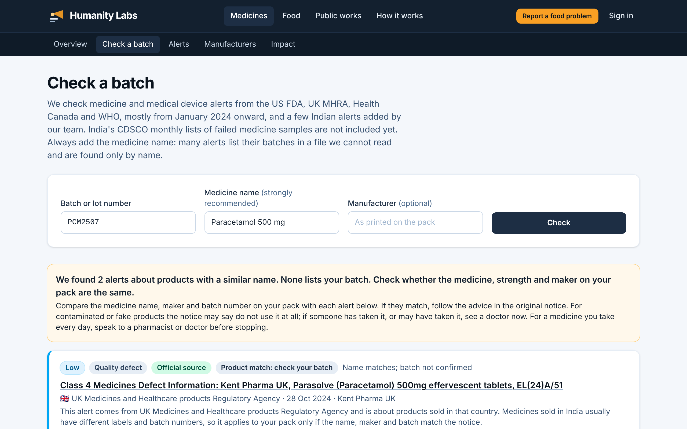

# Batch check

**Medicine Safety** · In the app: `/check`

Type a batch number and medicine name to see whether any alert lists the batch, mentions a similar product, or nothing was found.

## Recordings (3)

Click a thumbnail to open the video (MP4, 1920 × 1200, 30 fps).

<table>
<tr>
<td width="50%" valign="top">

 <b>A batch listed in an alert</b> · 0:14 
Check batch SR-13 of Coldrif: the batch is listed in an official test result, the result explains why it matched, and the alert opens.
</td>
<td width="50%" valign="top">

 <b>A similar name, but not the batch</b> · 0:13 
Check batch B24017 of Pantoprazole 40 mg: alerts mention a similar product but not the batch, so the result asks the user to compare medicine, strength and maker.
</td>
</tr>
<tr>
<td width="50%" valign="top">

 <b>No alert found</b> · 0:14 
Check batch DLO2310 of Dolo 650: no alert names it, the result says exactly which sources were searched, and that &quot;no alert found&quot; does not prove a medicine is genuine.
</td>
<td width="50%"></td>
</tr>
</table>

## Screenshots (2)

<table>
<tr>
<td width="50%" valign="top">

 <b>Batch check: exact match</b> 
Checking batch SR-13 of Coldrif finds the alert that lists it. The result explains why it matched (batch and name) and what to do next.
</td>
<td width="50%" valign="top">

 <b>Batch check: similar name only</b> 
When alerts mention a similar product but not the batch, the result says so in a different colour and asks the user to compare strength and maker.
</td>
</tr>
</table>

---

[All walkthroughs](../../../../USER_FACING_WALKTHROUGHS.md#batch-check) · [All screenshots](../../../../USER_FACING_FEATURES.md) · [All features](../../README.md)
