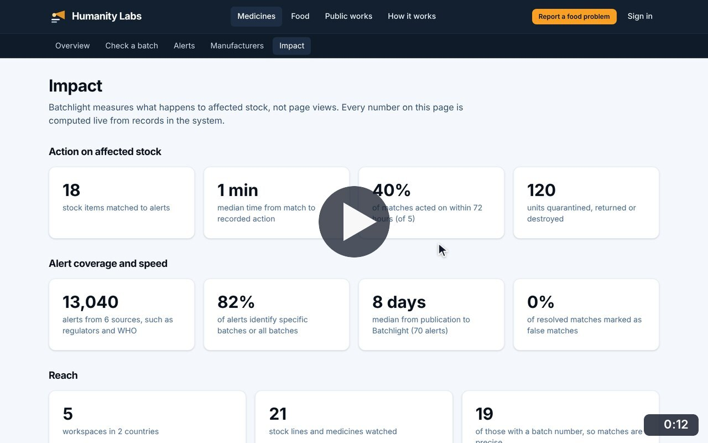
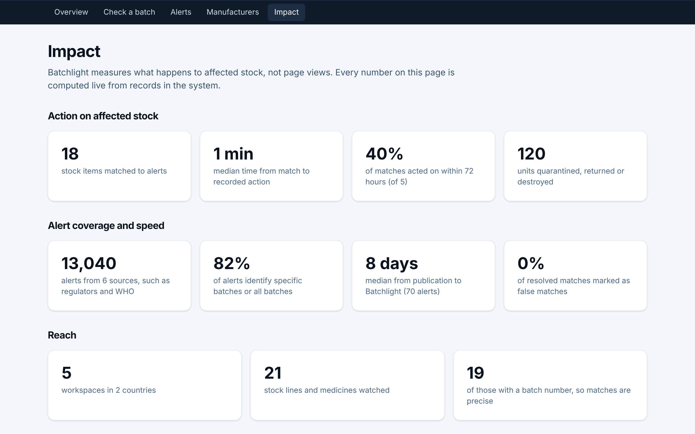

# Impact

**Medicine Safety** · In the app: `/impact`

Live figures on action taken on affected stock, alert coverage and speed, reach, food safety activity, and alerts by source and severity.

## Recordings (1)

Click a thumbnail to open the video (MP4, 1920 × 1200, 30 fps).

<table>
<tr>
<td width="50%" valign="top">

 <b>Impact figures</b> · 0:12 
Every figure is computed live from records: action taken on affected stock, alert coverage and speed, reach, food safety activity, and alerts by source and severity.
</td>
<td width="50%"></td>
</tr>
</table>

## Screenshots (1)

<table>
<tr>
<td width="50%" valign="top">

 <b>Impact</b> 
Figures computed live from the records: action taken on affected stock, alert coverage and speed, and reach. The workspace figures count the demo and walkthrough workspaces in this database, not real use.
</td>
<td width="50%"></td>
</tr>
</table>

---

[All walkthroughs](../../../../USER_FACING_WALKTHROUGHS.md#impact) · [All screenshots](../../../../USER_FACING_FEATURES.md) · [All features](../../README.md)
