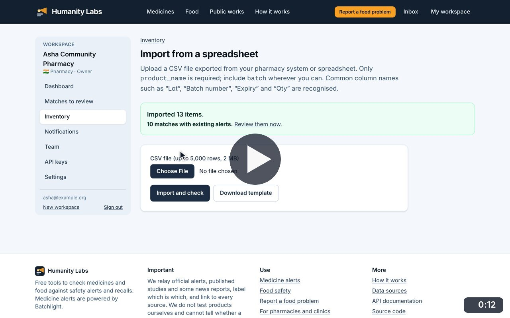
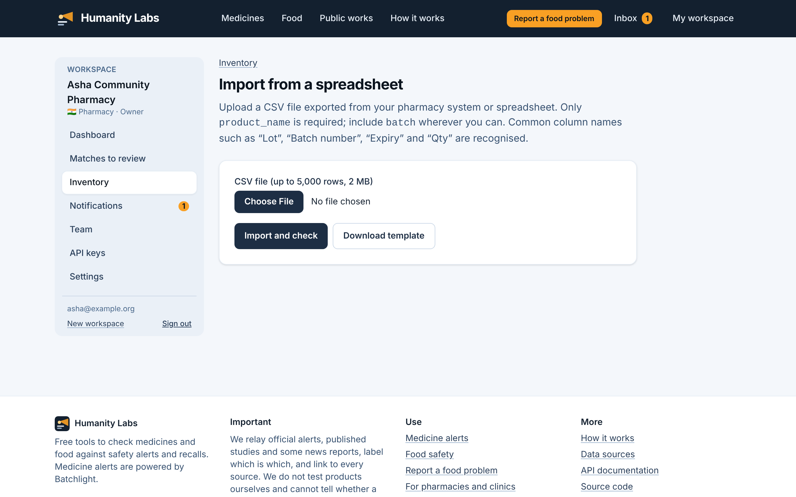

# Import from a spreadsheet

**Medicine Safety** · In the app: `/app/inventory/import`

Upload a CSV exported from a pharmacy system; common column names are recognised and every row is checked against every alert at once.

## Recordings (1)

Click a thumbnail to open the video (MP4, 1920 × 1200, 30 fps).

<table>
<tr>
<td width="50%" valign="top">

 <b>Import stock from a spreadsheet</b> · 0:12 
Choose a CSV of the pharmacy&#x27;s stock and import it. Every row is checked against every alert; the summary links straight to the matches.
</td>
<td width="50%"></td>
</tr>
</table>

## Screenshots (1)

<table>
<tr>
<td width="50%" valign="top">

 <b>Import from a spreadsheet</b> 
Upload a CSV exported from a pharmacy system. Common column names such as &quot;Lot&quot;, &quot;Batch number&quot; and &quot;Expiry&quot; are recognised, and the import is checked against every alert at once.
</td>
<td width="50%"></td>
</tr>
</table>

---

[All walkthroughs](../../../../USER_FACING_WALKTHROUGHS.md#import-from-a-spreadsheet) · [All screenshots](../../../../USER_FACING_FEATURES.md) · [All features](../../README.md)
