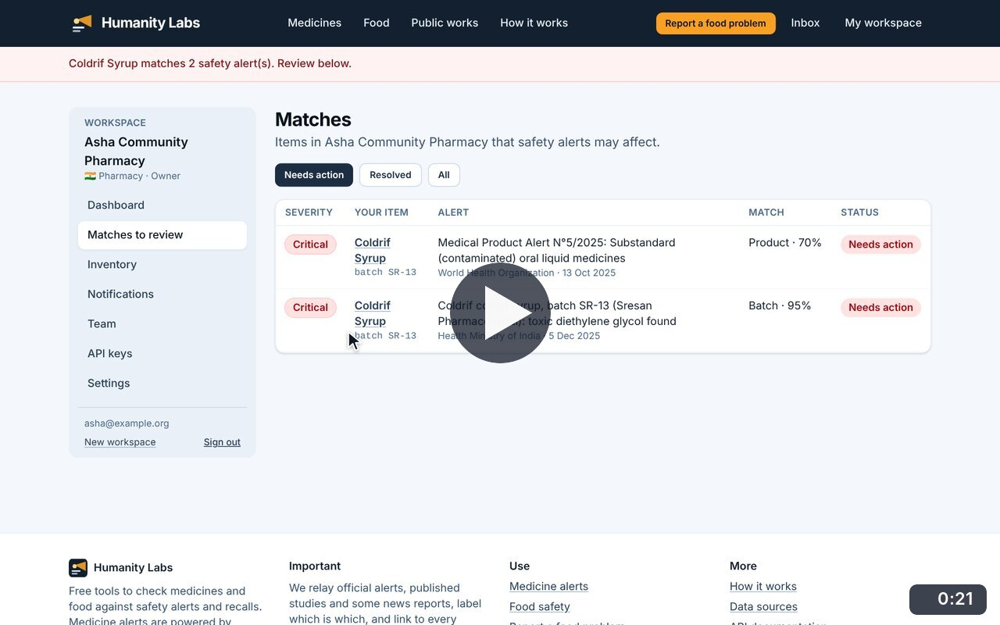
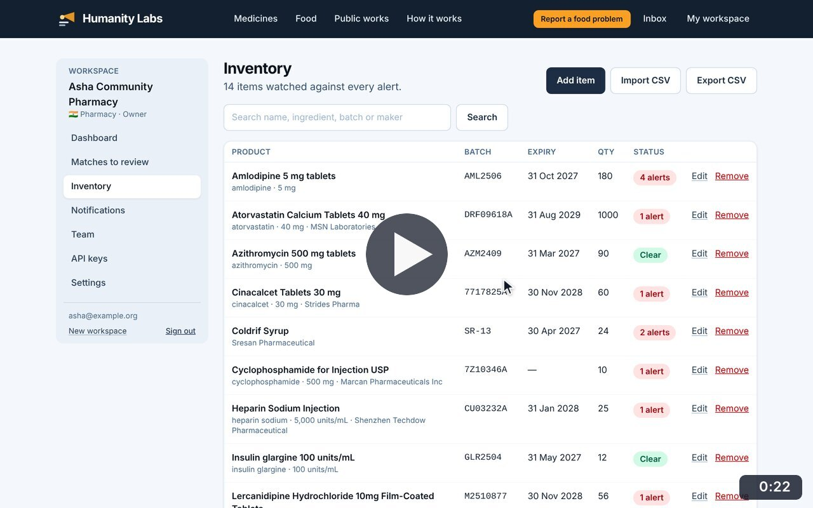
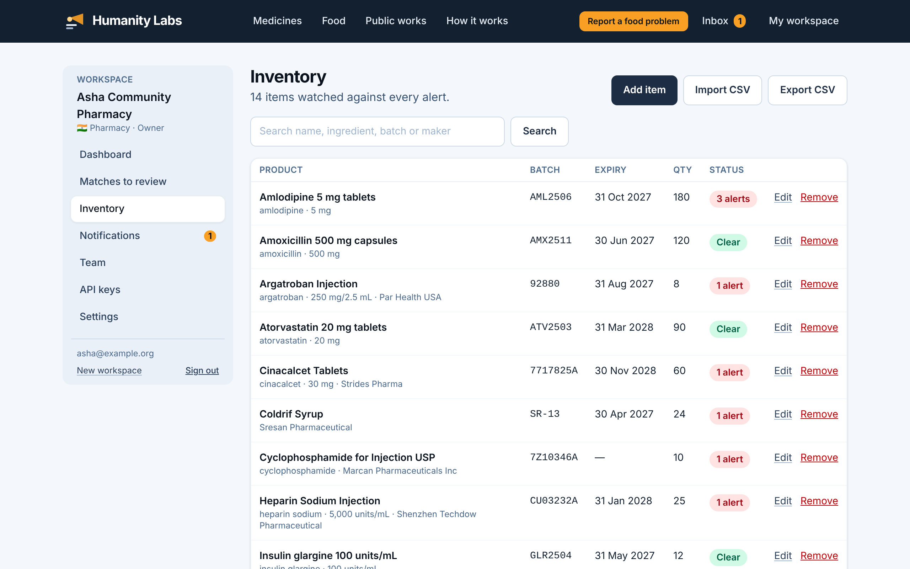
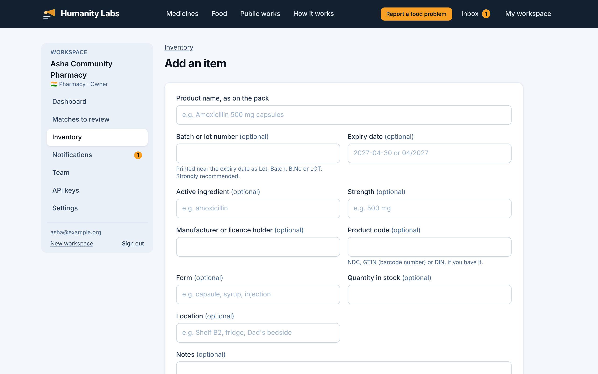

# Inventory

**Medicine Safety** · In the app: `/app/inventory`, `/app/inventory/new`, `/app/inventory/{id}/edit`

List stock with batch, expiry and quantity; add, search, edit and remove items; export the list as CSV. Each item shows whether alerts may affect it.

## Recordings (2)

Click a thumbnail to open the video (MP4, 1920 × 1200, 30 fps).

<table>
<tr>
<td width="50%" valign="top">

 <b>Add an item</b> · 0:21 
Add Coldrif cough syrup, batch SR-13, by hand. On saving, Batchlight checks it against every alert at once and reports the matches.
</td>
<td width="50%" valign="top">

 <b>Search, edit and remove items</b> · 0:22 
Search the stock, edit an item&#x27;s quantity, then remove an item from the list after confirming. The list shows each item&#x27;s status: clear, or how many alerts may affect it.
</td>
</tr>
</table>

## Screenshots (2)

<table>
<tr>
<td width="50%" valign="top">

 <b>Inventory</b> 
The stock list with batch, expiry and quantity. A status on each row shows whether the item is clear or how many alerts may affect it.
</td>
<td width="50%" valign="top">

 <b>Add an item</b> 
Add one item by hand. Only the product name is required; the batch number is strongly recommended because it allows exact matches.
</td>
</tr>
</table>

---

[All walkthroughs](../../../../USER_FACING_WALKTHROUGHS.md#inventory) · [All screenshots](../../../../USER_FACING_FEATURES.md) · [All features](../../README.md)
