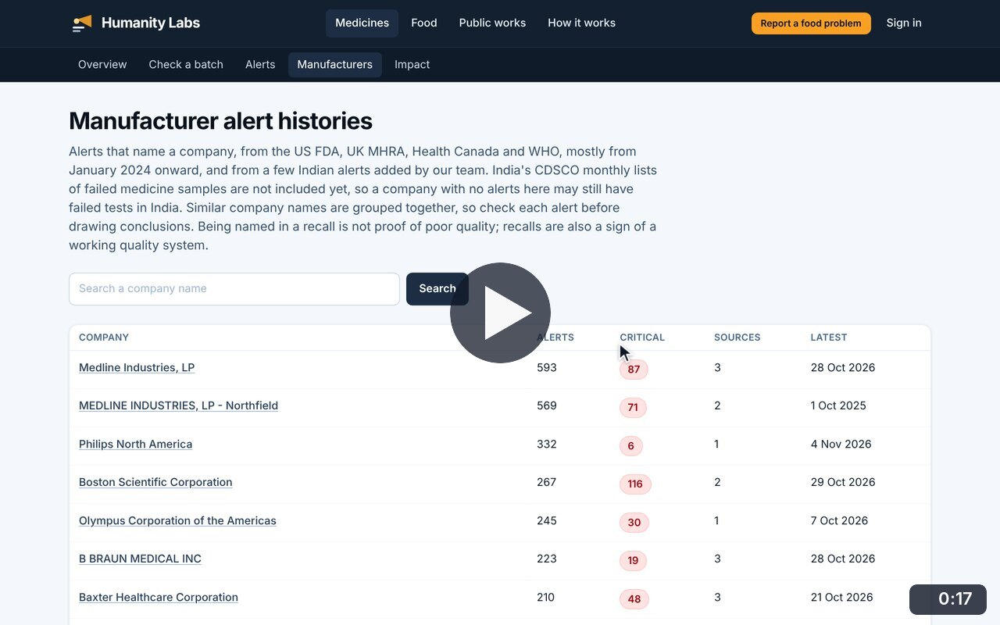
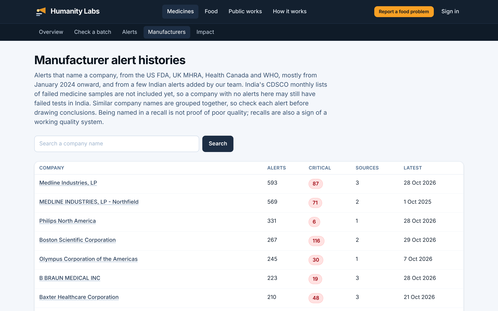
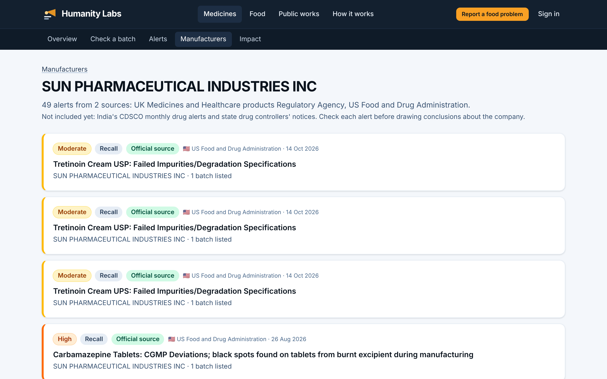

# Manufacturer histories

**Medicine Safety** · In the app: `/manufacturers`, `/manufacturers/{slug}`

Companies named in alerts, with counts of alerts and critical alerts, and each company's full alert history.

## Recordings (1)

Click a thumbnail to open the video (MP4, 1920 × 1200, 30 fps).

<table>
<tr>
<td width="50%" valign="top">

 <b>Manufacturer alert histories</b> · 0:17 
Read the company table, search for Sun Pharmaceutical, open its history across sources and then one of its alerts.
</td>
<td width="50%"></td>
</tr>
</table>

## Screenshots (2)

<table>
<tr>
<td width="50%" valign="top">

 <b>Manufacturer alert histories</b> 
Companies named in alerts, with the number of alerts, how many were critical, how many sources named them and the latest date. A note explains that a recall is not proof of poor quality.
</td>
<td width="50%" valign="top">

 <b>One manufacturer&#x27;s history</b> 
Every alert that names one company, across sources, newest first.
</td>
</tr>
</table>

---

[All walkthroughs](../../../../USER_FACING_WALKTHROUGHS.md#manufacturer-histories) · [All screenshots](../../../../USER_FACING_FEATURES.md) · [All features](../../README.md)
