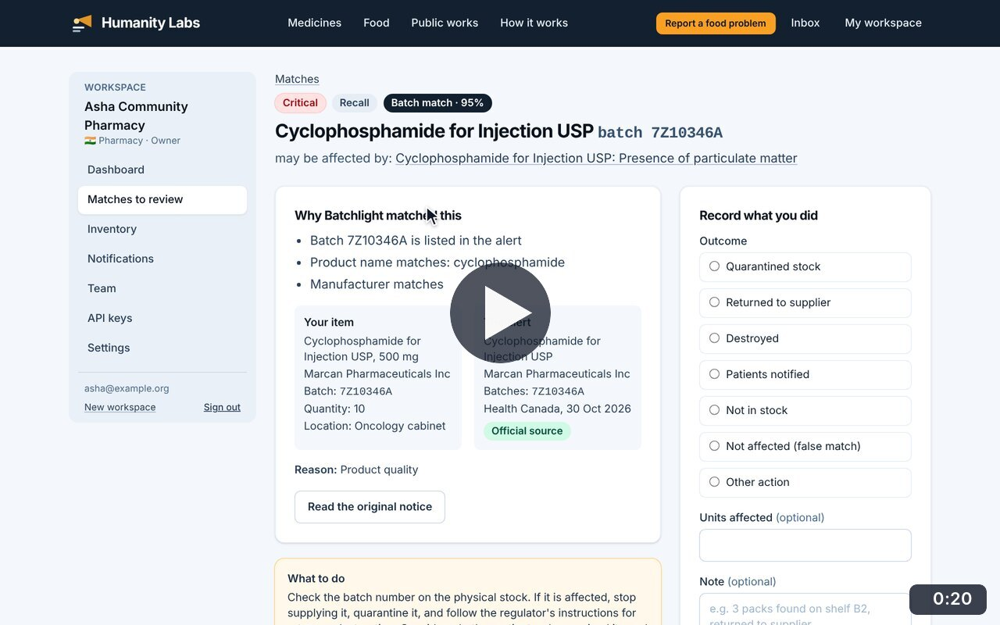
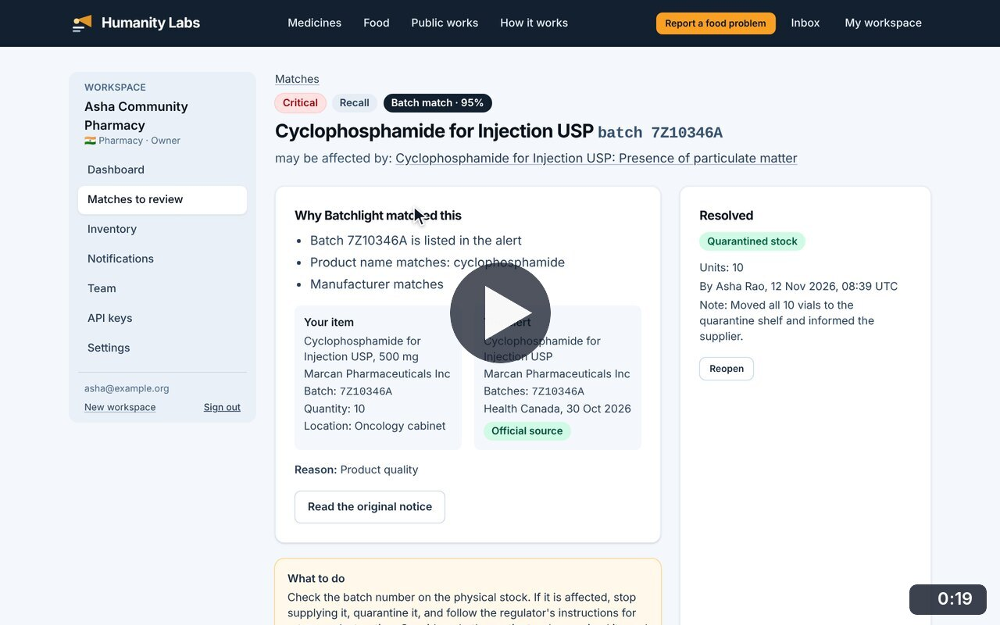
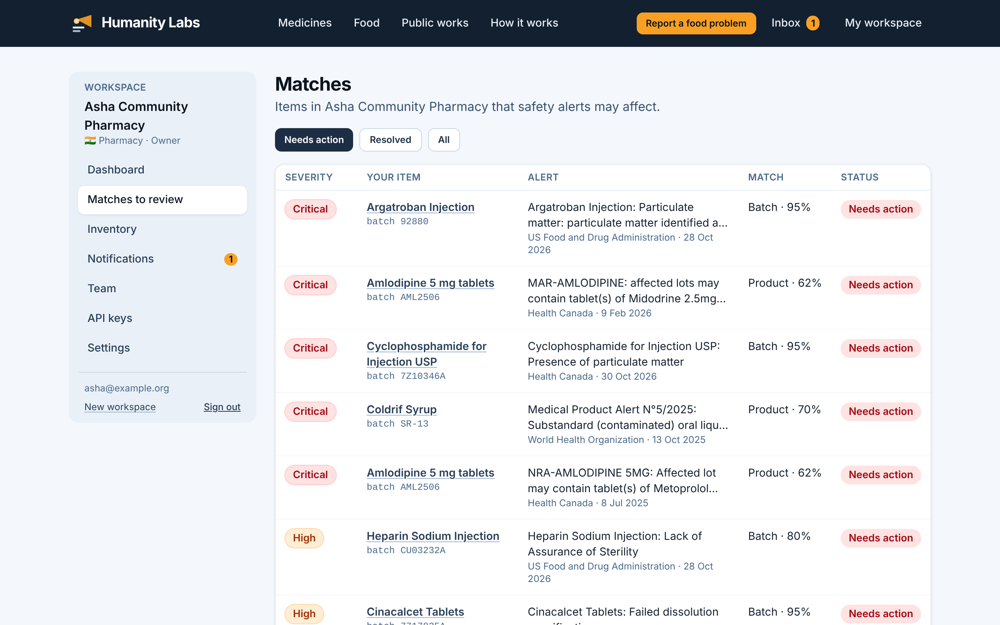
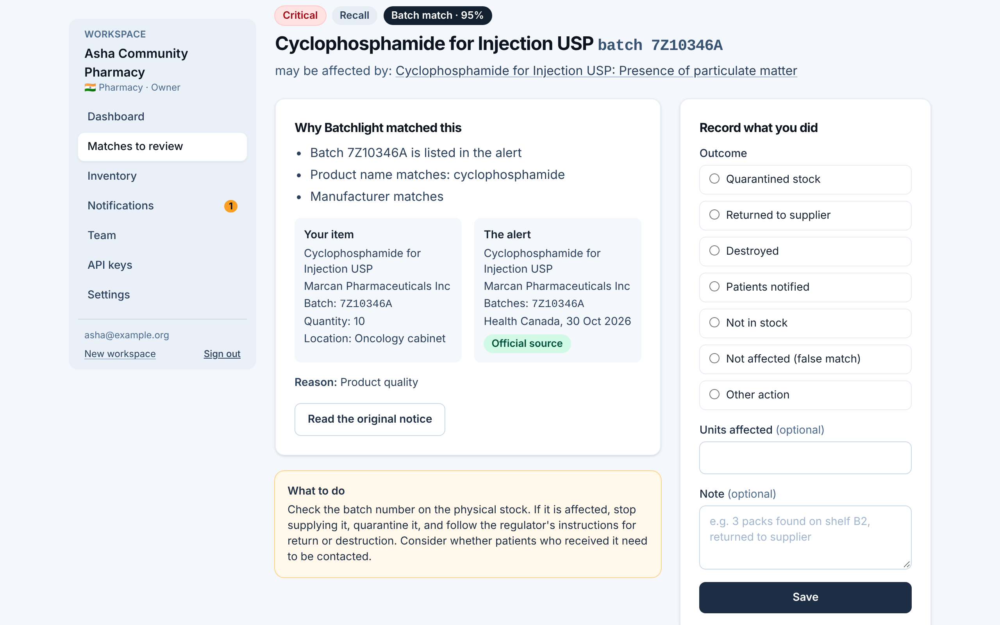
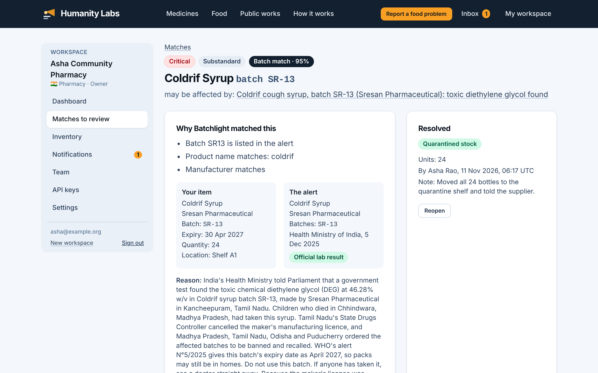

# Matches

**Medicine Safety** · In the app: `/app/matches`, `/app/matches/{id}`

Stock items that alerts may affect: why each matched, what to do, recording the outcome, and reopening a resolved match.

## Recordings (2)

Click a thumbnail to open the video (MP4, 1920 × 1200, 30 fps).

<table>
<tr>
<td width="50%" valign="top">

 <b>Review a match and record the outcome</b> · 0:20 
Open the cyclophosphamide match: why it matched (batch, name and maker), the stock record beside the alert and what to do. Record that the stock was quarantined, with units and a note.
</td>
<td width="50%" valign="top">

 <b>Filter matches and reopen one</b> · 0:19 
Switch between matches that need action, resolved and all; open the resolved match to see who recorded what and when, and reopen it.
</td>
</tr>
</table>

## Screenshots (3)

<table>
<tr>
<td width="50%" valign="top">

 <b>Matches to review</b> 
Stock items that alerts may affect. Each row shows the severity, the item and batch, the alert, how it matched (batch or product name) with a confidence score, and its status.
</td>
<td width="50%" valign="top">

 <b>Match detail</b> 
Why Batchlight matched an item, with the stock record and the alert side by side, advice on what to do, and a form to record the outcome.
</td>
</tr>
<tr>
<td width="50%" valign="top">

 <b>Recorded outcome</b> 
A resolved match keeps a record of what was done, how many units were affected, who recorded it and when. It can be reopened.
</td>
<td width="50%"></td>
</tr>
</table>

---

[All walkthroughs](../../../../USER_FACING_WALKTHROUGHS.md#matches) · [All screenshots](../../../../USER_FACING_FEATURES.md) · [All features](../../README.md)
