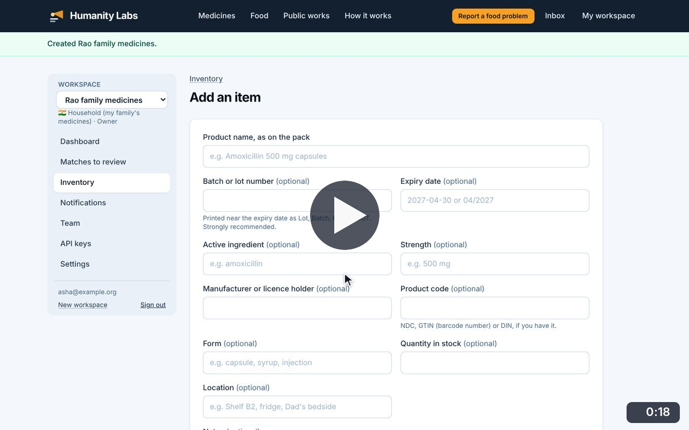
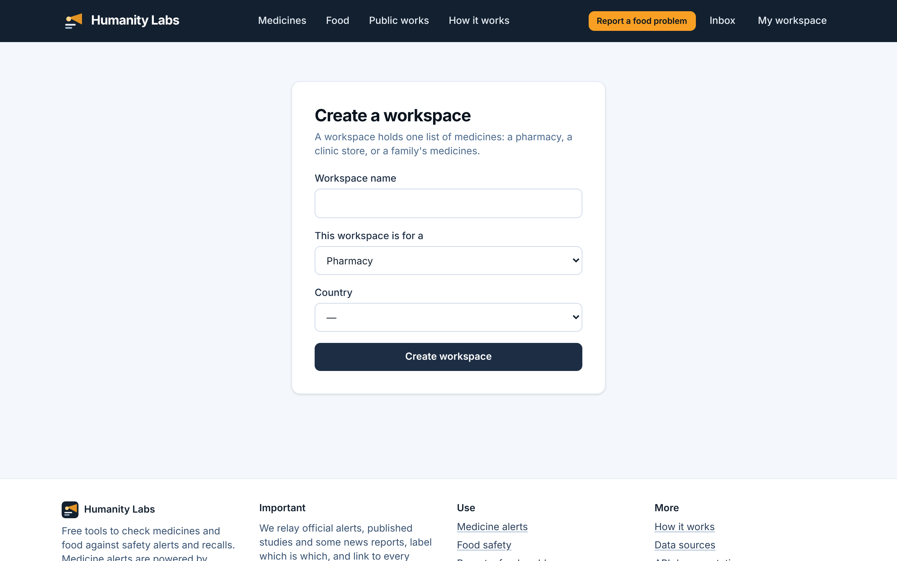

# Multiple workspaces

**Medicine Safety** · In the app: `/app/workspaces/new`

Create another workspace, for example a household alongside a pharmacy, and switch between them.

## Recordings (1)

Click a thumbnail to open the video (MP4, 1920 × 1200, 30 fps).

<table>
<tr>
<td width="50%" valign="top">

 <b>Create and switch workspaces</b> · 0:18 
Create a second workspace for the family&#x27;s own medicines, then switch back to the pharmacy from the workspace menu.
</td>
<td width="50%"></td>
</tr>
</table>

## Screenshots (1)

<table>
<tr>
<td width="50%" valign="top">

 <b>Create another workspace</b> 
One person can hold several workspaces, for example a pharmacy and the family&#x27;s own medicines, and switch between them from the sidebar.
</td>
<td width="50%"></td>
</tr>
</table>

---

[All walkthroughs](../../../../USER_FACING_WALKTHROUGHS.md#multiple-workspaces) · [All screenshots](../../../../USER_FACING_FEATURES.md) · [All features](../../README.md)
