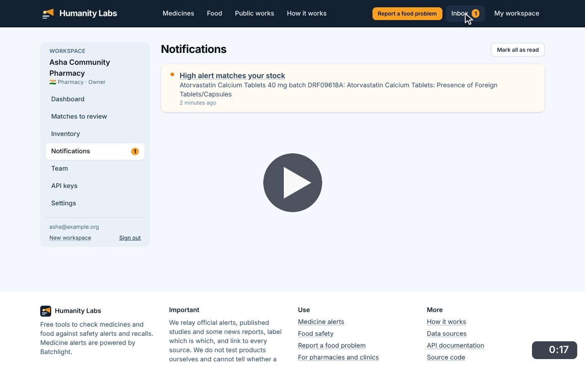
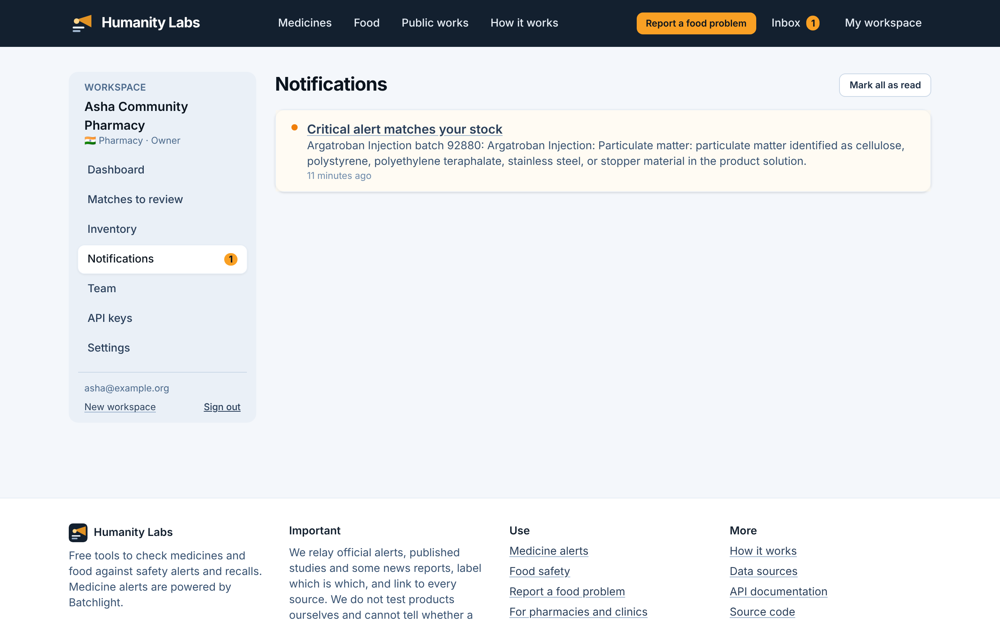

# Notifications

**Medicine Safety** · In the app: `/app/notifications`

When a newly published alert matches something in stock, everyone in the workspace is notified in the app (and by an email digest if switched on).

## Recordings (1)

Click a thumbnail to open the video (MP4, 1920 × 1200, 30 fps).

<table>
<tr>
<td width="50%" valign="top">

 <b>A new alert matches your stock</b> · 0:17 
After the US FDA source refreshed, a newly published recall of atorvastatin batch DRF09618A matched the pharmacy&#x27;s stock. The inbox badge shows it; mark it as read, then open the match it points to.
</td>
<td width="50%"></td>
</tr>
</table>

## Screenshots (1)

<table>
<tr>
<td width="50%" valign="top">

 <b>Notifications</b> 
When a newly published alert matches something in stock, everyone in the workspace is notified here and, if switched on, by an email digest.
</td>
<td width="50%"></td>
</tr>
</table>

---

[All walkthroughs](../../../../USER_FACING_WALKTHROUGHS.md#notifications) · [All screenshots](../../../../USER_FACING_FEATURES.md) · [All features](../../README.md)
