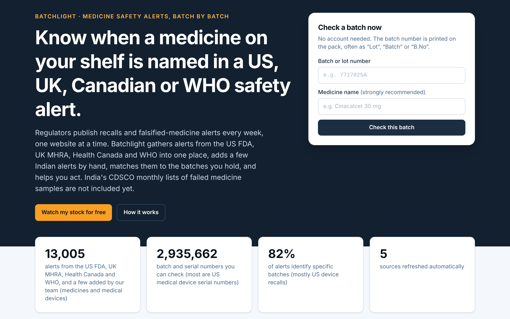
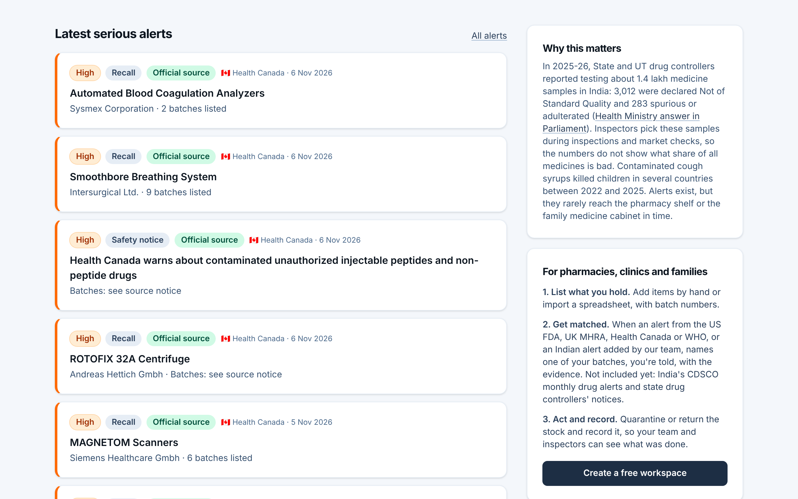

# Medicine Safety overview

**Medicine Safety** · In the app: `/medicines`

Check a batch without an account, see the coverage counters, the latest serious alerts and how the workspace helps pharmacies, clinics and families.

## Recordings (1)

Click a thumbnail to open the video (MP4, 1920 × 1200, 30 fps).

<table>
<tr>
<td width="50%" valign="top">

 <b>Medicine Safety overview</b> · 0:18 
The batch check, the coverage counters, the latest serious alerts, why this matters in India, the three steps for pharmacies and families, and the sources.
</td>
<td width="50%"></td>
</tr>
</table>

## Screenshots (2)

<table>
<tr>
<td width="50%" valign="top">

 <b>Medicine Safety home</b> 
Batchlight, the medicine module: check a batch without an account, or watch your stock for free. The counters show alerts held, batch numbers read from them, and the share of alerts that name specific batches.
</td>
<td width="50%" valign="top">

 <b>Latest serious alerts</b> 
The newest serious medicine and device alerts, beside a sourced explanation of why this matters and the three steps for pharmacies, clinics and families.
</td>
</tr>
</table>

---

[All walkthroughs](../../../../USER_FACING_WALKTHROUGHS.md#medicine-safety-overview) · [All screenshots](../../../../USER_FACING_FEATURES.md) · [All features](../../README.md)
