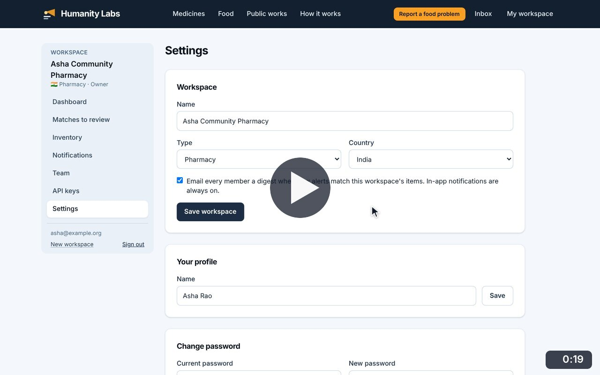
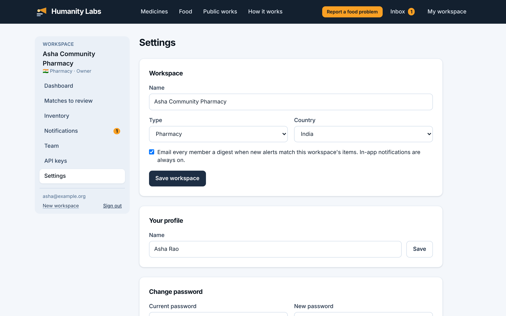

# Settings

**Medicine Safety** · In the app: `/app/settings`

Workspace name, type, country and email digest, the user's profile and password.

## Recordings (1)

Click a thumbnail to open the video (MP4, 1920 × 1200, 30 fps).

<table>
<tr>
<td width="50%" valign="top">

 <b>Workspace, profile and password settings</b> · 0:19 
Turn the email digest off and save, turn it back on, then change the password.
</td>
<td width="50%"></td>
</tr>
</table>

## Screenshots (1)

<table>
<tr>
<td width="50%" valign="top">

 <b>Workspace settings</b> 
Workspace name, type and country, the email digest switch, the user&#x27;s profile and password.
</td>
<td width="50%"></td>
</tr>
</table>

---

[All walkthroughs](../../../../USER_FACING_WALKTHROUGHS.md#settings) · [All screenshots](../../../../USER_FACING_FEATURES.md) · [All features](../../README.md)
