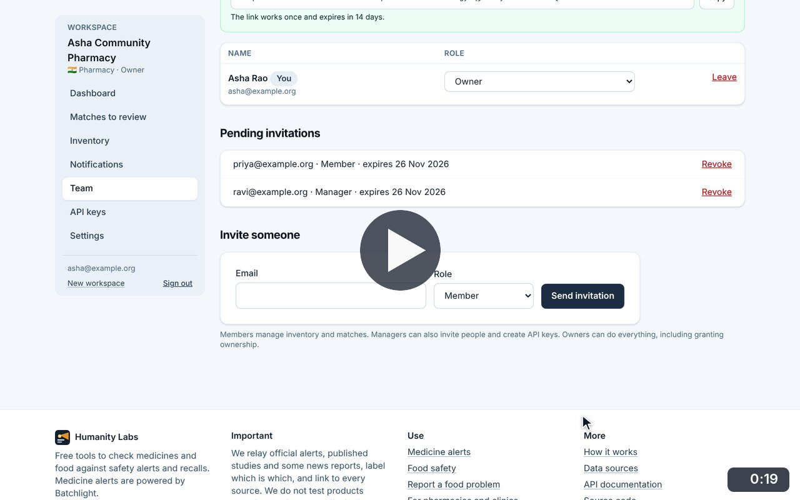
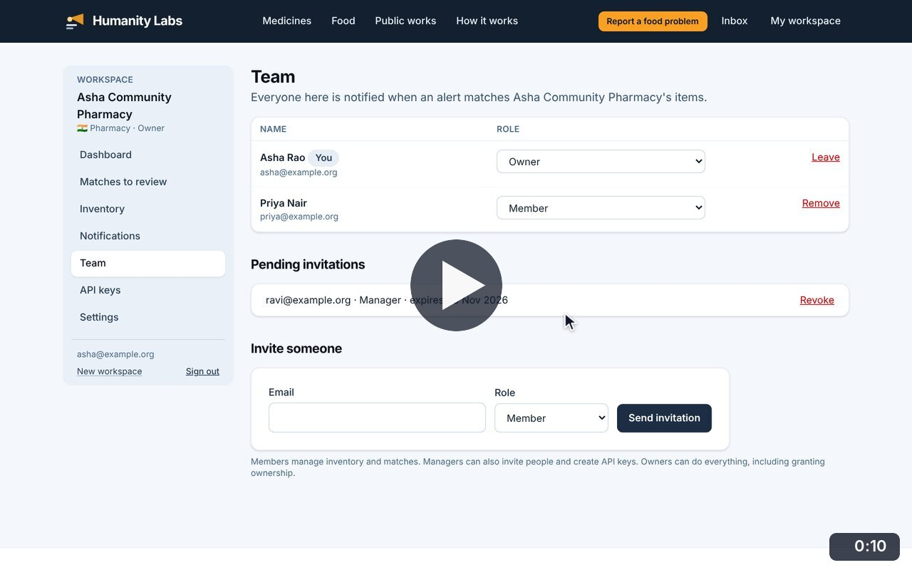
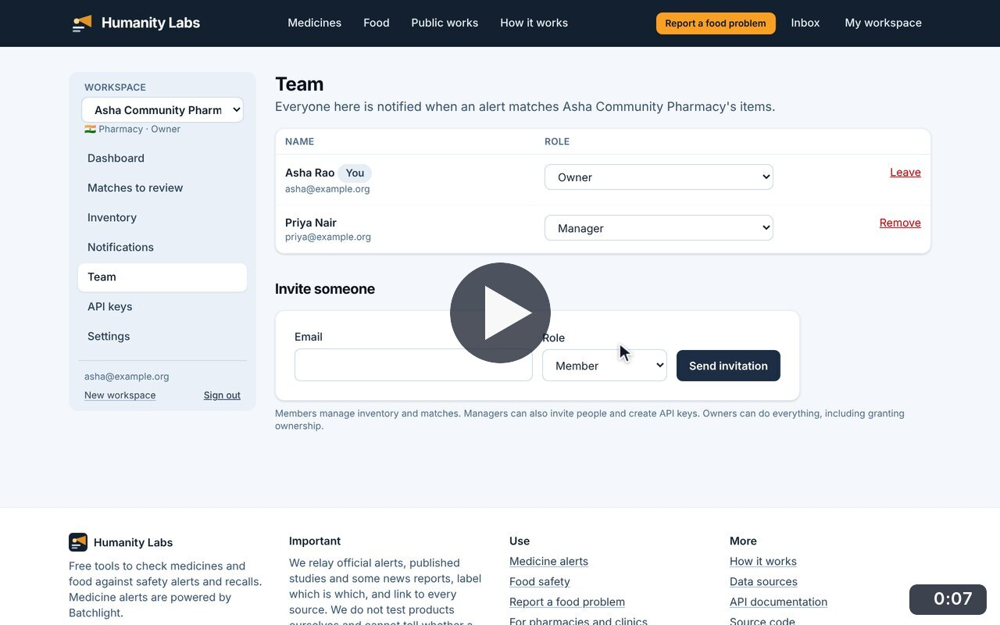
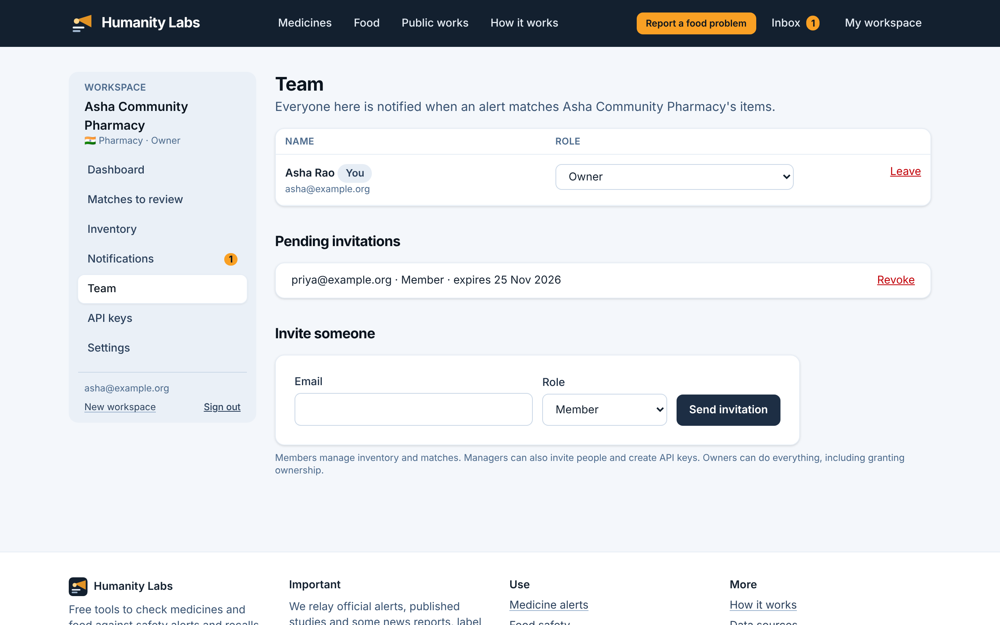

# Team and invitations

**Medicine Safety** · In the app: `/app/team`

Invite colleagues as owner, manager or member, see pending invitations, change roles and revoke invitations.

## Recordings (3)

Click a thumbnail to open the video (MP4, 1920 × 1200, 30 fps).

<table>
<tr>
<td width="50%" valign="top">

 <b>Invite colleagues</b> · 0:19 
Invite a pharmacist as a member and a colleague as a manager. Each invitation gets a single-use link, also sent by email, and appears under pending invitations.
</td>
<td width="50%" valign="top">

 <b>Change roles and revoke an invitation</b> · 0:10 
The new member now appears in the team. Make her a manager, then revoke the invitation that is still pending.
</td>
</tr>
<tr>
<td width="50%" valign="top">

 <b>Remove a member</b> · 0:07 
Remove a member from the workspace after confirming; she loses access to its stock and matches straight away.
</td>
<td width="50%"></td>
</tr>
</table>

## Screenshots (1)

<table>
<tr>
<td width="50%" valign="top">

 <b>Team and invitations</b> 
Invite colleagues by email as owner, manager or member, see pending invitations and change roles.
</td>
<td width="50%"></td>
</tr>
</table>

---

[All walkthroughs](../../../../USER_FACING_WALKTHROUGHS.md#team-and-invitations) · [All screenshots](../../../../USER_FACING_FEATURES.md) · [All features](../../README.md)
