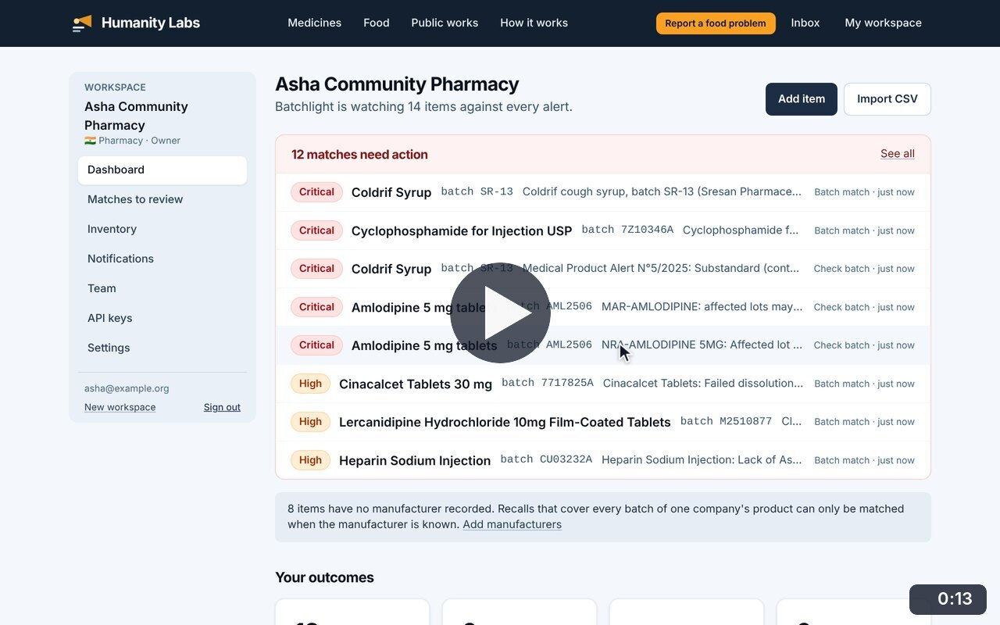
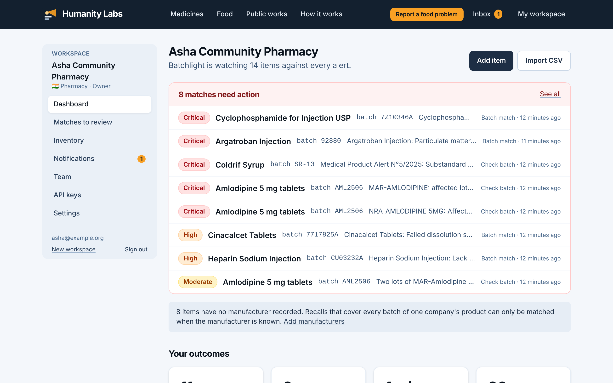
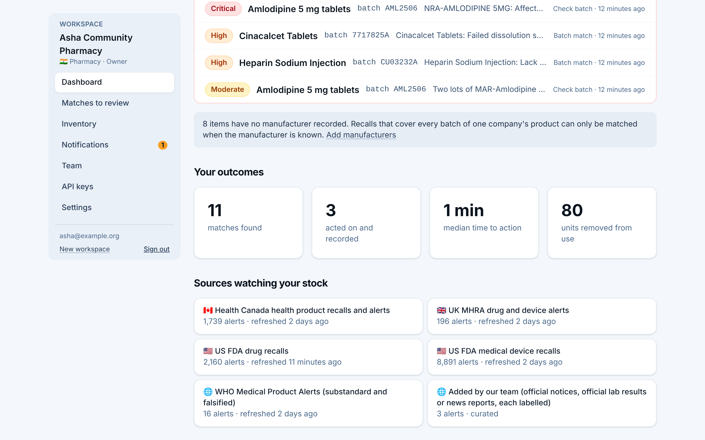

# Workspace dashboard

**Medicine Safety** · In the app: `/app`

What the workspace is watching, the matches that need action, outcomes recorded so far and the sources watching the stock.

## Recordings (1)

Click a thumbnail to open the video (MP4, 1920 × 1200, 30 fps).

<table>
<tr>
<td width="50%" valign="top">

 <b>Workspace dashboard</b> · 0:13 
What the workspace is watching, the matches that need action (most severe first), the outcomes recorded so far, and the sources watching the stock.
</td>
<td width="50%"></td>
</tr>
</table>

## Screenshots (2)

<table>
<tr>
<td width="50%" valign="top">

 <b>Workspace dashboard</b> 
The pharmacy&#x27;s home screen: how many stock items are being watched and which matches need action, most severe first.
</td>
<td width="50%" valign="top">

 <b>Outcomes and sources</b> 
What the workspace has done about its matches (acted on, time to action, units removed from use) and the sources watching its stock, with their last refresh.
</td>
</tr>
</table>

---

[All walkthroughs](../../../../USER_FACING_WALKTHROUGHS.md#workspace-dashboard) · [All screenshots](../../../../USER_FACING_FEATURES.md) · [All features](../../README.md)
