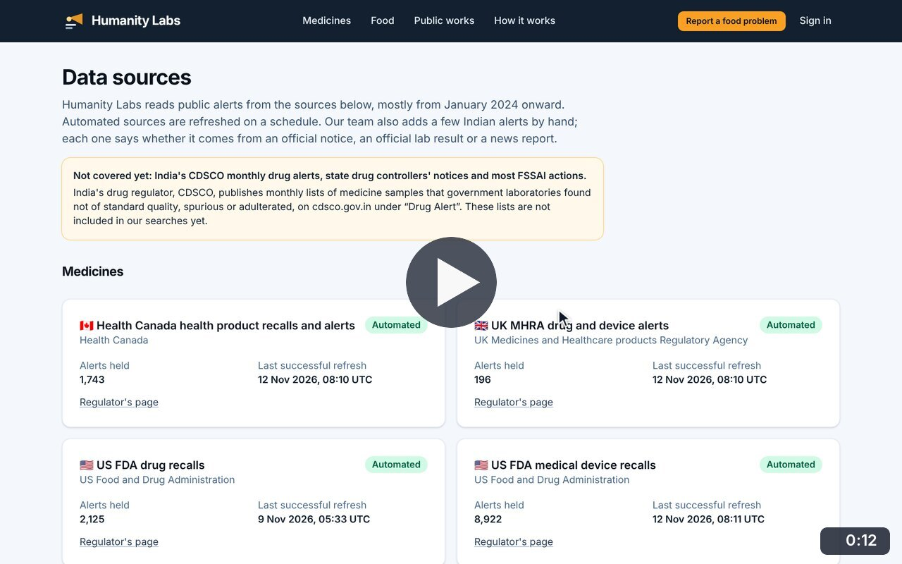
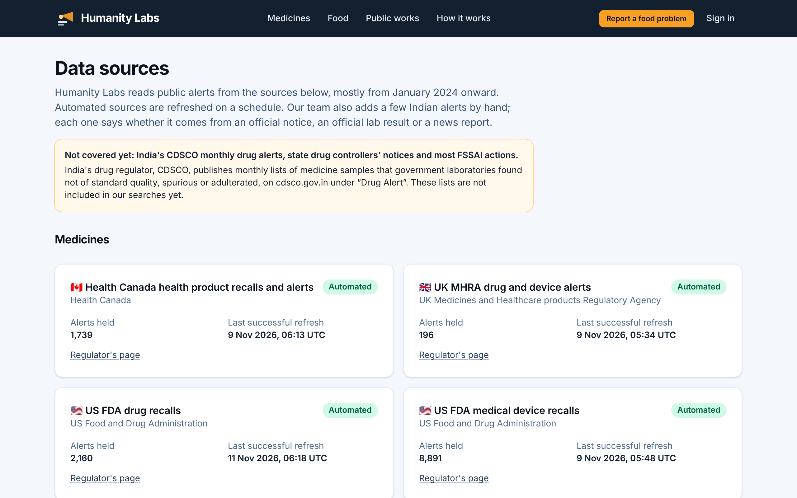

# Data sources

**Shared pages** · In the app: `/sources`

Every connected medicine and food source, how many alerts it holds and when it was last refreshed, with a plain note on what is not covered yet.

## Recordings (1)

Click a thumbnail to open the video (MP4, 1920 × 1200, 30 fps).

<table>
<tr>
<td width="50%" valign="top">

 <b>Data sources and freshness</b> · 0:12 
Read what is not covered yet, then each medicine and food source with the number of alerts held and its last successful refresh, and the licences the data is used under.
</td>
<td width="50%"></td>
</tr>
</table>

## Screenshots (1)

<table>
<tr>
<td width="50%" valign="top">

 <b>Data sources and freshness</b> 
Every connected source with the number of alerts held and the time of its last successful refresh. A note at the top states plainly what is not covered yet.
</td>
<td width="50%"></td>
</tr>
</table>

---

[All walkthroughs](../../../../USER_FACING_WALKTHROUGHS.md#data-sources) · [All screenshots](../../../../USER_FACING_FEATURES.md) · [All features](../../README.md)
