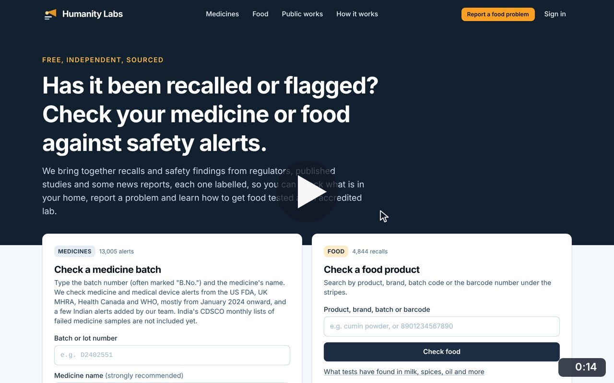
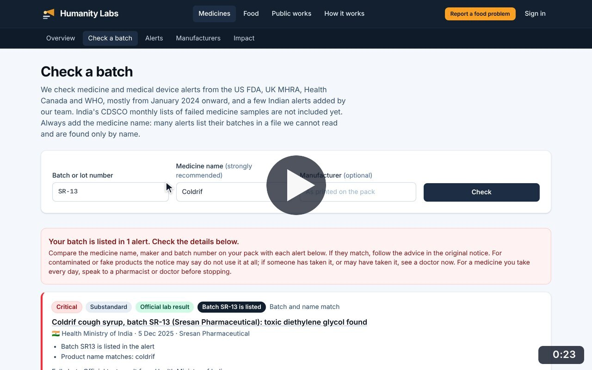
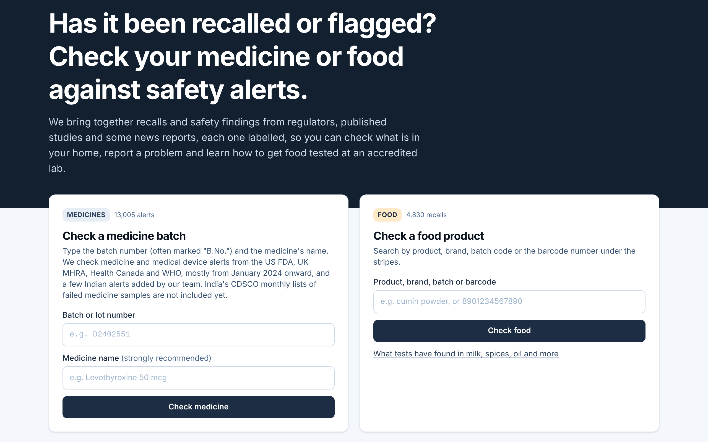
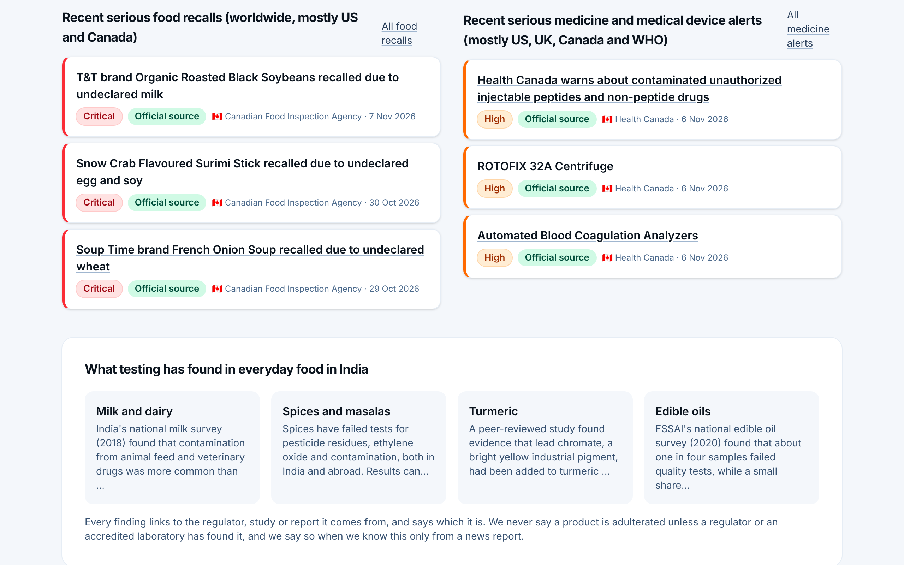

# Home page

**Shared pages** · In the app: `/`

Check a medicine batch or a food product straight from the home page, and see the latest serious alerts and what testing has found in everyday food in India.

## Recordings (2)

Click a thumbnail to open the video (MP4, 1920 × 1200, 30 fps).

<table>
<tr>
<td width="50%" valign="top">

 <b>Tour the home page</b> · 0:14 
Scroll from the two checks at the top through the latest serious food recalls and medicine alerts, what testing has found in India, and what the service does and does not do.
</td>
<td width="50%" valign="top">

 <b>Check a medicine and a food from the home page</b> · 0:23 
Check batch SR-13 of Coldrif cough syrup and find the alert that lists it, then return home and search food recalls for &quot;ghee&quot;.
</td>
</tr>
</table>

## Screenshots (2)

<table>
<tr>
<td width="50%" valign="top">

 <b>One home page, two checks</b> 
The home page lets anyone check a medicine batch or a food product straight away, with no account. Counters show how many alerts and recalls are searchable.
</td>
<td width="50%" valign="top">

 <b>Recent serious alerts</b> 
The latest serious food recalls and medicine alerts side by side, each labelled with its severity, its evidence type and the regulator that published it. Below, a summary of what testing has found in everyday food in India.
</td>
</tr>
</table>

---

[All walkthroughs](../../../../USER_FACING_WALKTHROUGHS.md#home-page) · [All screenshots](../../../../USER_FACING_FEATURES.md) · [All features](../../README.md)
