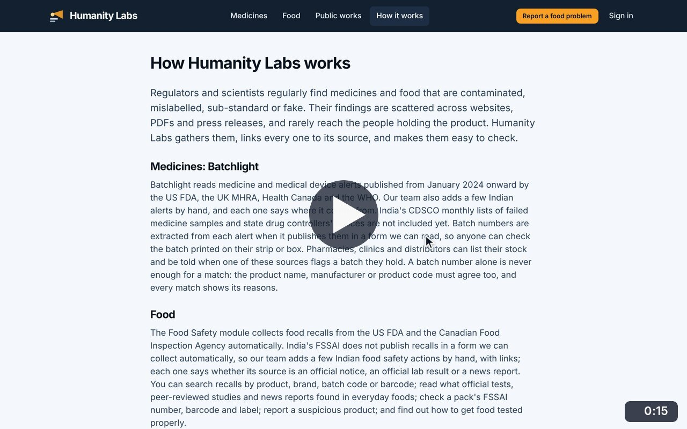
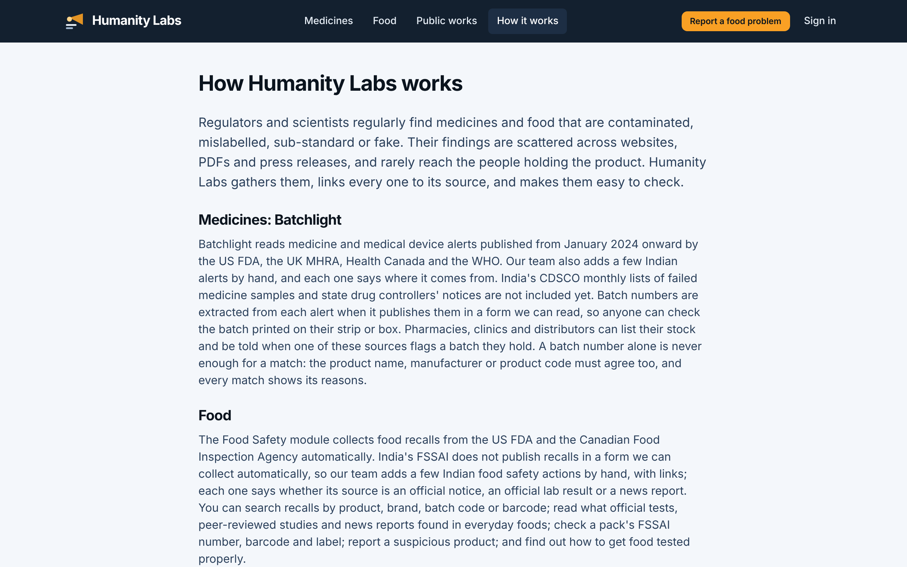

# How it works

**Shared pages** · In the app: `/about`

Where the data comes from, the evidence rules every alert follows, what the service does not do, and how privacy is handled.

## Recordings (1)

Click a thumbnail to open the video (MP4, 1920 × 1200, 30 fps).

<table>
<tr>
<td width="50%" valign="top">

 <b>How it works</b> · 0:15 
Read how the medicine and food modules work, the evidence rules, what the service is not, and its privacy approach, then continue to Food Safety.
</td>
<td width="50%"></td>
</tr>
</table>

## Screenshots (1)

<table>
<tr>
<td width="50%" valign="top">

 <b>How it works</b> 
A plain-language explanation of where the data comes from, the evidence rules, and what the service does not do.
</td>
<td width="50%"></td>
</tr>
</table>

---

[All walkthroughs](../../../../USER_FACING_WALKTHROUGHS.md#how-it-works) · [All screenshots](../../../../USER_FACING_FEATURES.md) · [All features](../../README.md)
